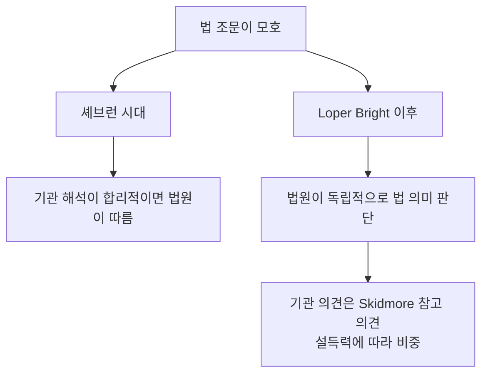

# Loper Bright 판결 (2024)

> 미국 연방대법원이 2024년 *Loper Bright Enterprises v. Raimondo*에서 **셰브런(Chevron) 존중 원칙을 폐기**하고, 법의 의미는 법원이 독립적으로 판단해야 한다고 6대3으로 판결한 사건. AI·금융 규제에서 "기관의 법 해석을 법원이 얼마나 따르는가"를 바꿨다. (법률 자문 아님)

## 쉽게 말하면
법 조문이 애매할 때 예전에는 "담당 부처의 설명이 합리적이면 법원도 따른다"가 기본이었다. 이 판결 이후에는 법원이 직접 법 뜻을 정하고, 부처의 설명은 참고 의견 정도로 취급한다.

## 자세히
출처: Cornell LII 판결문 요약(앞 100,000자 확인, 2026-11-18). 사건번호 22-451(제22-1219 병합).
- **판단**: 행정절차법(APA)상 법원은 기관이 법정 권한 범위 안에서 행동했는지 독립적으로 판단해야 하며, 법이 모호하다는 이유만으로 기관의 해석에 따르지 않는다. 셰브런의 2단계 틀(의회가 직접 말했는가 → 말하지 않았으면 기관의 "허용 가능한" 해석 존중)은 더 이상 유효하지 않다.
- **표결**: 6대3. 로버츠 대법원장이 다수의견(토머스·알리토·고서치·캐버노·배럿 동참). 케이건 반대(소토마요르, 22-1219에서는 잭슨도). 잭슨은 22-451에서는 불참.
- **논리**: 법이 모호하면 기관에 위임한 것이라는 추정은 "허구"이고, APA는 법원에 "모든 관련 법적 문제를 결정"할 책임을 준다.
- **과거 판결**: 셰브런에 따라 기관 행위를 승인한 기존 판결은 구속력이 유지된다. 셰브런에 의존했다는 사실만으로 뒤집을 특별한 사유가 되지 않는다.
- **Skidmore 존중**: 법원은 기관 의견을 참고할 수 있고, 그 비중은 면밀함·추론의 건전성·일관성·설득력에 달린다. 구속하지는 않는다.
- **위임된 재량**: 법이 실제로 기관에 재량을 줬다면 그 경계 안에서 존중하고, 기관이 합리적 의사결정을 했는지 본다.
- **차별 영향·AI와의 연결**: HUD는 2026-01 차별 영향 규정 폐지안의 근거 중 하나로 Loper Bright를 든다([HUD 차별 영향 규정](#hud-disparate-impact-rule)). 기관 가이던스(예: CFPB·FTC·EEOC의 AI 관련 해석)의 법원 내 무게도 약해질 수 있다는 것은 해석이다.

## 그림으로 보기

## 예시
- 금융 규제 기관이 "모델 설명 요건"을 가이던스로 해석했을 때, 분쟁에서 법원은 그 해석을 자동으로 따르지 않고 조문에서 직접 의미를 찾는다.
- 교육 활용: 컴플라이언스 직무 교육에서 "기관 지침의 법적 지위"를 설명하는 사례.

## 헷갈리는 것과 비교
| 개념 | 차이 |
|---|---|
| Chevron 존중 | 모호하면 기관 해석을 따름(폐기) |
| Skidmore 존중 | 설득력에 따라 참고하는 약한 존중 |
| [Inclusive Communities](#inclusive-communities) | FHA상 차별 영향을 인정한 판례 |
| [HUD 차별 영향 규정](#hud-disparate-impact-rule) | Loper Bright를 폐지 근거로 인용 |

## 더 읽을거리
- [Cornell LII: Loper Bright 판결문](https://www.law.cornell.edu/supremecourt/text/22-451) — 다수·반대 의견
- [Nixon Peabody: HUD Rescinds Disparate Impact Regulations](https://www.nixonpeabody.com/insights/alerts/2026/01/21/hud-rescinds-disparate-impact-regulations) — Loper Bright의 규정 폐지 근거 인용
