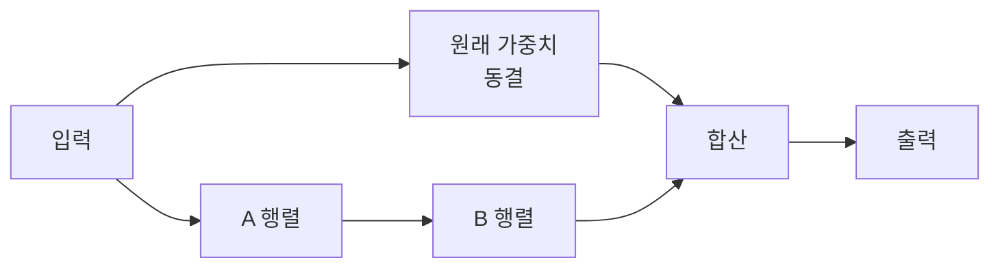
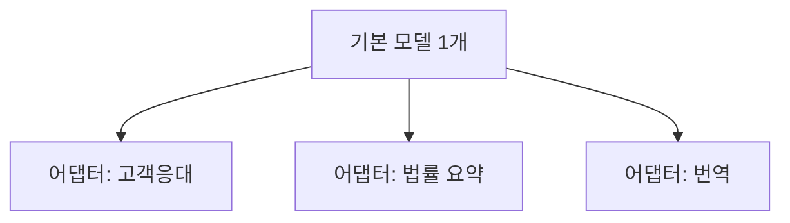

# LoRA 어댑터

> 거대한 모델의 원래 가중치는 그대로 얼려 두고, 각 층에 작은 저랭크 행렬 한 쌍(A, B)만 새로 학습해 미세조정 비용을 크게 줄이는 방법. 학습된 결과물이 작은 "어댑터" 파일이다.

## 쉽게 말하면
두꺼운 교과서(원래 모델)를 고치지 않고 포스트잇(어댑터)만 붙여 내용을 보정하는 것이다. 포스트잇은 얇고, 과목마다 다른 것을 바꿔 붙일 수 있다.

## 자세히
- **원리(LoRA 논문 arXiv 2106.09685, 초록 열람)**: 사전학습 가중치를 동결하고 각 트랜스포머 층에 학습 가능한 작은 저랭크 행렬을 추가한다. GPT-3 175B를 Adam으로 미세조정하는 것과 비교해 학습 파라미터를 약 10,000배, GPU 메모리를 약 3배 줄이고 추론 지연이 추가되지 않으며, RoBERTa·DeBERTa·GPT-2·GPT-3에서 전체 미세조정과 비슷하거나 낫다고 보고(저자 보고).
- **HF PEFT 문서(열람)**: 가중치 변화를 두 저랭크 행렬 A, B로 표현하고 추론 때 원래 가중치와 합친다. 트랜스포머에선 보통 어텐션 블록에 적용한다.
- **주요 설정**: `r`(랭크, 작을수록 학습 파라미터 감소), `lora_alpha`(스케일, 기본 `lora_alpha/r`), `target_modules`(적용할 모듈), `use_rslora`(스케일 `lora_alpha/sqrt(r)`, 높은 랭크를 안정화), `bias`, `modules_to_save` 등.
- **간단 사용 예(문서의 예)**: `LoraConfig(r=16, lora_alpha=32, target_modules=["q_proj","v_proj"])`를 만들고 `get_peft_model(base_model, lora_config)`로 감싼 뒤 일반 학습처럼 학습한다.
- **합치기**: `merge_and_unload()`로 어댑터를 기본 모델에 합쳐 추론 지연을 없애고 독립 모델로 만든다. `merge_adapter()`·`unmerge_adapter()`로 나중에 풀 수도 있고, `add_weighted_adapter()`로 여러 어댑터를 가중 결합한다.
- **초기화**: 기본은 A를 Kaiming-uniform, B를 0으로 시작해 처음에는 원래 모델과 같다. 양자화 모델(QLoRA)엔 `loftq` 옵션이 있다.
- **실무 이점**: 기본 모델 하나에 가벼운 어댑터 여러 개를 유지하고 교체할 수 있다. 언어 모델뿐 아니라 확산 모델에도 쓴다.
- 한계: 성능이 항상 전체 미세조정과 같다는 뜻은 아니다. 위 비교는 논문 과제 조건에서의 보고다.

## 그림으로 보기

## 예시
- 사내 문체 미세조정: 7B 모델에 `r=16` 어댑터를 학습해 파일 하나로 배포.
- 교육 실습: 같은 데이터로 r=4와 r=16을 학습해 학습 파라미터 수와 결과 품질 차이를 비교.

## 헷갈리는 것과 비교
| 개념 | 차이 |
|---|---|
| LoRA | 저랭크 어댑터만 학습 |
| 전체 미세조정 | 모든 가중치 갱신, 메모리 큼 |
| QLoRA | 양자화한 기본 모델 위의 LoRA |
| [학습·검증·평가 분할](#train-eval-split) | 어댑터 학습 시 데이터 누수 방지 |

## 더 읽을거리
- [LoRA (arXiv 2106.09685)](https://arxiv.org/abs/2106.09685) — 원 논문(초록 열람)
- [Hugging Face PEFT: LoRA 개념 가이드](https://huggingface.co/docs/peft/main/en/conceptual_guides/lora) — 설정과 병합(열람)
