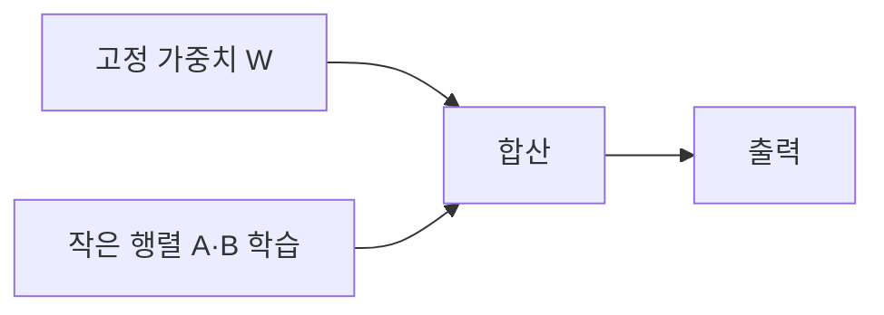
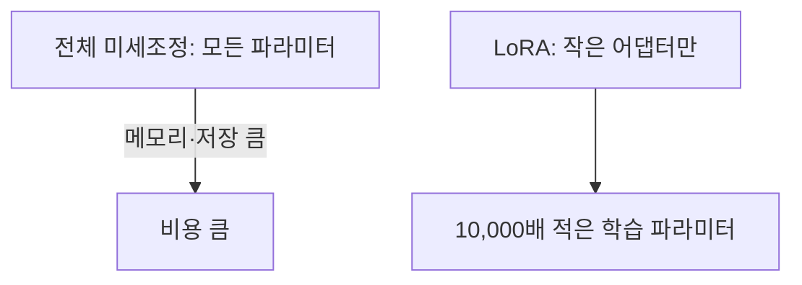

# LoRA 미세조정

> **LoRA(Low-Rank Adaptation)** 는 사전학습 가중치를 고정하고 층마다 **작은 저랭크 행렬**만 학습시켜, 적은 비용으로 모델을 특정 과제·화풍·인물에 맞추는 미세조정법이다.

## 쉽게 말하면
두꺼운 교과서를 새로 쓰지 않고 포스트잇 몇 장만 붙여 "우리 회사 용어"를 알려 주는 것과 같다. 원본은 그대로이고 포스트잇(어댑터)만 갈아 끼우면 용도가 바뀐다.

## 자세히
(Hu 외, arXiv 2106.09685 초록 확인)
- 사전학습 가중치를 **고정**하고 각 트랜스포머 층에 학습 가능한 **저랭크 분해 행렬**을 넣는다.
- GPT-3 175B를 Adam으로 전체 미세조정할 때보다 학습 파라미터가 약 **10,000배** 적고 GPU 메모리 요구는 약 **3배** 감소.
- 어댑터와 달리 **추가 추론 지연이 없다**(학습한 행렬을 합칠 수 있음).
- RoBERTa·DeBERTa·GPT-2·GPT-3에서 전체 미세조정과 동등하거나 더 좋은 성능을 보고했다.
- 이미지 생성(화풍·인물 학습)에도 널리 쓰인다는 점은 일반 지식이며 이 논문 초록에는 없다. 한 번에 한 어댑터를 붙이거나 합성해 쓰기도 한다.

## 그림으로 보기



## 예시
```python
from peft import LoraConfig, get_peft_model
cfg = LoraConfig(r=8, lora_alpha=16, target_modules=["q_proj","v_proj"])
model = get_peft_model(base_model, cfg)   # 어댑터만 학습
```
- 회사 로고 스타일 이미지를 몇십 장으로 학습해 어댑터 파일로 공유.

## 헷갈리는 것과 비교
| 개념 | 차이 |
|---|---|
| LoRA | 저랭크 어댑터만 학습 |
| 전체 미세조정 | 모든 가중치 갱신 |
| 어댑터(층 삽입) | 추론 지연이 늘 수 있음 |
| [ControlNet](#controlnet-inpainting) | 구조 조건 추가, 스타일 학습이 아님 |

## 더 읽을거리
- [LoRA: Low-Rank Adaptation of Large Language Models](https://arxiv.org/abs/2106.09685) — 원 논문.
