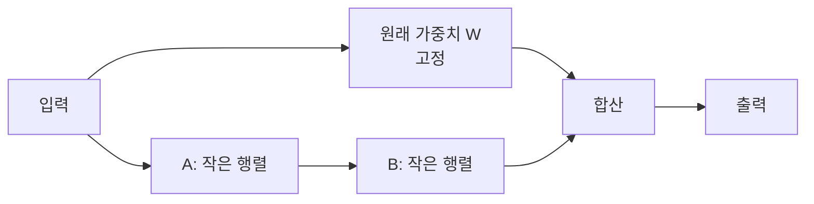
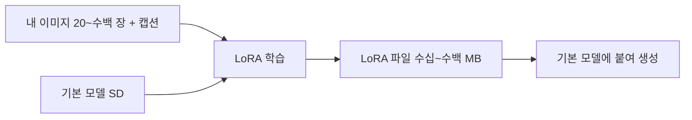

# LoRA로 이미지 모델 맞춤화

> 큰 이미지 모델의 원래 가중치는 얼리고, 작은 보조 행렬만 학습해 특정 화풍·캐릭터를 입히는 방법. 결과 파일이 수십~수백 MB로 작다.

## 쉽게 말하면
교과서(원 모델)를 새로 인쇄하지 않고, 위에 붙이는 얇은 스티커(LoRA)만 만드는 것이다. 스티커를 붙이면 그 화풍이 나오고, 떼면 원래대로 돌아온다. 여러 장을 겹쳐 붙일 수도 있다.

## 자세히
- **원리**: 큰 가중치 행렬 W의 변화량을 작은 두 행렬의 곱 B·A(낮은 rank r)로 근사해 그것만 학습한다(Hu et al., 2021). 학습 파라미터가 크게 준다.
- **어디에 붙이나**: diffusers 예시는 [U-Net](#unet-denoiser)의 어텐션 층(`to_q, to_k, to_v, to_out.0`)에 붙인다. SDXL 등은 텍스트 인코더에도 붙일 수 있다.
- **핵심 설정**: `--rank`(클수록 표현력↑·파일↑), `learning_rate`(예시 1e-4; 문서는 LoRA에서 더 높게 써도 된다고 안내), 학습 이미지와 캡션.
- **산출물**: `pytorch_lora_weights.safetensors`. 추론 때 `pipeline.load_lora_weights(...)`로 불러온다. 문서의 예시 학습(Naruto 캡션 데이터, 15000스텝)은 11GB 2080 Ti에서 약 5시간.
- **조합**: 여러 LoRA를 가중치를 달리해 섞을 수 있다(PEFT). Kohya 등 커뮤니티 형식도 불러올 수 있다.
- 주의: 타인의 작품·얼굴로 학습하면 저작권·초상권 문제가 생긴다([AI 안전·윤리](#ai-safety)).

## 그림으로 보기

## 예시
- 회사 마스코트 20장으로 LoRA를 만들어 "마스코트가 회의하는 장면"을 일관되게 생성.
- `pipe.load_lora_weights("path/to/lora", weight_name="pytorch_lora_weights.safetensors")`

## 헷갈리는 것과 비교
| 개념 | 차이 |
|---|---|
| 전체 파인튜닝 | 모든 가중치 수정. 무겁고 파일이 크다 |
| LoRA | 보조 행렬만. 가볍고 떼었다 붙임 |
| DreamBooth | 특정 대상을 가르치는 학습법. LoRA와 결합 가능 |
| 프롬프트 엔지니어링 | 모델은 그대로, 말만 조정 |

## 더 읽을거리
- [Diffusers: LoRA 학습](https://huggingface.co/docs/diffusers/main/en/training/lora) — 학습 스크립트와 설정.
- [LoRA 논문](https://arxiv.org/abs/2106.09685) — 낮은 rank 적응의 원 아이디어.
