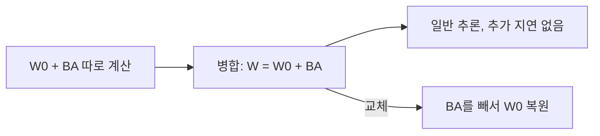

# LoRA 병합

> 학습한 어댑터 ΔW=BA를 **기본 모델의 가중치 W0에 더해 하나의 행렬로 합쳐** 추론 지연(latency)을 없애는 작업이다.

## 쉽게 말하면
기본 사전에 따로 붙인 메모지(어댑터)를 본문에 직접 써 넣어 한 권으로 합치는 것이다. 한 권이면 찾아볼 때 메모지를 따로 넘길 일이 없다.

## 자세히
(LoRA 논문과 PEFT 문서를 직접 읽었다.)
- **원리(논문)**: 배포 시 **W = W0 + BA**를 계산해 저장하고 평소처럼 추론한다. W0와 BA의 모양이 같아(R^(d×k)) 합칠 수 있고, 어댑터 방식과 달리 **추가 추론 지연이 없다**. 다른 과제로 바꿀 때는 BA를 빼서 W0를 복원한 뒤 다른 B′A′를 더하면 되며 메모리 부담이 거의 없다.
- **PEFT API(문서)**: `merge_and_unload()` — 어댑터를 기본 모델에 합치고 독립 모델을 반환. `merge_adapter()` — 합치되 `PeftModel`을 유지해 나중에 `unmerge_adapter()`로 되돌리거나 어댑터를 삭제·교체. `unload()` — 합치지 않고 기본 모델로 복원. `add_weighted_adapter()` — 여러 LoRA를 가중치로 합쳐 새 어댑터를 만든다.
- **코드(문서가 안내한 표준 사용, 이 페이지엔 없음)**: `PeftModel.from_pretrained(base_model, id).merge_and_unload()`.
- **한계(논문)**: 병합하면 서로 다른 A·B를 쓰는 **여러 과제의 입력을 한 배치에서 처리하기 어렵다**. 지연이 중요하지 않다면 병합하지 않고 배치별로 LoRA를 고르는 것도 가능하다.
- **주의(문서, 해석)**: 어댑터 교체가 필요하면 `merge_and_unload()`보다 `merge_adapter()/unmerge_adapter()`를 쓴다.

## 그림으로 보기


## 예시
```python
from peft import PeftModel
model = PeftModel.from_pretrained(base_model, "my-lora")
merged = model.merge_and_unload()   # 독립 모델
```
- 서비스에 단일 과제만 올릴 땐 병합, 고객사별 어댑터가 많으면 [다중 어댑터 서빙](#multi-adapter-serving)을 고려(제안).

## 헷갈리는 것과 비교
| 개념 | 차이 |
|---|---|
| merge_and_unload | 합치고 독립 모델로 |
| merge_adapter | 합치되 되돌릴 수 있음 |
| [다중 어댑터 서빙](#multi-adapter-serving) | 병합하지 않고 어댑터를 교체 |

## 더 읽을거리
- [Hu et al. (2021) — LoRA](https://arxiv.org/abs/2106.09685) — §4.1·한계(직접 읽음).
- [PEFT LoRA 가이드](https://huggingface.co/docs/peft/main/en/conceptual_guides/lora) — 병합 API(직접 읽음).
