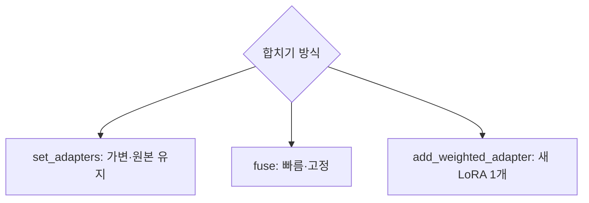

# LoRA 합치기·가중치

> 여러 LoRA를 동시에 쓰려면 각 LoRA의 가중치를 정해 섞는데, 추론 때만 섞는 방법(set_adapters), 기본 가중치에 굽는 방법(fuse), 새 LoRA 하나로 합치는 방법(add_weighted_adapter)이 있다.

## 쉽게 말하면
물감 두 색을 섞을 때 "빨강 1, 파랑 0.5"처럼 비율을 정하는 것이다. 섞는 방법에 따라 색이 탁해지거나 한쪽이 묻힐 수 있어 시험해 봐야 한다.

## 자세히
diffusers merge_loras 문서(이번엔 리다이렉트만 열림; 일반 지식으로 정리, 확인 필요):
- **`set_adapters(["a","b"], adapter_weights=[1.0, 0.5])`**: 이름 붙여 불러온 LoRA들의 가중치를 정한다. 기본 가중치는 건드리지 않는다.
- **`fuse_lora`**: LoRA 변화량을 기본 가중치에 굽는다. 추론이 빨라지고 `unfuse_lora()`로 복구 가능. 굽고 나면 가중치 조정이 불편하고 fp16·양자화 모델에서는 미세한 수치 차이나 비호환이 생길 수 있다.
- **`add_weighted_adapter`**(PEFT): 여러 LoRA를 하나의 새 어댑터로. `combination_type`: `linear`(가중합, rank가 같아야 함), `cat`(행렬 이어붙임, rank 합만큼 커지지만 정보 손실 없음), `ties`·`dare_*`(희소화·부호 충돌 해결, `density` 필요), `svd` 등. 버전에 따라 옵션이 다르다.
- 부작용: 스타일 LoRA와 캐릭터 LoRA를 섞으면 서로를 방해하거나 결과가 예측 불가능해질 수 있다. 가중치를 0.6~1.0 범위로 바꿔 가며 눈으로 확인하는 것이 일반적 방법이다.
- 언어 모델의 `merge_and_unload()`(PEFT)는 LoRA를 원본에 합쳐 어댑터 없는 일반 모델로 만든다. 합친 뒤에는 어댑터를 바꾸거나 되돌릴 수 없다([rank·alpha](#lora-rank-alpha)).

## 그림으로 보기



## 예시
```python
pipe.load_lora_weights("user/style-lora", adapter_name="style")
pipe.load_lora_weights("user/char-lora", adapter_name="char")
pipe.set_adapters(["style", "char"], adapter_weights=[0.8, 1.0])
image = pipe("a portrait in watercolor style").images[0]
```
(일반 사용 예.) 브랜드 화풍 LoRA와 제품 LoRA를 조합한 시안을 만들 때 쓴다.

## 헷갈리는 것과 비교
| 개념 | 차이 |
|---|---|
| set_adapters | 추론 시 가중치 혼합, 되돌리기 쉬움 |
| fuse_lora | 가중치에 영구 반영(속도↑) |
| add_weighted_adapter | 어댑터끼리 새 LoRA 생성 |
| [LoRA](#lora-image) | 개별 어댑터 자체 |

## 더 읽을거리
- [HF diffusers: Merge LoRAs](https://huggingface.co/docs/diffusers/using-diffusers/merge_loras) — 최신 문서(이번엔 리다이렉트만 열림).
- [HF DreamBooth 가이드](https://huggingface.co/docs/diffusers/training/dreambooth) — LoRA 학습 맥락.
