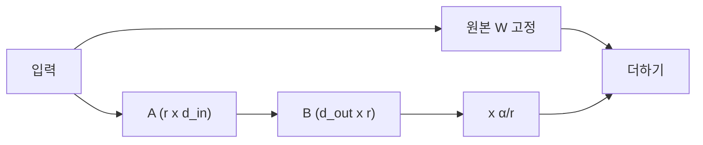
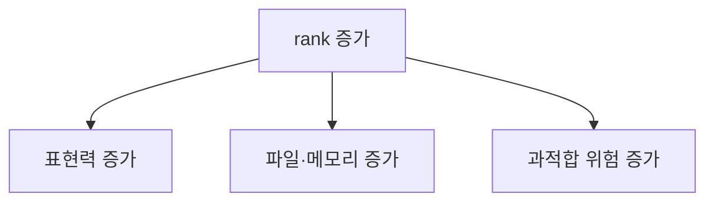

# LoRA rank와 alpha

> LoRA의 rank(r)는 추가로 학습하는 저차원 행렬의 크기, alpha는 그 변화량을 얼마나 반영할지 정하는 스케일 값이다. 둘이 표현력·파일 크기·학습 강도를 정한다.

## 쉽게 말하면
기존 책(원본 모델)에 포스트잇(LoRA)을 붙여 내용을 고치는 것이다. rank는 포스트잇의 크기, alpha는 포스트잇 내용을 얼마나 진하게 반영할지다. 크기가 클수록 많이 적을 수 있지만 무겁다.

## 자세히
Hugging Face PEFT의 LoRA 설명(문서 페이지는 열리지 않아 일반 지식으로 보완, 버전별 확인 필요):
- 기본식: 가중치 W는 고정하고 저랭크 업데이트를 더한다. `W' = W + (α/r)·B·A`. A는 r×d_in, B는 d_out×r이며 A·B만 학습한다.
- **`r`**: 내부 차원. 작을수록 학습 파라미터가 적다. 흔히 8~64.
- **`lora_alpha`**: 업데이트에 곱하는 스케일 α/r. α와 r을 함께 정하는 경우가 많고(예: α=2r), `use_rslora=True`면 α/√r을 쓴다.
- **`target_modules`**: LoRA를 붙일 층(예 `q_proj`, `v_proj`, 또는 `"all-linear"`).
- DreamBooth+LoRA 문서(diffusers)는 LoRA가 학습 파라미터를 크게 줄여 학습이 빠르고 가중치 파일이 작다(약 100MB)고 설명한다.
- 이미지 LoRA에서는 rank가 높을수록 디테일과 파일 크기가 커지지만 과적합 위험도 있다(일반적 경험칙, 확인하지 못함). 좋은 값은 데이터와 대상에 따라 달라 직접 실험이 필요하다([하이퍼파라미터](#hyperparameter)).

## 그림으로 보기



## 예시
```python
from peft import LoraConfig, get_peft_model
config = LoraConfig(r=8, lora_alpha=16, target_modules=["q_proj","v_proj"], lora_dropout=0.05, task_type="CAUSAL_LM")
model = get_peft_model(base_model, config)
model.print_trainable_parameters()
```
(일반 사용 예.) 8GB GPU에서 먼저 r=8, α=16으로 시작해 결과를 보고 올리거나 내린다.

## 헷갈리는 것과 비교
| 개념 | 차이 |
|---|---|
| rank r | 업데이트 행렬의 크기(용량) |
| alpha α | 업데이트 반영 스케일(α/r) |
| [LoRA 이미지](#lora-image) | 이미지 모델에 적용한 LoRA 전반 |
| 전체 파인튜닝 | 모든 가중치를 갱신, 훨씬 무겁다 |

## 더 읽을거리
- [HF DreamBooth 학습 가이드](https://huggingface.co/docs/diffusers/training/dreambooth) — LoRA 섹션(파라미터 감소, 약 100MB).
- [HF PEFT LoRA 개념](https://huggingface.co/docs/peft/conceptual_guides/lora) — 최신 문서 위치(이번엔 리다이렉트만 열림).
