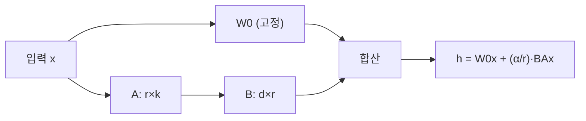

# LoRA 랭크 r

> LoRA에서 **업데이트 행렬의 랭크(차원)**를 정하는 값으로, 작을수록 학습할 파라미터가 줄어든다. 놀랄 만큼 작은 r로도 충분한 경우가 많다는 것이 원 논문의 관찰이다.

## 쉽게 말하면
큰 지도 전체를 다시 그리는 대신, 바뀐 부분을 설명하는 "요약 메모"의 줄 수가 r이다. 메모가 짧아도 핵심은 담긴다. 줄이 길수록 자세하지만 이득은 점점 줄어든다.

## 자세히
(Hu 외, "LoRA: Low-Rank Adaptation of Large Language Models"(arXiv 2106.09685 v2) PDF와 Hugging Face PEFT 문서를 직접 읽었다.)
- **정의**: 가중치 W0 ∈ R^(d×k)의 업데이트를 ΔW = BA로 표현하고, B ∈ R^(d×r), A ∈ R^(r×k), **r ≪ min(d, k)**. 학습 중 W0는 고정, A와 B만 학습. 순전파는 h = W0x + BAx. A는 가우시안 초기화, B는 0이라 시작 시 ΔW=0.
- **스케일(논문)**: ΔWx를 **α/r**로 곱한다. Adam 사용 시 α 조정은 학습률 조정과 비슷하며, 논문은 α를 처음 시도한 r로 두고 튜닝하지 않았다. r을 바꿔도 하이퍼파라미터 재조정이 덜 필요하다.
- **파라미터 수**: 학습 가능한 수는 r과 원본 행렬 모양으로 정해진다. 논문은 GPT-3 175B에서 **r=4, 쿼리·값 투영만** 적용하면 체크포인트가 약 **350GB→35MB(약 10,000배 감소)**, 예산 18M 파라미터(FP16 약 35MB)는 한 종류를 적응하면 r=8, 두 종류면 r=4에 해당.
- **적정 r(논문)**: WikiSQL·MultiNLI 실험(Table 6)에서 **r=1도** {Wq, Wv} 적응에 충분했고, Wq만 적응할 때는 더 큰 r이 필요했다. 서로 다른 r·시드로 학습한 부분공간의 겹침을 보여 "저랭크 적응으로 충분"하다고 주장. 단, "모든 과제에서 작은 r이 통할 것으로 기대하지는 않는다"고 한계를 적었다.
- **PEFT의 설정**: `LoraConfig(r=..., lora_alpha=..., target_modules=...)`. 스케일은 기본 **lora_alpha/r**, `use_rslora=True`이면 **lora_alpha/√r**(RSLoRA 논문 주장: 더 높은 r에서도 안정). 층별 r은 `rank_pattern`으로 덮어쓴다.
- **완전 미세조정과의 관계(논문)**: 모든 가중치 행렬에 적용하고 편향을 학습해 r을 원본 랭크까지 올리면 완전 미세조정의 표현력을 대체로 회복한다.

## 그림으로 보기


## 예시
```python
from peft import LoraConfig, get_peft_model
cfg = LoraConfig(r=8, lora_alpha=16, target_modules=["q_proj","v_proj"])
model = get_peft_model(base_model, cfg)
```
- 처음에는 r=8 같은 작은 값으로 시작해 검증 성능이 정체되면 올려 본다(제안).

## 헷갈리는 것과 비교
| 개념 | 차이 |
|---|---|
| r | 업데이트 행렬의 랭크(용량) |
| lora_alpha | 스케일 상수 α |
| [LoRA 병합](#lora-merge) | 학습 후 ΔW를 W에 합침 |
| 완전 미세조정 | 모든 가중치를 갱신 |

## 더 읽을거리
- [Hu et al. (2021) — LoRA](https://arxiv.org/abs/2106.09685) — 직접 읽음.
- [Hugging Face PEFT — LoRA 개념 가이드](https://huggingface.co/docs/peft/main/en/conceptual_guides/lora) — 직접 읽음.
