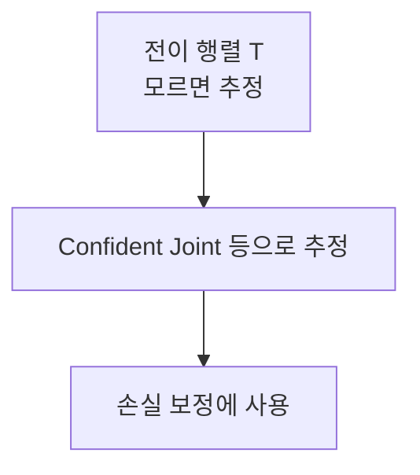

# 손실 보정(forward/backward)

> 손실 보정은 라벨이 어떤 확률로 어떤 클래스로 바뀌는지 적은 전이 행렬 T를 알고 있을 때, 학습 손실을 그 행렬로 고쳐 노이즈 라벨로 학습해도 깨끗한 라벨로 학습한 것에 가깝게 만드는 기법이다. Patrini 외(2017)가 두 가지 방식을 제안했다.

## 쉽게 말하면
채점자가 정답을 50% 확률로 엉뚱하게 적는다는 사실을 알고 있다면, 학생의 답이 "채점자의 틀린 기록과 얼마나 맞는지"를 계산할 때 그 오류 습관을 감안해 점수를 매길 수 있다. 오류 습관을 모르는 채 기록에만 맞추면 학생이 엉뚱한 습관까지 따라 배운다.

## 자세히
- **논문 요약(Patrini 외 초록, 열람)**: 클래스에 의존하는 라벨 노이즈에서 심층 신경망을 학습하기 위한 두 가지 손실 보정 절차를 제안한다. 둘 다 역행렬 계산과 행렬 곱이 필요하고 "각 클래스가 다른 클래스로 오염될 확률"이 주어져야 한다. 기존의 노이즈 추정 기법을 다중 클래스로 확장해 이 확률도 추정한다. MNIST·IMDB·CIFAR-10·CIFAR-100·의류 이미지 데이터셋에서 견고성이 개선됐다고 보고한다. 초록에는 "forward/backward"라는 용어가 없어 두 방식의 이름과 정확한 정의는 이 글에서 확인하지 못했다.
- **forward 보정의 직관(해석, 흔한 설명)**: 모델이 낸 깨끗한 라벨 확률 p에 T를 곱해 "노이즈 라벨이 나올 확률" pT를 만들고, 그 확률로 노이즈 라벨에 대한 손실을 계산한다. backward는 T의 역행렬을 손실에 적용하는 방식으로 알려져 있다.
- **직접 구현해 본 실험(숫자 손글씨, 학습 라벨 50% 대칭 노이즈, T는 안다고 가정, 소프트맥스 회귀를 경사하강으로 학습)**: 그냥 노이즈 라벨로 학습하면 깨끗한 시험 정확도가 0.892, forward 보정 손실로 학습하면 0.918이었다(+0.026). 50% 노이즈에서도 큰 하락이 없었는데 대칭 노이즈에서는 정답이 여전히 단일 오답보다 많기 때문일 것으로 해석한다. 한 번의 실험이라 개선 폭은 오차 범위일 수 있다. 실제로는 T를 모르기 때문에 추정한 T를 써야 하며([Confident Joint](#confident-joint)) 이 실험은 정확한 T를 쓴 이상적인 경우다.
- **한계(해석)**: T 추정이 틀리면 보정이 오히려 해로울 수 있다. 클래스 조건부 가정이 깨지는 [특징 의존 노이즈](#feature-dependent-noise)에서는 보정이 약해진다.

## 그림으로 보기

## 예시
- 라벨 오류가 클래스 쌍에 몰린 사내 데이터에서 Confident Joint로 T를 추정하고 보정 손실로 모델을 학습한 뒤, 작은 깨끗한 시험 세트로 효과를 확인한다.
- 교육 활용: T를 행렬로 직접 적어 보고 p×T 계산을 손으로 해 본다.

## 헷갈리는 것과 비교
| 개념 | 차이 |
| --- | --- |
| 손실 보정 | 손실을 T로 고쳐 학습 |
| 데이터 정제 | 오라벨을 찾아 제거·수정 |
| [Confident Joint](#confident-joint) | T를 추정하는 도구 |
| [표본 외 예측 확률](#out-of-sample-probabilities) | 추정의 입력 |

## 더 읽을거리
- [Making Deep Neural Networks Robust to Label Noise: a Loss Correction Approach (arXiv 1609.03683)](https://arxiv.org/abs/1609.03683) — 손실 보정 접근
