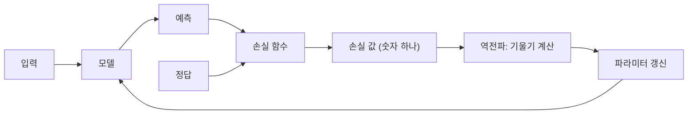
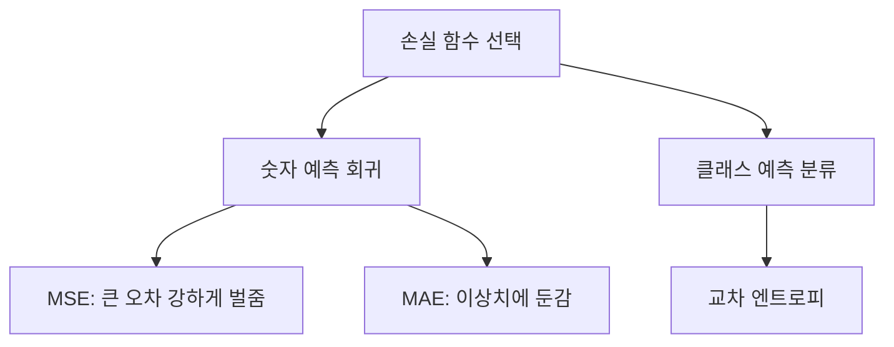

# 손실 함수

> 손실 함수(loss function)는 모델의 예측이 정답에서 얼마나 벗어났는지를 숫자 하나로 재는 식이다. 학습은 이 숫자를 줄이는 방향으로 파라미터를 고치는 일이다.

## 쉽게 말하면
양궁 점수판을 생각하면 된다. 화살이 과녁 중심에서 멀수록 감점이 크다. 손실 함수는 "감점 규칙"이고, 학습은 감점을 줄이도록 자세를 고치는 과정이다. 감점 규칙을 어떻게 정하느냐에 따라 모델이 무엇을 중요하게 여기는지가 달라진다.

## 자세히
- **회귀**(숫자 예측)에서 흔한 손실(Google ML Crash Course 기준): L1 = |정답−예측|의 합, MAE = L1의 평균, L2 = (정답−예측)²의 합, MSE = L2의 평균, RMSE = √MSE.
- 제곱을 하므로 MSE는 큰 오차를 훨씬 크게 벌준다. 그래서 이상치(outlier)에 끌려가기 쉽고, MAE는 이상치에 더 둔감하다. MAE·RMSE는 예측값과 단위가 같아 해석이 쉽다.
- **분류**에서는 정답 클래스에 매긴 확률이 낮을수록 손실이 커지는 **교차 엔트로피(cross-entropy)**를 주로 쓴다. LLM의 사전학습도 정답 토큰의 교차 엔트로피를 줄이는 것이다([다음 토큰 예측](#next-token-prediction)).
- 손실은 미분 가능해야 한다. 기울기를 따라 파라미터를 고치는 [역전파와 경사하강법](#backpropagation)이 손실의 기울기를 쓰기 때문이다.
- 손실은 "학습에 쓰는 점수"이고, 사람이 보고 싶은 성능 지표(정확도, F1 등)와 다를 수 있다.

## 그림으로 보기

## 예시
- 집값 예측: 실제 24, 예측 23.1이면 L2 손실은 (24−23.1)² = 0.81이다. 어쩌다 5억 틀린 이상치가 있을 때 MSE는 그 하나에 크게 흔들리고 MAE는 덜하다.
- 스팸 분류: 스팸 메일에 "스팸 확률 0.1"이라 답하면 교차 엔트로피 손실이 크고, 0.95라 답하면 작다.

## 헷갈리는 것과 비교
| 개념 | 차이 |
|---|---|
| 손실 함수 | 학습 중 최소화하는, 미분 가능한 점수 |
| 평가 지표 | 사람이 성능을 보려고 쓰는 값(정확도 등). 손실과 달라도 된다 |
| [옵티마이저](#optimizer-adam) | 손실을 줄이는 방법(어떻게 갱신할지). 손실 자체는 아님 |

## 더 읽을거리
- [Google ML Crash Course: Linear regression · Loss](https://developers.google.com/machine-learning/crash-course/linear-regression/loss) — L1·L2·MAE·MSE·RMSE 정의와 이상치 영향.
