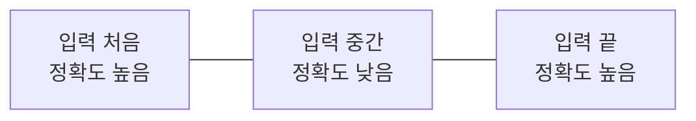
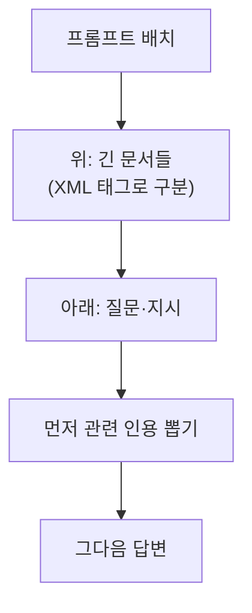

# 중간 정보 손실(Lost in the Middle)

> 긴 입력에서 관련 정보가 처음이나 끝에 있을 때보다 가운데 있을 때 모델이 더 못 활용하는 위치 편향. 성능이 U자 모양 곡선을 그린다.

## 쉽게 말하면
긴 회의에서 처음 발언과 마지막 발언은 기억나지만 중간에 나온 중요한 이야기는 흐려지는 경험과 같다. 입력이 길수록 모델도 중간 구간을 덜 챙긴다. 그래서 "많이 넣을수록 좋다"가 아니라 "중요한 것을 어디에 두느냐"가 중요하다.

## 자세히
- **원 논문**: Liu 외 "Lost in the Middle: How Language Models Use Long Contexts"(arXiv 2307.03172, 2023). 다중 문서 질의응답과 키-값 검색 과제에서, 관련 정보가 입력의 **처음이나 끝**에 있을 때 성능이 가장 좋고 **중간**에 있으면 크게 떨어지는 U자형 곡선을 보였다.
- **긴 컨텍스트 전용 모델도 예외 없음**: 이 하락은 긴 컨텍스트를 겨냥해 만든 모델에서도 나타났다. 즉 컨텍스트 창이 크다고 그 안을 잘 쓰는 것은 아니다(논문 시점 모델 기준; 최신 모델은 개선됐을 수 있어 직접 시험해야 한다).
- **실무 대응(Claude 프롬프트 가이드, 20k+ 토큰 입력)**
  1. **긴 자료는 프롬프트 위쪽**에, 질문·지시·예시는 **맨 끝**에 둔다. 모든 모델에서 성능을 높이고, 끝에 질문을 두면 복잡한 다중 문서 입력에서 응답 품질이 최대 30% 좋아질 수 있다는 테스트 결과가 안내되어 있다.
  2. 여러 문서는 `<document>`, `<document_content>`, `<source>` 태그로 구조화한다.
  3. 긴 문서 과제는 **먼저 관련 부분을 인용**하게 한 뒤 답하게 한다("Ground responses in quotes"). 모델이 관련 내용에 집중하고 나머지를 무시하게 돕는다.
- **다른 대응**: [RAG](#rag)로 관련 조각만 골라 넣기, 중요한 문서를 앞·뒤로 재배치, 컨텍스트를 짧게 유지, 자르기·요약.
- **측정**: 자기 데이터에서 "정답 문서의 위치를 앞/중간/뒤로 바꿔" 정확도를 재 보면 모델별 편향이 보인다.

## 그림으로 보기

## 예시
- 계약서 20개를 붙여 "해지 조건이 다른 계약서를 찾아 줘"를 시킬 때: 핵심 계약서가 중간에 묻히지 않도록 문서를 태그로 나누고 "관련 조항을 먼저 인용하라"고 지시한다.
- 위치 시험: 정답이 든 문서를 1번째/10번째/20번째에 두고 같은 질문의 정답률을 비교한다.

## 헷갈리는 것과 비교
| 개념 | 차이 |
|---|---|
| [컨텍스트 창](#context-window) | 한 번에 넣을 수 있는 양의 한도. 많이 넣는다고 잘 쓰는 건 아님 |
| 중간 정보 손실 | 위치에 따라 활용도가 달라지는 편향 |
| [RAG](#rag) | 필요한 조각만 골라 넣어 길이를 줄임 |
| [프롬프트 캐싱](#prompt-caching) | 반복되는 앞부분 비용 절감. 위치 편향과는 무관 |

## 더 읽을거리
- [Lost in the Middle (arXiv 2307.03172)](https://arxiv.org/abs/2307.03172) — 원 논문
- [Prompting best practices: Long context (Claude 문서)](https://platform.claude.com/docs/en/build-with-claude/prompt-engineering/claude-prompting-best-practices) — 긴 입력 구성 요령
