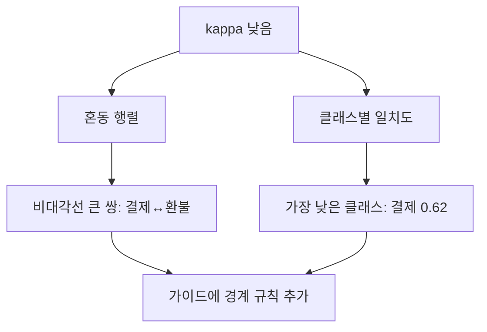
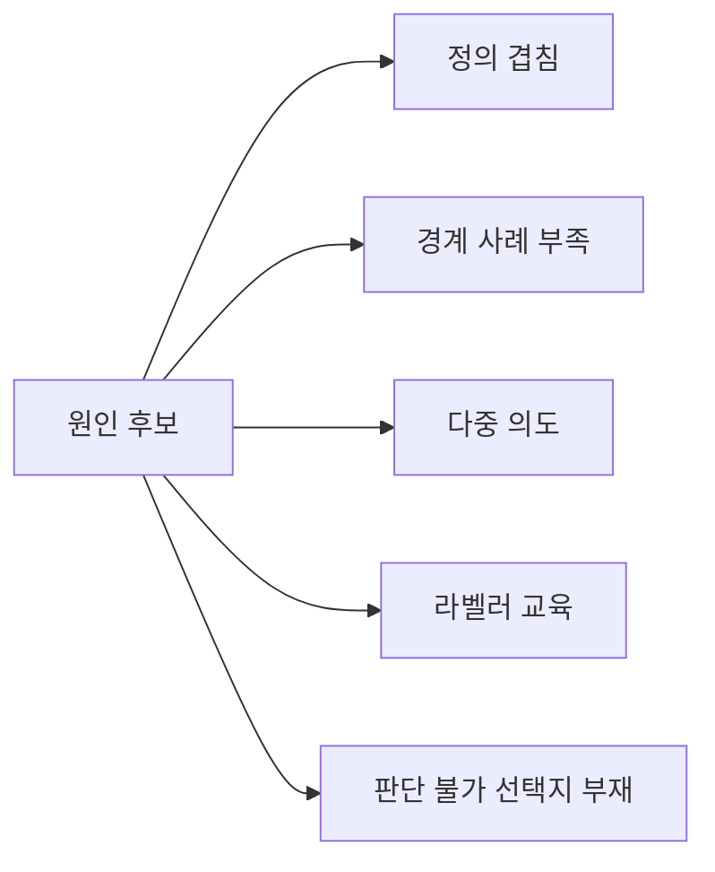

# 낮은 일치도 진단

> 시범 라운드에서 일치도(kappa)가 목표에 못 미칠 때 **어느 클래스 쌍의 정의가 모호한지** 찾아내는 절차다. 라벨러를 탓하기 전에 혼동 행렬과 클래스별 일치도를 보고 라벨 가이드의 구멍을 찾는다.

## 쉽게 말하면
반 평균이 낮을 때 "학생이 문제"라고 하기 전에, 어떤 문제에서 틀렸는지 문항별 정답률을 본다. 특정 문항에서 다 같이 틀렸다면 문항(가이드)이 모호한 것이다.

## 자세히
- **1단계 전체 수치**: kappa와 일치율을 함께 본다([목표 일치도](#target-agreement-setting)).
- **2단계 라벨러 간 혼동 행렬**: 두 라벨러의 라벨을 교차표로 만들어 비대각선이 큰 칸을 찾는다.
- **3단계 클래스별 일치도**: 클래스마다 "이 클래스를 고른 두 사람이 같은 샘플을 골랐나"를 본다(specific agreement `2×공통/(A수+B수)` 또는 클래스 vs 나머지 kappa).
- **직접 시뮬레이션(scikit-learn, 고객 문의 4클래스 600건: 환불·배송·결제·기타, "결제" 문의가 "환불"로 15% 혼동되게 설정)**
  - 전체 kappa **0.615**, 일치율 0.717. 목표 0.6을 겨우 넘기지만 균일하게 좋은 것은 아니다.
  - 혼동 행렬(행=라벨러 A, 열=B)에서 비대각선 최댓값은 **결제↔환불 32건**. 배송 vs 기타 22, 환불→결제 28.
  - 클래스별 일치(specific agreement / 1-vs-나머지 kappa): 환불 0.73/0.61, 배송 0.80/0.71, **결제 0.62/0.52**, 기타 0.66/0.60. 결제가 가장 낮다.
  - 해석: 문제는 라벨러 전체가 아니라 "결제 vs 환불" 경계 정의다. 가이드에 판정 기준과 경계 사례를 추가하면 된다.
- **4단계 원인 분류**: ① 정의가 겹침 ② 경계 사례 설명 부족 ③ 한 문장에 의도가 둘(multi-label 필요) ④ 라벨러 이해 차이(교육 문제) ⑤ 샘플 자체가 모호해 "판단 불가" 선택지 필요.
- **5단계 불일치 샘플 토론**: 불일치 20~30개를 모아 두 사람이 왜 그렇게 골랐는지 이유를 적고 가이드 문구로 반영한다([규칙서 반복 개발](#guideline-draft-iteration)).
- **주의**: 시범 샘플이 적으면 클래스별 kappa는 표본 변동이 크다([kappa용 시범 크기](#pilot-size-for-kappa)). 희귀 클래스는 더 많이 뽑아 시범한다.
- 합성 데이터 한 번의 결과이며 실제 혼동 구조는 과제마다 다르다.

## 그림으로 보기



## 예시
```python
from sklearn.metrics import confusion_matrix, cohen_kappa_score
cm = confusion_matrix(labels_a, labels_b)         # 비대각선 큰 칸 = 혼동 쌍
for k in classes: cohen_kappa_score(labels_a == k, labels_b == k)  # 클래스 vs 나머지
```
- 감정 분류에서 "중립"과 "약한 긍정"이 계속 충돌 → "감탄사 없으면 중립" 같은 판정 규칙을 가이드에 추가.

## 헷갈리는 것과 비교
| 개념 | 차이 |
|---|---|
| 낮은 일치도 진단 | 원인을 클래스·사례 단위로 추적 |
| [평가자 간 일치도](#inter-annotator-agreement) | 일치 정도를 재는 지표 |
| [모호한 샘플 vs 오류](#ambiguous-vs-wrong-label) | 샘플 단위 구분 |
| 라벨러 교체 | 마지막 수단(원인 확인 후) |

## 더 읽을거리
- [McHugh 2012: Interrater reliability: the kappa statistic](https://pmc.ncbi.nlm.nih.gov/articles/PMC3900052/) — kappa 해석과 한계.
- [scikit-learn confusion_matrix](https://scikit-learn.org/stable/modules/generated/sklearn.metrics.confusion_matrix.html) — 혼동 행렬 계산(직접 사용 확인).
