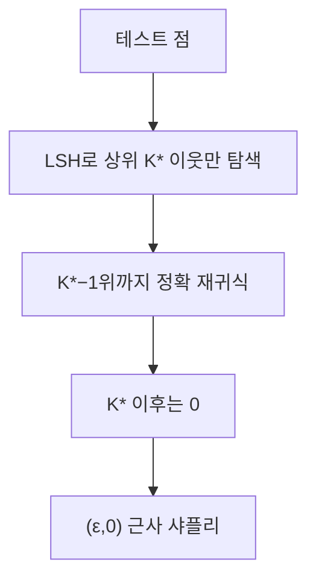
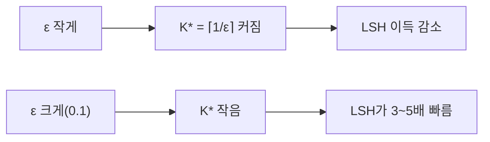

# LSH 근사 KNN-Shapley

> KNN 샤플리를 구할 때 **모든 학습 점을 정렬하지 않고**, 테스트 점에 가까운 상위 max{K, ⌈1/ε⌉}개 이웃만 찾아 오차 ε 이내로 근사하는 방법. 이웃 탐색에 **위치 민감 해싱(LSH)** 을 써서 데이터가 클수록 정확 계산보다 빠르다.

## 쉽게 말하면
도서관 전체를 줄 세우지 않고 "내 책상에서 가까운 서가 100칸"만 보면, 멀리 있는 책의 값이 어차피 작아서 전체 순위를 거의 그대로 알 수 있다는 것이다. 그 가까운 칸을 빨리 찾는 도구가 LSH다.

## 자세히
(Jia 외, arXiv 1908.08619 본문 확인)
- **핵심 정리(정리 2)**: 정확 계산이 필요한 것은 정렬된 점 중 **K* = max{K, ⌈1/ε⌉}** 번째까지다. 순위 i ≥ K*인 점의 값은 0으로 두고, i ≤ K*−1에서는 정확 재귀식(ŝ_i = ŝ_{i+1} + (1[y_i=y_test] − 1[y_{i+1}=y_test])/K · min(K,i)/i)을 쓰면 **(ε, 0) 근사**가 되고, 가까운 K* 이웃 내부의 **값 차이와 순위는 정확 값과 같다**(ŝ_i − ŝ_{i+1} = s_i − s_{i+1}).
- **직접 검증(순수 파이썬, N=300, K=3, 무작위 라벨)**: 정확 값과 절단 근사의 최대 오차
  | ε | K* | 최대 오차 |
  |---|---|---|
  | 0.5 | 3 | 0.2436 |
  | 0.2 | 5 | 0.1103 |
  | 0.1 | 10 | 0.0686 |
  | 0.05 | 20 | 0.0224 |
  | 0.01 | 100 | 0.0070 |
  모든 경우에 오차가 ε보다 작다(정리와 일치). ε이 작을수록 더 많은 이웃이 필요하다.
- **LSH의 역할**: 이웃을 근사적으로 빨리 찾는 기법(논문은 k-d 트리·LSH를 언급). 복잡도는 O(N·h(ε,K)·log N)이고 h(ε,K)는 데이터셋에 의존하며 **max{1/ε, K}가 커지면 단조 증가**. 상대 대비(relative contrast)가 클수록 해시 테이블이 적게 필요해 빠르다.
- **성능(논문 실험, 저자 보고; ε, δ = 0.1, K = 1; 한 테스트 점)**
  | 데이터셋 | 크기 | 정확 알고리즘 | LSH 근사 |
  |---|---|---|---|
  | CIFAR-10 | 6×10⁴ | 0.78초 | 0.23초 |
  | ImageNet | 1×10⁶ | 11.34초 | 2.74초 |
  | Yahoo10m | 1×10⁷ | 203.43초 | 44.13초 |
  LSH는 정확 알고리즘보다 **약 3~5배** 빠르다. 몬테카를로 기준선보다는 정확 알고리즘이 이미 **최대 세 자릿수** 빠르다고 한다.
- **한계(논문)**: LSH는 **관대한 오차(예: ε=0.1)** 는 잘 다루지만 **엄격한 오차에서는 정확 계산보다 덜 효율적**일 수 있고, 근사는 **분류 과제에 한정**된다(회귀 등 확장은 정확 알고리즘).
- **이점**: 테스트 점이 순차적으로 들어오는 문서 검색 같은 상황에서 정렬 없이 갱신 가능.

## 그림으로 보기



## 예시
```python
import math
Kstar = max(K, math.ceil(1/eps))
nbrs = ann_index.query(x_test, k=Kstar)        # LSH/ANN로 상위 K*만
s = {i: 0.0 for i in all_points}
for r in range(Kstar - 1, 0, -1):               # 순위 K*−1 → 1
    a, b = nbrs[r - 1], nbrs[r]
    s[a] = s[b] + (corr[a] - corr[b]) / K * min(K, r) / r
```
- 1,000만 건 이미지 임베딩에서 ε=0.1로 상위 10개 이웃만 보고 값을 구해 시간을 줄인다.

## 헷갈리는 것과 비교
| 방법 | 정렬 | 정확도 | 용도 |
|---|---|---|---|
| 정확 KNN-Shapley | 전체 정렬 | 정확 | 중간 규모, 회귀도 가능 |
| LSH 근사 | 상위 K*만 | ε 오차 | 매우 큰 분류 데이터 |
| 몬테카를로 | 순열 샘플링 | 확률적 | 일반 효용 |
| [KNN 효용](#knn-utility) | 기반 정의 | - | 두 방법 공통 |

## 더 읽을거리
- [Efficient Task-Specific Data Valuation for Nearest Neighbor Algorithms (arXiv 1908.08619)](https://arxiv.org/abs/1908.08619) — 정리 2·LSH·실험(PDF 본문 확인). ε-오차 표는 이 글의 직접 검증.
