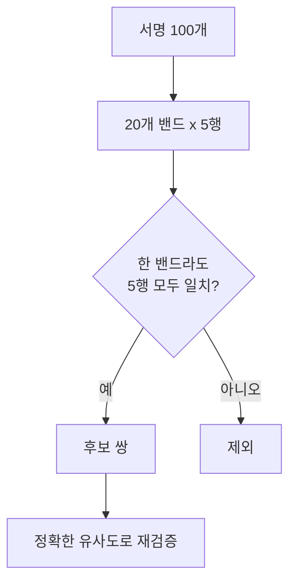
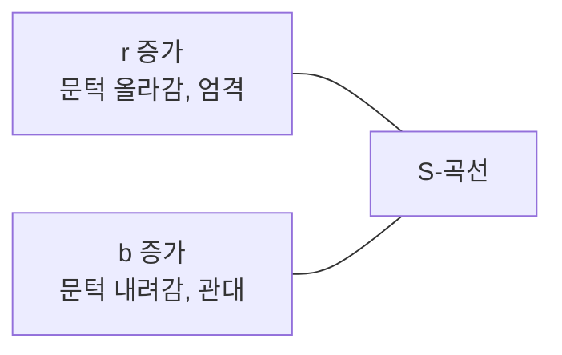

# LSH 밴드·행 조정

> MinHash 서명(길이 k)을 b개의 밴드(띠)로 나누고 밴드마다 r개의 행을 묶어, 한 밴드라도 통째로 일치하면 후보 쌍으로 삼는 방법이다. b와 r을 바꿔 "어느 유사도부터 후보로 잡을지"의 문턱을 조절한다.

## 쉽게 말하면
지문 100개를 20묶음(묶음당 5개)으로 나눠 두 사람의 지문을 비교한다. 한 묶음의 5개가 전부 같으면 "비슷한 사람 후보"로 올린다. 묶음 안은 전부 같아야 하니 엄격하고(AND), 묶음이 20개라 하나만 통과해도 되니 관대하다(OR). 묶음당 개수를 늘리면 엄격해지고 묶음 수를 늘리면 관대해진다.

## 자세히
- **구조(위키피디아 LSH 문서의 AND·OR 증폭, 열람)**: MinHash는 한 번의 일치 확률이 유사도 s와 같다. AND 구성은 r개가 모두 일치해야 하므로 확률이 s^r, OR 구성은 b개 중 하나라도 일치하면 되므로 1−(1−p)^b다. 밴딩은 밴드 안은 AND, 밴드 사이는 OR다(이 결합은 문서의 직접 서술이 아니라 두 구성의 조합이라는 해석이다).
- **후보가 될 확률**: P(s) = 1 − (1 − s^r)^b. s를 가로축으로 그리면 S자 곡선이고, 급히 오르는 문턱은 약 (1/b)^(1/r)이다. 이 공식은 표준 설명이며 원문 PDF는 열리지 않아 직접 대조하지 못했다.
- **직접 시뮬레이션으로 확인(밴드·행 조합마다 서명 위치가 확률 s로 일치하도록 20,000번 시행)**: 이론과 실측이 일치했다.

| b×r (k=100) | 문턱 | s=0.5 | s=0.7 | s=0.8 | s=0.9 |
| --- | --- | --- | --- | --- | --- |
| 20×5 | 약 0.55 | 이론 0.470 실측 0.469 | 0.975 / 0.976 | 1.000 / 1.000 | 1.000 / 1.000 |
| 10×10 | 약 0.79 | 0.010 / 0.009 | 0.249 / 0.251 | 0.679 / 0.683 | 0.986 / 0.986 |
| 50×2 | 약 0.14 | 1.000 / 1.000 | 1.000 / 1.000 | 1.000 / 1.000 | 1.000 / 1.000 |
| 5×20 | 약 0.92 | 0.000 / 0.000 | 0.004 / 0.005 | 0.056 / 0.056 | 0.477 / 0.485 |

  s=0.3에서 20×5는 0.047, 50×2는 0.991이다. 같은 서명 길이라도 b와 r에 따라 "거의 안 잡힘"에서 "거의 다 잡힘"까지 달라진다.
- **조정 지침(해석)**: ① 거의 같은 문서만 원하면 r을 키우고 b를 줄인다(10×10) ② 놓치기 싫으면 b를 키운다(20×5). 후보는 이후 정확한 유사도로 다시 검사하므로 거짓 양성은 허용해도 거짓 음성은 줄여야 한다. ③ b×r은 서명 길이 k와 맞춰야 한다.
- **비용**: 후보 쌍만 정밀 비교하면 되므로 모든 쌍 비교(문서 수의 제곱)를 피한다.

## 그림으로 보기

## 예시
- 중복 문서를 유사도 0.8 이상으로 찾고 싶다면 10×10(문턱 0.79)을, 0.5 이상을 폭넓게 후보로 올리려면 20×5(문턱 0.55)를 쓴다.
- 교육 활용: b와 r을 바꿔 S-곡선을 그려 보며 문턱이 어떻게 움직이는지 본다.

## 헷갈리는 것과 비교
| 개념 | 차이 |
| --- | --- |
| [MinHash](#minhash) | 서명을 만드는 단계 |
| LSH 밴딩 | 서명으로 후보를 거르는 단계 |
| 정확한 유사도 검사 | 후보에만 하는 마지막 확인 |
| [의미적 중복 제거](#semantic-deduplication) | 임베딩 기반 대안 |

## 더 읽을거리
- [Wikipedia: Locality-sensitive hashing](https://en.wikipedia.org/wiki/Locality-sensitive_hashing) — MinHash 충돌 확률, AND·OR 증폭
