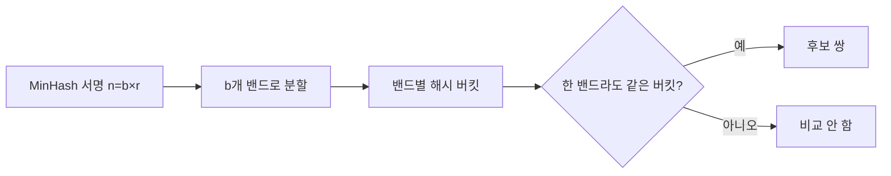
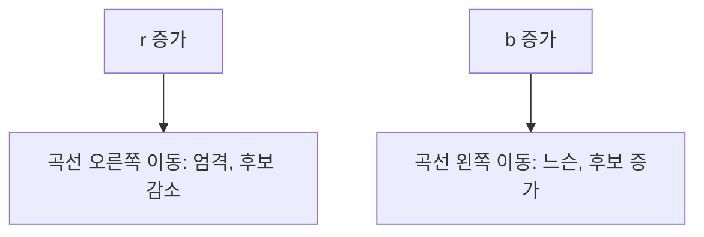

# LSH 밴딩 S자 곡선

> MinHash 서명을 **b개 밴드 × r행**으로 나눠, 한 밴드라도 완전히 같으면 후보로 삼는 방식의 **후보가 될 확률 곡선** `1-(1-s^r)^b`이다. b와 r을 바꿔 "어느 유사도부터 후보로 잡을지"(임계값)를 조절한다.

## 쉽게 말하면
시험 답안지를 5문항씩 묶음(밴드)으로 나눠 놓고, 어느 한 묶음이라도 두 사람 답이 전부 같으면 "베낀 의심"으로 올린다. 묶음 안 문항이 많을수록(r↑) 의심이 까다로워지고, 묶음 수가 많을수록(b↑) 의심 기회가 늘어 느슨해진다.

## 자세히
- 서명 길이 n = b×r. 두 문서의 [자카드 유사도](#jaccard-similarity)가 s면 서명 한 칸이 같을 확률도 s다.
- 한 밴드가 통째로 같을 확률 s^r, 모든 밴드가 어긋날 확률 (1-s^r)^b, 따라서 후보 확률 P(s)=1-(1-s^r)^b.
- 곡선이 급격히 오르는 지점(임계값)은 약 (1/b)^(1/r).
- 직접 계산(n=100 근방 설정, 유사도 0.2/0.4/0.6/0.8/0.9에서의 후보 확률):

| b×r | 임계값≈ | 0.2 | 0.4 | 0.6 | 0.8 | 0.9 |
|---|---|---|---|---|---|---|
| 20×5 | 0.55 | 0.006 | 0.186 | 0.802 | 1.000 | 1.000 |
| 25×5 | 0.53 | 0.008 | 0.227 | 0.868 | 1.000 | 1.000 |
| 10×10 | 0.79 | 0.000 | 0.001 | 0.059 | 0.679 | 0.986 |
| 50×2 | 0.14 | 0.87 | 1.0 | 1.0 | 1.0 | 1.0 |
| 5×20 | 0.92 | 0 | 0 | 0 | 0.056 | 0.477 |
- 설계 원칙: 진짜 유사 쌍을 놓치는 미탐(곡선 임계값 위쪽이 1보다 낮음)과 쓸데없이 후보가 늘어나는 오탐(아래쪽이 0보다 높음)을 맞바꾼다. 후보는 이후 실제 자카드로 한 번 더 확인한다.
- 서명 길이를 늘리면 곡선이 더 가팔라진다(이상적인 계단에 가까워짐) 대신 비용이 든다.

## 그림으로 보기

## 예시
- `datasketch` MinHashLSH는 num_perm=128, threshold=0.5에서 (b=25, r=5)를 고른다(문서 확인). 미탐에 가중을 주면 (0.1,0.9)에서 b=32·r=4로 곡선이 왼쪽으로, 오탐에 가중을 주면 (0.9,0.1)에서 b=16·r=8로 오른쪽으로 간다.
- 임계값 0.8로 엄격히 하려면 10×10: 유사도 0.6 쌍은 6%만 후보가 된다.

## 헷갈리는 것과 비교
| 개념 | 차이 |
|---|---|
| 밴딩 곡선 | 후보가 될 확률 함수 |
| [MinHash·LSH](#minhash-lsh) | 전체 방식 |
| 최종 판정 | 후보에 실제 자카드를 다시 계산 |

## 더 읽을거리
- [datasketch LSH 문서](http://ekzhu.com/datasketch/lsh.html) — threshold로 (b,r)을 고르는 방식과 오탐·미탐 가중치(열어 확인).
