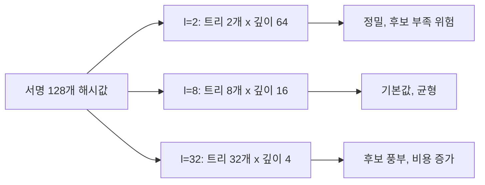
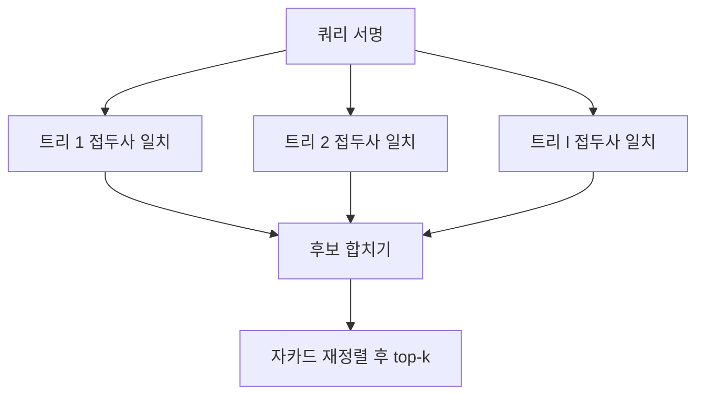

# 접두사 트리 l 값

> LSH Forest에서 `l`은 서명을 나눠 담는 **접두사 트리의 개수**이고, 각 트리의 깊이는 `num_perm / l`이다. 정해진 해시 예산 안에서 "트리를 많이" 할지 "트리를 깊게" 할지를 정하는 다이얼이다.

## 쉽게 말하면
도서관에서 책을 찾는 단서가 128개 있다고 하자. 이를 8개 색인 카드함(트리)에 16개씩 나눠 담을 수도, 2개 카드함에 64개씩 담을 수도 있다. 카드함이 깊으면(단서가 많으면) 정확히 맞는 책만 골라내지만, 한 카드함이 틀리면 놓친다. 카드함이 많고 얕으면 여러 곳에서 후보를 모으므로 덜 놓치지만 엉뚱한 책도 섞인다.

## 자세히
- `num_perm`개 해시값을 `l`개 트리에 나눈다. 트리 하나가 보는 접두사 최대 길이 = `num_perm / l`. 기본 `l=8`(datasketch 문서).
- 문서 설명(열어 확인): 예산이 작을 때(num_perm=32)는 **깊이가 귀하다** — `l=2`가 `l=16`보다 낫다. 예산이 커지면(128~) 트리가 많은 쪽이 유리하고 `l=8`이 앞선다. `l=2`는 MAP 0.66 근처에서 더 오르지 않는다.
- 트리가 적고 깊으면 검색 곡선이 완만해 약한 이웃까지 들어오고, 트리가 많고 얕으면 곡선이 가팔라 가장 닮은 것에 집중한다(문서).
- `num_perm` 자체는 검색 곡선을 거의 바꾸지 않고 유사도 추정 해상도를 정한다. 주 조절 변수는 `l`과 `k`.
- 직접 실행(datasketch 2.0.0, num_perm=128, 집합 크기 60, 겹침 55·45·30·15·5인 정답 5개 + 무작위 노이즈 300개, 시드 20회 평균, top-5 질의):

| l | 트리 깊이 | 정답 5개 중 평균 적중 | 평균 반환 수 | 최소 반환 수 |
|---|---|---|---|---|
| 2 | 64 | 2.6 | 4.3 | 2 |
| 4 | 32 | 3.2 | 4.95 | 4 |
| 8 | 16 | 3.6 | 5.0 | 5 |
| 16 | 8 | 3.6 | 5.0 | 5 |
| 32 | 4 | 3.85 | 5.0 | 5 |

  해석: 트리가 너무 적고 깊으면(`l=2`) **k개를 못 채우고** 적중도 낮았다. `l`을 8 이상으로 올리면 k개를 채웠다. 이 설정에서는 32까지 완만히 좋아졌지만 트리가 늘수록 메모리·질의 비용이 커진다. 작은 합성 데이터 20회 평균이라 일반화는 금물이고, 적중 정의가 자카드 0.14짜리 정답까지 포함해 낮게 나온 면이 있다.

## 그림으로 보기

## 예시
- 기본값으로 시작: `MinHashLSHForest(num_perm=128, l=8)` 후 `forest.index()`.
- k개가 안 채워지면 `l`을 올리거나 `query(mh, 2*k)`로 넓힌 뒤 재정렬.
- 교육: "같은 예산을 깊이에 쓰느냐 폭에 쓰느냐"의 트레이드오프 실습으로 위 표를 직접 재현.

## 헷갈리는 것과 비교
| 개념 | 차이 |
|---|---|
| `num_perm` | 서명 전체 길이. 추정 정밀도 |
| `l` | 트리 수. 깊이 = num_perm/l |
| `k` | 원하는 결과 수. 클수록 약한 이웃 포함 |
| [MinHash LSH의 b·r](#minhash-lsh) | 임계값 검색의 밴드 수·행 수. 비슷한 폭·깊이 논리 |

상위 개념: [MinHash LSH Forest](#minhash-lsh-forest)

## 더 읽을거리
- [datasketch LSH Forest 문서](http://ekzhu.com/datasketch/lshforest.html) — l, 깊이, 곡선 트레이드오프, 2k 재정렬 팁(열어 확인).
