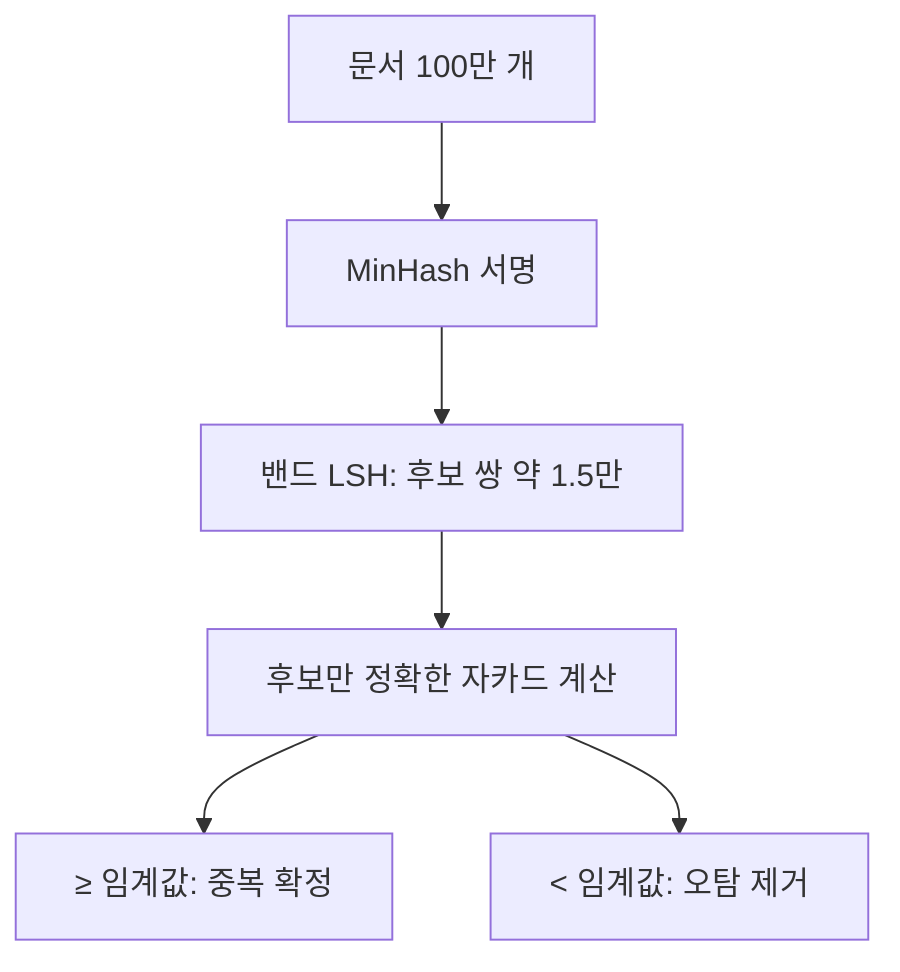
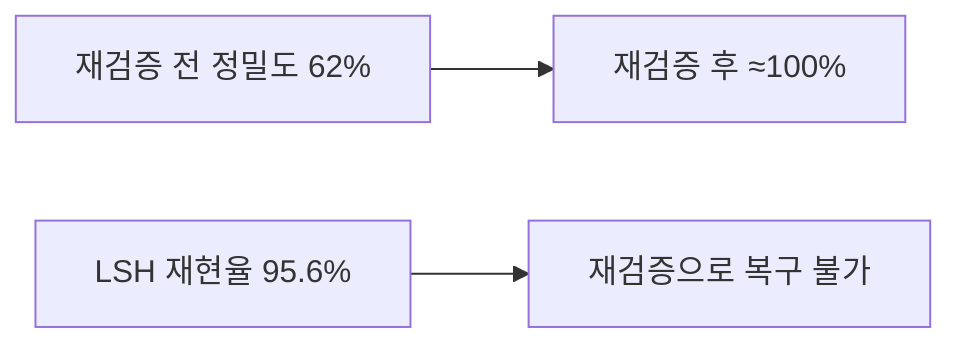

# LSH 후보 재검증

> LSH는 "유사할 가능성이 있는 후보 쌍"을 싸게 뽑는 **필터**일 뿐이다. 후보에는 오탐이 섞여 있으므로 **실제 자카드(또는 원문 비교)를 다시 계산해 확정**한다. 이 2단계 구조가 속도와 정확도를 함께 얻는 표준 방식이다.

## 쉽게 말하면
공항에서 1차 금속 탐지기는 빠르게 의심자를 고르지만 열쇠도 울린다. 울린 사람만 2차 정밀 검색을 하면 전원을 정밀 검색하는 비용을 피하면서 오탐을 걸러 낸다.

## 자세히
- **2단계 구조**
  1. **후보 생성**: MinHash 서명을 밴드로 나눠 같은 버킷에 든 쌍을 후보로(전체 쌍 비교 대신, [서명 길이와 곡선](#lsh-signature-length)).
  2. **재검증**: 후보 쌍만 **정확한 자카드**(또는 편집 거리·원문 비교)를 다시 계산해 임계값 이상이면 중복으로 확정.
- **직접 계산한 예(17×8 구성, 임계값 약 0.7; 가상 분포)**: 후보 확률 P(s)=1−(1−s⁸)¹⁷. 비교 대상 쌍 1,000,000개 중 s=0.1인 쌍 900,000, s=0.5인 쌍 90,000, 진짜 중복(s=0.8) 10,000개라고 가정.
  | 유사도 s | 쌍 수 | 후보가 될 확률 | 후보 수 |
  |---|---|---|---|
  | 0.1 | 900,000 | 1.7×10⁻⁷ | 약 0.15 |
  | 0.5 | 90,000 | 0.064 | 약 5,793 |
  | 0.8(진짜 중복) | 10,000 | 0.956 | 약 9,560 |
  후보 합계 약 15,353개 중 진짜 중복 비율(재검증 전 정밀도)은 **62%** 이고, 재검증을 거치면 s=0.5 후보 5,793개는 자카드 < 0.7로 걸러져 정밀도가 100%에 가까워진다(정확한 자카드 기준). 대신 재현율은 LSH 단계에서 정해져 **95.6%**(9,560/10,000)다. 전체 5,000억 쌍(10⁶ 문서의 쌍 약 5×10¹¹)을 모두 비교하는 대신 약 1.5만 쌍만 정밀 계산하면 된다.
- **재검증의 이점**: ① 오탐 제거(정밀도↑) ② LSH 파라미터를 **재현율 위주**(후보를 넉넉히)로 설정할 수 있음 ③ 최종 판정의 설명 가능성(실제 겹침 수치 보고).
- **한계**: LSH가 **놓친 쌍**(미탐)은 재검증으로 복구되지 않는다. 필요한 재현율에 맞춰 LSH 곡선을 설계한다([곡선에서 오탐·미탐 계산](#false-positive-negative-from-curve)).
- **재검증에서 쓰는 기준**: 후보 확정에는 정확한 자카드(같은 섀글 크기·전처리, [섀글 크기](#shingle-size-choice)), 삭제 같은 되돌리기 어려운 조치 전에는 샘플을 사람이 확인하고 경계 구간은 검수([3구간 설계](#three-band-dedup)).
- **비용 균형**: 재검증 비용 = 후보 수 × 쌍당 비교 비용. 후보가 너무 많으면 LSH 임계값을 높이거나 서명 길이를 늘린다.

## 그림으로 보기



## 예시
```python
cands = lsh.query_pairs()                          # LSH 후보 쌍
confirmed = [(a, b) for a, b in cands
             if jaccard(shingles(docs[a], 3), shingles(docs[b], 3)) >= 0.7]
```
- 학습 데이터 정제: LSH 후보 1.5만 쌍을 정확한 자카드로 확인해 9,560쌍만 중복으로 제거.

## 헷갈리는 것과 비교
| 단계 | 역할 | 오류 |
|---|---|---|
| LSH 후보 | 싼 필터 | 오탐·미탐 |
| 재검증 | 정밀 확정 | 오탐 제거(미탐은 못 고침) |
| 전수 비교 | 정확 | 비용 폭발 |
| [임계값 조정](#jaccard-threshold-tuning) | 두 단계의 기준 | - |

## 더 읽을거리
- [Wikipedia: Locality-sensitive hashing](https://en.wikipedia.org/wiki/Locality-sensitive_hashing) — MinHash·증폭 구성 개요(열어 확인; 밴딩 공식은 없음). 후보 수 표는 이 글의 가상 분포 직접 계산.
