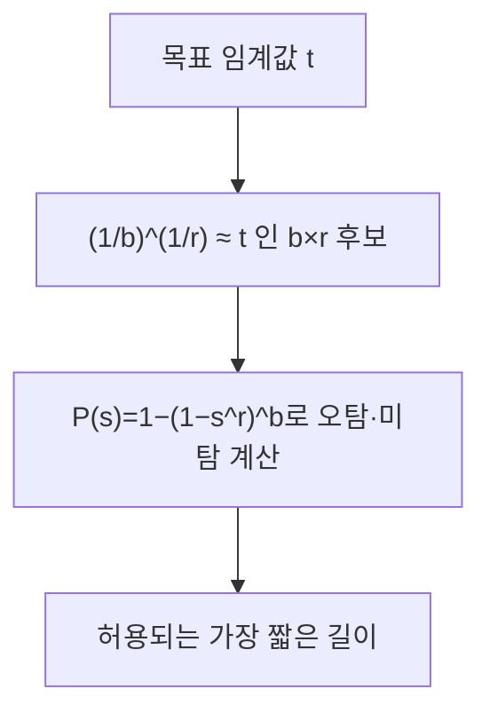

# 서명 길이와 곡선 기울기

> MinHash LSH에서 서명(signature)의 길이 **num_perm = b×r**을 늘리면, 같은 임계값을 유지하면서 **후보 확률 곡선(S-곡선)이 더 가파르게** 되어 오탐·미탐이 함께 줄어든다. 대신 저장·계산 비용이 늘어난다.

## 쉽게 말하면
의심 신호를 4개만 보고 "비슷하다"를 정하면 우연히 틀리기 쉽다. 신호를 16개, 136개로 늘리면 판정이 또렷해져 애매한 구간이 좁아진다. 하지만 신호를 모으는 데 시간과 저장 공간이 든다.

## 자세히
- **밴딩(banding) 공식(표준 LSH 분석; 위키피디아 LSH 문서에는 이 내용이 없어 확인하지 못했고 Mining of Massive Datasets 3장이 인용됨)**: 서명을 b개 밴드(각 r행)로 나누면 두 문서의 자카드 유사도가 s일 때 **하나 이상의 밴드가 모두 일치(후보가 됨)할 확률**은 P(s) = 1 − (1 − s^r)^b. 곡선이 급격히 오르는 **임계값 근사**는 (1/b)^(1/r). 서명 길이는 num_perm = b·r.
- **직접 계산: 임계값을 약 0.7로 고정하고 길이를 늘리면**
  | 구성(b×r) | 서명 길이 | s=0.4 | 0.5 | 0.6 | **0.7** | 0.8 | 0.9 | 임계값 근사 |
  |---|---|---|---|---|---|---|---|---|
  | 4×4 | 16 | 0.099 | 0.228 | 0.426 | 0.667 | 0.878 | 0.986 | 0.707 |
  | 17×8 | 136 | 0.011 | 0.064 | 0.250 | 0.636 | 0.956 | 1.000 | 0.702 |
  | 300×16 | 4,800 | 0.000 | 0.005 | 0.081 | 0.632 | 1.000 | 1.000 | 0.700 |
  같은 임계값(약 0.7) 근처에서 길이 16 → 136 → 4,800으로 늘리면 s=0.5에서의 후보 확률(오탐)이 **0.228 → 0.064 → 0.005**로, s=0.8에서의 후보 확률(미탐 반대)이 **0.878 → 0.956 → 1.000**으로 개선된다. 곡선이 임계값을 중심으로 **계단에 가까워진다.**
- **r을 고정하고 b만 늘리면 곡선이 가파르지 않고 왼쪽으로 이동**: 서명 길이 128/256/512에서 r=8 고정이면 임계값이 0.707/0.648/0.595로 낮아져(후보가 더 쉽게 생김) 같은 임계값에서의 비교가 안 된다. 길이를 늘릴 때는 **임계값 목표(b,r 조합)를 함께 다시 정한다**.
- **비용**: 서명을 만드는 시간·메모리가 길이에 비례한다. 문서 100만 개 × 서명 128개 × 4바이트면 약 512MB(직접 계산), 512개이면 약 2GB.
- **선택 절차(권장)**
  1. 목표 임계값 t를 [자카드 임계값 정하기](#jaccard-threshold-tuning)로 정한다.
  2. 서명 길이 후보(예: 64, 128, 256)마다 (1/b)^(1/r) ≈ t가 되는 b×r 조합을 고른다.
  3. 위 공식으로 s<t 구간의 오탐과 s>t 구간의 미탐 확률을 계산해 허용 수준을 확인.
  4. 비용이 허용되는 가장 짧은 길이를 선택하고, 후보는 실제 자카드로 재검증([LSH 후보 재검증](#lsh-post-verify)).
- **한계**: 공식은 서명 행이 독립인 이상적인 MinHash를 가정하며 실제 라이브러리의 파라미터 설정은 구현을 확인해야 한다(이 글은 특정 라이브러리 문서를 열어 확인하지 않음).

## 그림으로 보기



## 예시
```python
def cand_prob(s, b, r): return 1 - (1 - s**r)**b
for b, r in [(4, 4), (17, 8), (300, 16)]:
    print(b * r, [round(cand_prob(s, b, r), 3) for s in (0.5, 0.7, 0.8)])
```
- 중복 후보 탐지에서 임계값 0.7, 미탐 5% 이하·오탐 10% 이하를 요구하면 길이 136 조합으로 충분한지 위 식으로 먼저 확인.

## 헷갈리는 것과 비교
| 설정 | 효과 |
|---|---|
| 길이 증가(임계값 고정) | 곡선이 가파라짐 |
| b 증가(r 고정) | 곡선이 왼쪽으로(후보 증가) |
| r 증가(b 고정) | 곡선이 오른쪽으로(후보 감소) |
| 재검증 | 후보를 실제 자카드로 걸러냄 |

## 더 읽을거리
- [Wikipedia: Locality-sensitive hashing](https://en.wikipedia.org/wiki/Locality-sensitive_hashing) — MinHash와 OR 구성의 일반 형태 확인(밴딩 공식은 이 문서에 없음). 표는 이 글의 직접 계산.
