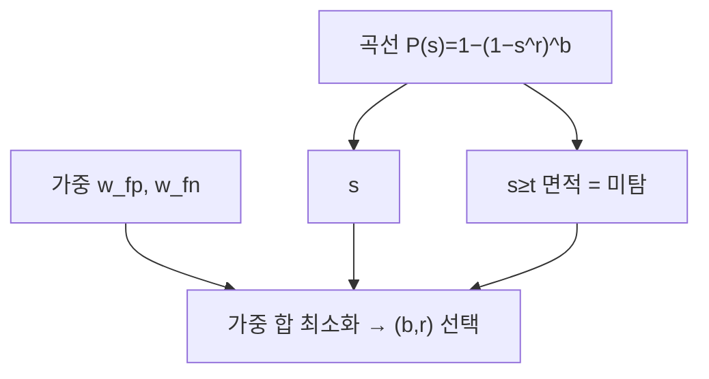

# LSH 오탐·미탐 가중치

> MinHash LSH의 밴드 구성(b×r)은 **오탐(유사하지 않은데 후보)과 미탐(유사한데 놓침) 중 무엇을 더 싫어하느냐**에 따라 달라진다. 가중치로 두 오류의 면적을 가중해 곡선을 좌우로 옮기는 방식이 쓰인다.

## 쉽게 말하면
스팸 필터에서 정상 메일을 스팸으로 보내는 실수(오탐)가 더 싫으면 기준을 엄격하게, 스팸을 놓치는 실수(미탐)가 더 싫으면 느슨하게 둔다. LSH 곡선의 기준선을 오른쪽/왼쪽으로 옮기는 일이다.

## 자세히
- **곡선**: 후보 확률 P(s) = 1 − (1 − s^r)^b(서명 길이 b·r ≤ num_perm, 표준 LSH 분석). 임계값 t 아래(s<t)에서 P(s)의 면적이 **오탐 면적**, t 위(s≥t)에서 1−P(s)의 면적이 **미탐 면적**이다.
- **가중 최적화(개념)**: 목표 = w_fp·(오탐 면적) + w_fn·(미탐 면적)을 최소화하는 (b, r)를 찾는다. 이 글은 이 아이디어를 직접 수치 적분으로 계산해 보였고, 특정 라이브러리의 파라미터 이름·기본값은 확인하지 않았다.
- **직접 계산(서명 길이 128, b·r ≤ 128 전수 탐색, 수치 적분)**
  | 임계값 t | 가중치(오탐, 미탐) | 최적 b×r | 오탐 면적 | 미탐 면적 |
  |---|---|---|---|---|
  | 0.7 | (0.5, 0.5) | 14×9 | 0.0346 | 0.0379 |
  | 0.7 | **(0.9, 0.1)** 오탐을 더 싫어함 | 9×14 | **0.0028** | 0.1229 |
  | 0.7 | **(0.1, 0.9)** 미탐을 더 싫어함 | 21×6 | 0.1464 | **0.0023** |
  | 0.5 | (0.5, 0.5) | 25×5 | 0.0537 | 0.0338 |
  | 0.5 | (0.9, 0.1) | 16×8 | 0.0034 | 0.1664 |
  | 0.5 | (0.1, 0.9) | 32×4 | 0.1265 | 0.0057 |
  같은 임계값 0.7에서 **오탐을 중시하면 r이 커지고(9×14) 곡선이 오른쪽**으로, **미탐을 중시하면 r이 작아지고(21×6) 왼쪽**으로 이동한다. 오탐 면적이 0.0028까지 줄 때 미탐 면적은 0.1229로 늘어나는 교환 관계가 보인다.
- **의사결정 지침(권장)**
  | 상황 | 가중 |
  |---|---|
  | 재검증이 싸고 놓치면 큰일(중복 제거 누수 방지) | 미탐 가중↑ (후보 넉넉히) |
  | 후보 처리 비용이 크고 오탐이 비쌈 | 오탐 가중↑ |
  | 균형 | 0.5/0.5에서 시작 |
  재검증([LSH 후보 재검증](#lsh-post-verify))이 있으면 보통 **미탐을 줄이는 쪽**(후보를 넉넉히)이 유리하다. 오탐은 재검증으로 걸러지고 미탐은 복구되지 않기 때문이다.
- **서명 길이와의 관계**: 길이를 늘리면 같은 가중에서 두 면적이 함께 줄어든다([서명 길이](#lsh-signature-length)).
- **한계**: 면적 가중은 s의 분포가 균등하다고 암묵적으로 가정한다. 실제 쌍의 유사도 분포(대부분 매우 낮은 s)를 반영하면 최적이 달라진다(일반 주의).

## 그림으로 보기



## 예시
```python
def P(s, b, r): return 1 - (1 - s**r) ** b
def err(t, b, r, wfp, wfn, n=2000):
    fp = sum(P((i+.5)*t/n, b, r) for i in range(n)) * t / n
    fn = sum(1-P(t+(i+.5)*(1-t)/n, b, r) for i in range(n)) * (1-t) / n
    return wfp*fp + wfn*fn
best = min(((err(0.7, 128//r, r, 0.1, 0.9), 128//r, r) for r in range(1, 129)))
```
- 학습 데이터 누수 방지가 목적이면 가중을 (0.1, 0.9)로 두고 21×6 같은 구성으로 후보를 넉넉히 뽑는다.

## 헷갈리는 것과 비교
| 항목 | 설명 |
|---|---|
| 오탐 | 무관한데 후보(재검증으로 제거 가능) |
| 미탐 | 유사한데 후보 아님(복구 불가) |
| 가중 | 두 오류의 상대 중요도 |
| [곡선 기울기](#lsh-signature-length) | 길이에 의한 가파름 |

## 더 읽을거리
- [Wikipedia: Locality-sensitive hashing](https://en.wikipedia.org/wiki/Locality-sensitive_hashing) — 증폭(OR 구성) 일반론(열어 확인; 밴딩·가중 최적화는 이 문서에 없음). 표는 이 글의 직접 수치 적분.
