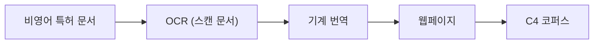
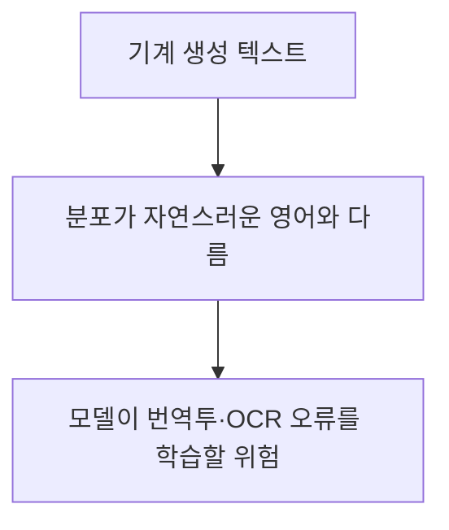

# 웹의 기계 생성 텍스트

> 웹 크롤 데이터에는 **사람이 쓰지 않은 글**(기계 번역, OCR 인식 결과, 이후에는 생성형 AI 글)이 섞이고, 이런 글은 자연스러운 영어와 분포가 다르다. 데이터 품질과 모델의 학습 분포를 해칠 수 있다.

## 쉽게 말하면
외국 서류를 기계로 번역하고 스캔해서 글자로 바꾼 뒤 도서관 책으로 꽂아 둔 것이다. 번역투와 오타가 섞인 이 글들을 원어민의 글과 같은 비중으로 읽으면 말투가 이상하게 배운다.

## 자세히
(Dodge 외 2021, arXiv 2104.08758 PDF 본문 4.1절을 직접 읽음. 영어 C4.EN 기준)
- **연구 대상**: C4.EN에서 토큰을 가장 많이 제공한 도메인 `patents.google.com`. 이 사이트는 **세계 각국 특허청의 특허를 기계 번역으로 영어로 번역**해 보여 준다.
- **발견**: 특허청마다 출원 언어 요건이 있다(예: 일본 특허청은 일본어). C4.EN의 특허는 대다수가 미국 특허청 것이지만 **10% 넘게가 영어가 아닌 언어로 제출해야 하는 특허청의 것**이다(부록 Table 3). 따라서 상당수가 기계 번역 결과다.
- **OCR 문제**: 많은 특허는 종이 문서를 **OCR**로 스캔한 것이고, 일부 오래된 비영어권 문서는 OCR 후 기계 번역을 거친다. OCR은 철자 오류·누락 단어처럼 **예측 가능한 방식의 오류**를 만들어 자연스러운 영어와 분포가 다르다.
- **한계와 전망**: 기계 생성 문서의 비율을 정량화하는 것은 활발한 연구 분야라고 하며(Zellers 외 2019), 논문은 생성 모델이 늘수록 웹 크롤 데이터에 사람이 쓰지 않은 글이 늘 것이라고 지적한다(2021년 서술, 이후 상황은 이 글에서 확인하지 않았다).
- 대응(제안): ① 출처 도메인별로 기계 번역·OCR 비중을 추정해 표본 점검 ② 기계 생성 탐지기·휴리스틱(철자 오류율, 번역투 지표)으로 라벨링하고 비율을 데이터 카드에 기록 ③ 목적에 따라 가중치를 낮추거나 제외 ④ 평가 때 사람 글 위주 검증 세트를 따로 유지([코퍼스 문서화](#corpus-documentation-practice)).

## 그림으로 보기

## 예시
- 특허 도메인 표본 50개를 읽어 철자 오류율과 번역투를 확인하고 해당 도메인 비중을 조정.
- 교육: 데이터 출처를 알아야 "누가 쓴 글인가"를 판단할 수 있다는 설명.

## 헷갈리는 것과 비교
| 개념 | 차이 |
|---|---|
| 기계 번역 텍스트 | 다른 언어 문서를 번역한 글 |
| OCR 텍스트 | 이미지 문서를 글자로 인식한 글(오류 패턴) |
| 생성형 AI 글 | 모델이 쓴 글, 웹에 늘어날 것으로 우려 |
| [C4 감사](#c4-audit-dodge) | 이 문제를 처음 정량 보고한 감사 연구 |

## 더 읽을거리
- [Documenting Large Webtext Corpora (arXiv 2104.08758)](https://arxiv.org/abs/2104.08758) — 4.1절 기계 생성 텍스트(PDF 본문 읽음).
