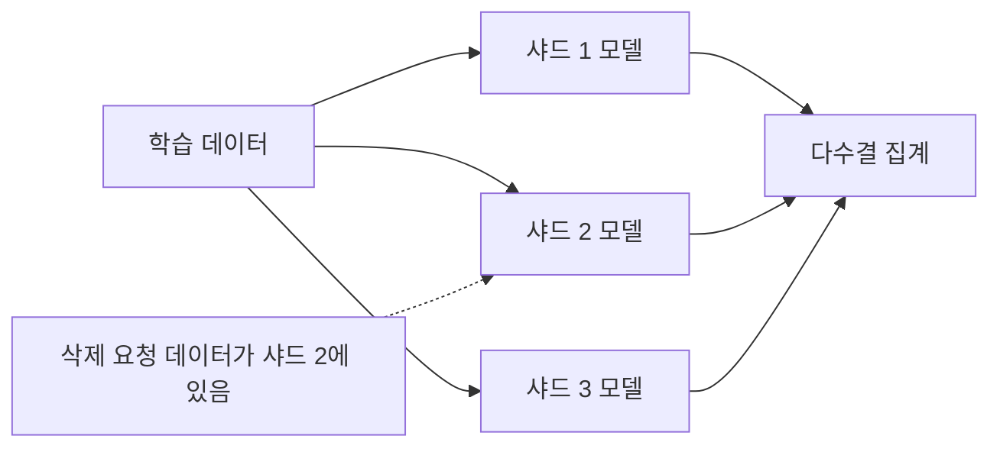
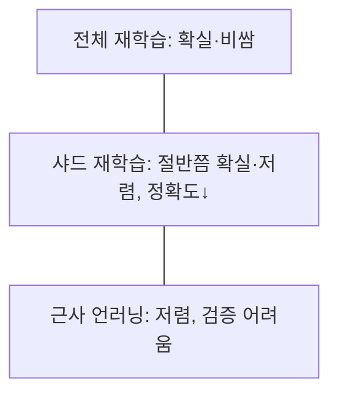

# 머신 언러닝

> 머신 언러닝은 **이미 학습한 모델에서 특정 데이터의 영향을 지우는 기술**이다. 가장 확실한 방법은 그 데이터를 빼고 처음부터 다시 학습(재학습)하는 것인데 비용이 크므로, 재학습 비용을 줄이거나 영향을 근사적으로 지우는 방법들이 연구된다.

## 쉽게 말하면
수프에 이미 들어간 소금은 건져 낼 수 없다. 대신 소금을 뺀 새 수프를 끓이거나(재학습), 수프를 여러 냄비로 나눠 끓여 두고 문제 냄비만 다시 끓이는 방법이 있다.

## 자세히
- 문제 배경(Bourtoule 외, *Machine Unlearning*, arXiv 1912.03817 초록·본문 읽음): 사용자가 데이터를 공유한 뒤에는 접근을 철회하고 삭제를 요청하기 어렵고, 학습된 모델이 데이터를 **암기**했을 수 있어 프라이버시 공격 위험이 있다. 그럼에도 "모델이 잊게 하는 것은 악명 높게 어렵다".
- **SISA 학습**(Sharded, Isolated, Sliced, Aggregated): 데이터를 여러 **샤드(조각)**로 나눠 샤드마다 독립 모델을 학습하고 예측을 **집계**한다. 한 데이터 삭제 요청이 오면 그 데이터가 속한 샤드의 모델만 다시 학습하면 된다. 논문은 슬라이스(샤드 안 조각별 체크포인트)로 재학습 시작점을 앞당기는 장치도 쓴다. 보고된 효과: 어떤 분포 가정 없이 간단한 과제에서 **Purchase 데이터셋은 재학습 대비 4.63배, SVHN은 2.45배 빠르게** 삭제 처리, 요청 4건일 때 mini-ImageNet에서는 8.01배 빠르지만 **정확도가 16.7%p 하락**했다고 각주에 적는다.
- 직접 해 본 토이 실험(scikit-learn `load_digits`, 학습 1,257장, 로지스틱 회귀, 다수결 앙상블; 시간은 밀리초 단위 단일 실행이라 대략치):
  | 구성 | 시험 정확도 | 데이터 1건 삭제 시 재학습 |
  |---|---|---|
  | 단일 모델(전체 재학습) | **0.970** | 약 46ms(전체) |
  | SISA 샤드 2개 | 0.956 | 샤드 1개 재학습 약 25ms(전체 대비 1.9배 빠름) |
  | 샤드 5개 | 0.956 | 약 12ms(3.7배 빠름) |
  | 샤드 10개 | 0.948 | 약 15ms(3.1배 빠름) |
  - 읽는 법: 샤드를 늘리면 삭제 비용은 줄지만 **정확도가 내려간다**(0.970 → 0.948). 샤드마다 학습 데이터가 줄기 때문이다. 이 토이에서는 학습이 너무 빨라 속도 이득의 크기를 단정하기 어렵고, **정확도–삭제 비용의 교환 관계**를 보여 주는 용도다.
- 근사적 방법(일반적 설명; 이 지도에서 읽거나 실험하지 않음): 기울기 상승·영향 함수 등으로 대상 데이터의 영향을 줄이는 접근이 있으나 **완전히 지웠는지 검증하기 어렵다**.
- 대형 모델의 현실: 사전학습 후 파인튜닝·합성 데이터에 퍼진 영향을 추적하기 어려워, 실무에서는 [데이터 계보 기록](#data-lineage-record)으로 어떤 모델이 어떤 데이터로 학습됐는지 알고 **다음 학습 버전에서 제외**하는 방식이 흔한 현실적 대안이다([데이터셋 삭제 요청](#dataset-removal-request)).
- 한계: 법적으로 "모델 삭제"가 요구되는지는 관할마다 다르며 이 문서는 법률 자문이 아니다. 토이 실험은 소규모·선형 모델이다.

## 그림으로 보기

## 예시
- 사용자가 자기 구매 기록 삭제를 요청 → 해당 기록이 속한 샤드 모델만 다시 학습.
- 교육: "삭제 요청 대응이 모델 설계에도 영향을 준다"는 데이터 윤리 토론 소재.

## 헷갈리는 것과 비교
| 개념 | 차이 |
|---|---|
| 데이터 삭제 | 저장된 원본에서 제거 |
| 머신 언러닝 | 학습된 모델에 남은 영향 제거 |
| 재학습 | 가장 확실한 언러닝(비용 큼) |
| [학습 데이터 추출 공격](#training-data-extraction-attack) | 모델에 남은 데이터를 꺼내는 공격(언러닝이 막으려는 위험) |

## 더 읽을거리
- [Machine Unlearning (arXiv 1912.03817)](https://arxiv.org/abs/1912.03817) — SISA 학습(읽음).
- 직접 실행: scikit-learn 숫자 데이터 SISA 토이.
