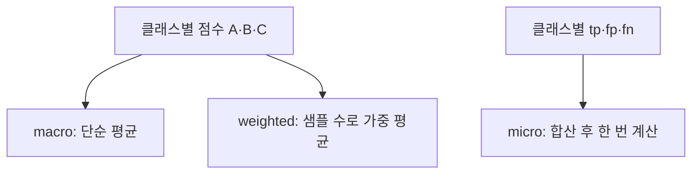

# macro·micro 평균

> 다중 클래스·다중 라벨 분류에서 클래스별 점수를 하나로 합치는 방식으로, macro는 클래스를 동등하게, micro는 모든 샘플을 합쳐 계산하고, weighted는 클래스 비중으로 가중한다.

## 쉽게 말하면
학교별 평균 점수를 합칠 때, 학교마다 똑같이 반영(macro)하느냐, 전교생을 한 줄로 세워 평균(micro)하느냐의 차이다. 작은 학교의 성적이 중요하면 macro를 본다.

## 자세히
scikit-learn 문서(`average` 파라미터, 2026-11 확인):
- **macro**: 클래스별 지표의 단순 평균 → 모든 클래스 동등. 드문 클래스 성능을 부각하고 그 낮은 성능을 과하게 강조할 수 있다.
- **weighted**: 클래스별 지표를 **참 라벨 개수**로 가중 평균 → 불균형 반영.
- **micro**: 전 라벨의 tp·fp·fn을 합산해 한 번 계산. 다수 클래스를 무시하고 싶은 다중 라벨 설정에 적합. 다중 클래스에서 모든 라벨 포함 시 micro 정밀도·재현율·F는 **정확도와 같다**.
- `samples`(다중 라벨 전용), `average=None`(클래스별 배열).
- 주의: macro F는 클래스별 F의 산술 평균이지 macro 정밀도·재현율의 조화 평균이 아니다. weighted F는 정밀도와 재현율 사이에 있지 않을 수 있다.
- 예시(문서): `y_true=[0,1,2,0,1,2]`, `y_pred=[0,2,1,0,0,1]` → macro 정밀도 0.22, micro 재현율 0.33, weighted F1 0.267.

## 그림으로 보기

## 예시
고객 문의를 10개 카테고리로 분류하는 모델에서 드문 "법적 문의" 카테고리 성능이 중요하면 macro F1을, 전체 처리 품질이면 micro/weighted를 본다.

## 헷갈리는 것과 비교
| 개념 | 차이 |
|---|---|
| macro | 클래스 동등, 소수 클래스에 민감 |
| micro | 샘플 단위 집계, 다수 클래스가 지배 |
| weighted | 클래스 크기 비례 |
| [F1](#f1-score) | 평균 대상이 되는 지표 |

## 더 읽을거리
- [scikit-learn: Model evaluation](https://scikit-learn.org/stable/modules/model_evaluation.html) — average 옵션과 예제.
