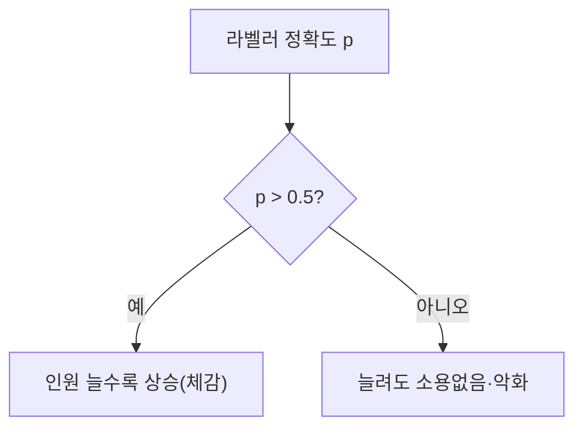

# 다수결 정확도 곡선

> 서로 독립이고 정확도가 같은(p > 0.5) 라벨러 n명이 다수결로 정할 때, 인원이 늘수록 정확도는 오르지만 증가폭은 점점 줄어든다. 중복 라벨링을 몇 명까지 할지 정하는 기초 계산이다.

## 쉽게 말하면
동전이 70% 확률로 정답 쪽으로 기우는 사람이 여러 명 있을 때, 한 명보다 세 명의 다수결이 더 맞는다. 그런데 3→5→7명으로 늘릴수록 더하는 이득은 작아진다.

## 자세히
(Sheng, Provost, Ipeirotis, "Get Another Label?", KDD 2008의 식과 직접 계산으로 확인.)
- **식**: 라벨러 수 2N+1(홀수), 각 라벨러 정확도 p이며 서로 독립일 때 다수결 정확도 q = Σ_{i=0..N} C(2N+1, i)·p^(2N+1−i)·(1−p)^i.
- **p=0.7 계산 결과(이진 분류)**: n=1 → 0.700, n=3 → 0.784, n=5 → 0.837, n=7 → 0.874, n=9 → 0.901, n=11 → 0.922, n=21 → 0.974, n=51 → 0.9986.
- **p ≤ 0.5이면** 인원을 늘려도 이득이 없거나 오히려 나빠진다(p<0.5면 틀린 쪽으로 수렴).
- **한계 체감**: 처음 3명 추가(1→3)가 +0.084이지만 7→9는 +0.027이다. 비용(라벨 수)에 비해 이득이 줄어드는 지점을 보고 인원을 정한다.
- **전제**: 독립·동일 정확도·이진·균형 문제. 실제는 라벨러마다 정확도가 다르고 오류가 상관된다([라벨러 독립 가정](#annotator-independence-assumption)).
- 논문 결과: 라벨 품질이 낮을 때(p=0.6 등) 반복 라벨링이 모델 정확도에 도움이 되지만 항상 그런 것은 아니다. p=0.8에서 예시 수가 적으면 한 번 라벨이 나을 수도 있다.

## 그림으로 보기

## 예시
- 라벨당 0.05달러, p≈0.7이면 3명(0.15달러)에서 0.784, 5명(0.25달러)에서 0.837 → 추가 비용 대비 +0.053 이득을 따져 결정.
- 교육 활용: 파이썬 한 줄로 표를 만들어 "몇 명까지가 경제적인가" 실습.

## 헷갈리는 것과 비교
| 개념 | 차이 |
|---|---|
| 다수결 곡선 | 독립 가정의 이론값 |
| [적응형 중복 라벨링](#adaptive-redundancy) | 어려운 항목에만 추가 라벨 |
| 콩도르세 배심원 정리 | 같은 수학적 아이디어(정치철학) |

## 더 읽을거리
- [Get Another Label? (Sheng 외, KDD 2008, NYU 아카이브 PDF)](https://archive.nyu.edu/bitstream/2451/27818/2/CPP-02-08.pdf) — 다수결 정확도 식·반복 라벨링 실험.
