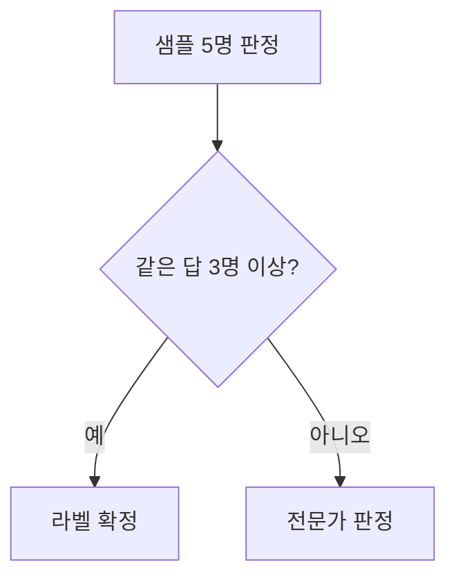
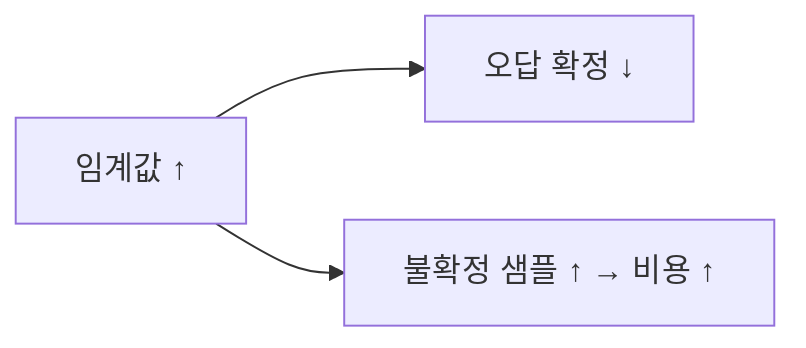

# 과반 판정 임계값(3-of-5)

> 과반 판정 임계값은 같은 샘플을 여러 작업자가 판정할 때 몇 명 이상이 같은 답을 해야 라벨을 확정할지 정하는 규칙이다(예: 5명 중 3명). 기준을 높이면 확정된 라벨은 정확해지지만 확정되지 않는 샘플이 늘어난다.

## 쉽게 말하면
배심원 5명 중 3명이 찬성하면 통과, 4명이 찬성해야 통과, 5명 전원이 찬성해야 통과 — 기준이 엄격할수록 잘못된 결정은 줄지만 결정이 아예 안 나는 사건이 늘어난다.

## 자세히
- **직접 계산(각 작업자가 독립적으로 확률 p로 정답을 낸다는 가정, 이항분포)**: "다수가 정답으로 판정"할 확률은 아래와 같다.

| 작업자 정확도 p | 1명 | 3명 중 2 | 5명 중 3 | 5명 중 4 | 5명 중 5 |
| --- | --- | --- | --- | --- | --- |
| 0.7 | 0.700 | 0.784 | 0.837 | 0.528 | 0.168 |
| 0.8 | 0.800 | 0.896 | 0.942 | 0.737 | 0.328 |
| 0.9 | 0.900 | 0.972 | 0.991 | 0.919 | 0.591 |

  3-of-5이면 p=0.8일 때 0.942로 한 명(0.80)보다 확실히 높다. 한편 임계값을 4-of-5, 5-of-5로 올리면 "정답 쪽으로 확정"되는 비율이 0.737, 0.328로 떨어지는데, 나머지는 불확정이 되어 재검수가 필요하다는 뜻이다(오답으로 확정될 확률은 별도로 아래에).
- **오답이 확정될 확률(같은 가정)**: p=0.8일 때 오답에 필요 인원이 모일 확률은 2-of-3 0.104, 3-of-5 0.058, 4-of-5 0.007이다. 임계값을 높이면 오답 확정은 크게 줄고, 대신 확정 못 하는 샘플이 늘어난다. 독립 가정은 비현실적일 수 있어(같은 편향을 공유, [주석자 공통 편향](#shared-annotator-bias)) 실제 오류는 이 표보다 크다.
- **논문 근거(Snow 외 2008, EMNLP)**: 5개 NLP 작업에서 MTurk 비전문가 라벨이 전문가 정답과 높은 일치를 보였다고 하고, 본문에서 7개 작업 평균으로 전문가 한 명과 같은 수준의 평가자 간 일치도를 내는 데 샘플당 비전문가 라벨이 약 4개면 된다고 보고한다(여러 개 라벨 평균·다수결 사용). 이 숫자는 그 연구의 작업 설정에 한정된다.
- **운영(해석)**: 기본은 3-of-5, 불확정(2-3 갈림)은 전문가 판정으로 넘긴다([이중 검수](#double-annotation-review)).

## 그림으로 보기

## 예시
- 코드: `from math import comb; sum(comb(5,k)*0.8**k*0.2**(5-k) for k in range(3,6))` → 0.942.
- 교육 활용: 작업자 정확도를 바꿔 가며 3-of-5와 4-of-5의 확정 비율과 오답률을 표로 만들어 본다.

## 헷갈리는 것과 비교
| 개념 | 차이 |
| --- | --- |
| 과반 판정 | 사람 수만 센다 |
| [CROWDLAB](#crowdlab) | 라벨 + 모델 예측을 가중 |
| [3인 다수결](#majority-vote-three-reviewers) | 3명 중 2명의 특수한 경우 |
| [작업자 품질 관리](#worker-quality-control) | 작업자 정확도 p 자체를 높이는 방법 |

## 더 읽을거리
- [Cheap and Fast — But is it Good? (Snow 외, EMNLP 2008)](https://aclanthology.org/D08-1027/) — 비전문가 라벨의 품질, 4개 라벨 ≈ 전문가 1명
