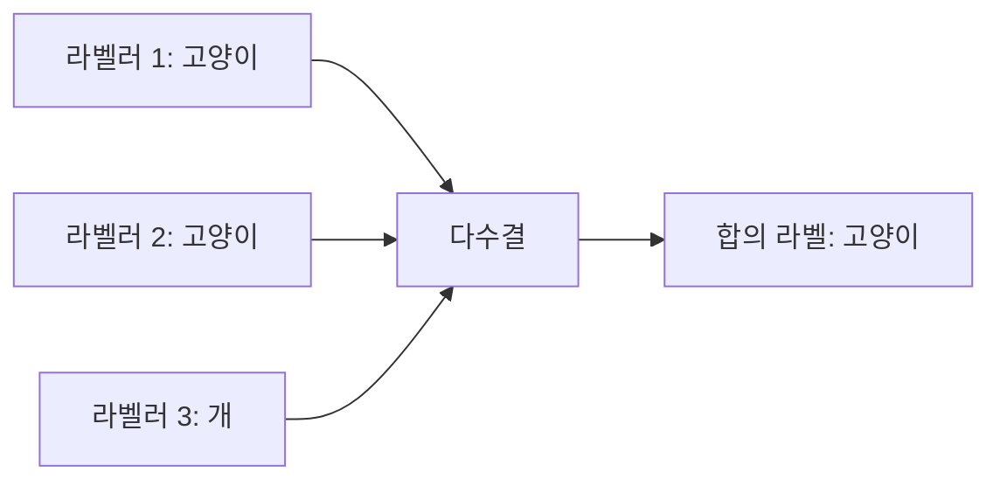
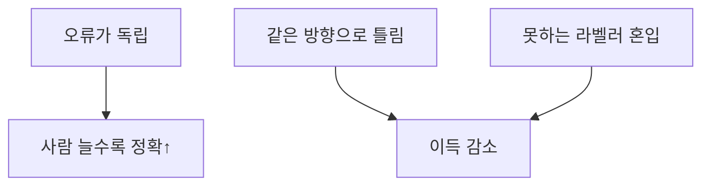

# 라벨 다수결

> 한 샘플에 여러 사람이 단 라벨 중 **가장 많이 나온 라벨**을 정답으로 삼는 가장 단순한 합의 방법이다. 라벨러 오류가 서로 독립이고 각자 정확도가 50%를 넘으면 사람이 많을수록 정확해지지만, 모두가 같은 방향으로 틀리면 효과가 크게 줄어든다.

## 쉽게 말하면
의견이 갈릴 때 손을 들어 다수를 따르는 것이다. 각자 가끔 틀려도 틀리는 방향이 제각각이면 다수는 거의 맞는다. 그러나 모두가 같은 함정에 빠지면 다수도 함정에 빠진다.

## 자세히
- **독립 오류의 이진 라벨 계산(직접 계산, 정확도 p, 라벨러 k명 홀수)**
  | 라벨러 수 | p=0.6 | p=0.7 | p=0.8 | p=0.9 |
  |---|---|---|---|---|
  | 1 | 0.600 | 0.700 | 0.800 | 0.900 |
  | 3 | 0.648 | 0.784 | 0.896 | 0.972 |
  | 5 | 0.683 | 0.837 | 0.942 | 0.991 |
  | 9 | 0.733 | 0.901 | 0.980 | 0.999 |
  | 15 | 0.787 | 0.950 | 0.996 | 1.000 |
  정확도 0.7인 라벨러 5명의 다수결은 0.837, 9명은 0.901이다. 개인 정확도가 낮을수록 더 많은 사람이 필요하다. p가 0.5 이하면 사람이 늘수록 오히려 나빠진다(Condorcet 배심 정리의 직관).
- **현실 데이터 근거(Snow et al. 2008, EMNLP "Cheap and Fast—But is it Good?", PDF 본문 확인)**: Mechanical Turk 비전문가 라벨을 다섯 자연어 과제(감정 인식, 단어 유사도, 텍스트 함의 인식, 사건 시간 순서, 단어 의미 중의성 해소)에서 전문가 골드 라벨과 비교해 높은 일치를 보였다. 7개 과제 평균으로 **예시당 비전문가 라벨 4개**를 평균하면 전문가 1명 수준의 일치도에 도달했고, 2달러로 얻은 라벨 수 기준 USD당 최소 875개의 전문가 동급 라벨이라고 보고했다. 또 라벨러 편향 보정 기법이 두 과제에서 품질을 크게 개선했다고 한다.
- **독립이 깨지면(직접 시뮬레이션, 5명 다수결)**: 쉬운 항목에서 각자 정확도 0.85, "어려운" 항목에서는 모두가 0.4(체계적으로 오도됨)라고 두면 — 어려운 항목 0%: 개인 0.851, 다수결 **0.975**. 10%: 개인 0.804, 다수결 **0.909**. 20%: 개인 0.759, 다수결 **0.839**. 어려운 항목이 늘수록 다수결의 이득이 줄었다.
- **스패머 섞임(시뮬)**: 정확도 0.9, 0.9, 0.5(무작위)인 3명 다수결은 0.900으로, 좋은 라벨러 한 명(0.897)과 거의 같았다. 못하는 라벨러가 끼면 다수결의 이득이 사라질 수 있다.
- **동률·다중 클래스**: 동률은 규칙(전문가, 모델 확률, 가장 신뢰하는 라벨러)으로 정한다. 클래스가 많으면 표가 갈려 과반이 없을 수 있다.
- **대안**: 라벨러 신뢰도 가중([다중 주석자 합의](#cleanlab-multiannotator)), 불일치만 전문가 판정([판정자 역할](#adjudicator-role)).

## 그림으로 보기

## 예시
- 감정 분류 라벨 5명 다수결: 개인 정확도 0.8이면 0.94 수준(독립 가정 시). 어려운 문장이 많으면 기대보다 낮다.
- 교육: "다수의 지혜가 통하는 조건"을 확률 계산으로 체험.

## 헷갈리는 것과 비교
| 개념 | 차이 |
|---|---|
| 다수결 | 모든 사람 동일 가중 |
| 가중 합의(CROWDLAB) | 신뢰도·모델 반영 |
| [판정자](#adjudicator-role) | 불일치만 전문가가 결정 |
| 평균(수치 라벨) | 연속값은 평균·중앙값 |

## 더 읽을거리
- [Snow et al. 2008: Cheap and Fast—But is it Good?](https://aclanthology.org/D08-1027/) — 비전문가 라벨 4개 ≈ 전문가 1명, 편향 보정(PDF 본문 확인).
- [cleanlab.multiannotator 문서](https://docs.cleanlab.ai/stable/cleanlab/multiannotator.html) — 다수결과 가중 합의 옵션.
