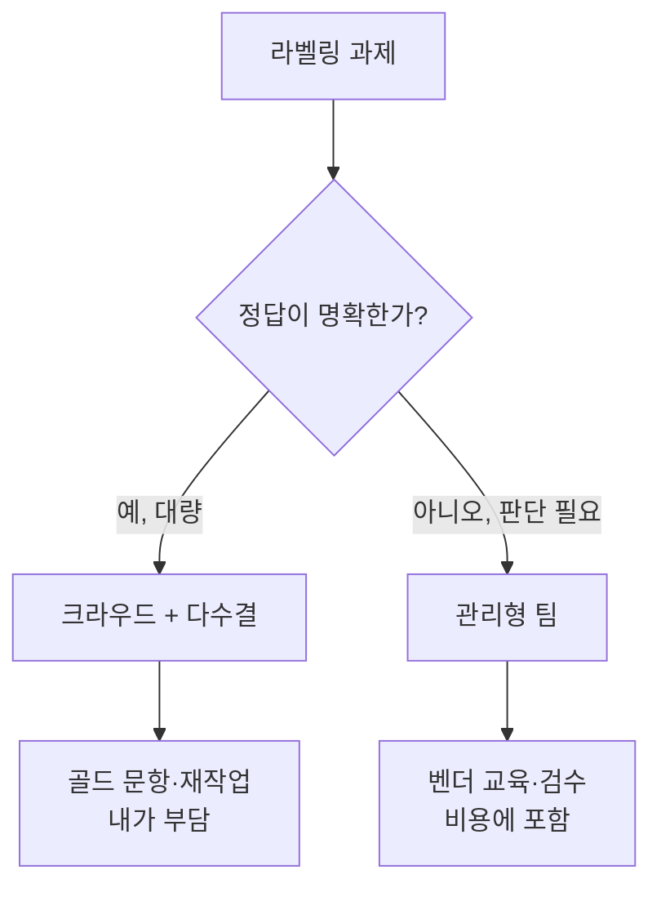
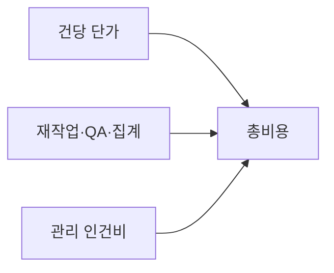

# 관리형 인력 라벨링

> 벤더나 자체 팀이 **사전 검증·교육·보정을 거친 고정 인력**으로 라벨링을 수행하는 방식이다. 건당 단가는 크라우드보다 비싸지만 품질이 안정적이고 관리 부담이 작아, 판단이 필요한 작업에 쓰인다.

## 쉽게 말하면
크라우드소싱이 "일당 알바를 그때그때 모집"이라면, 관리형은 "교육받은 계약 직원 팀"이다. 시급은 높아도 교육을 한 번만 하면 되고, 실수를 팀 리더가 잡아 주므로 검수에 드는 내 시간이 줄어든다.

## 자세히
- **구성**: 사전 심사된 작업자, 프로젝트별 교육과 보정(calibration), 팀 리더·검수 단계, 벤더의 품질 보고. 작업자가 시간이 지나도 같은 팀에 남아 일관성이 유지된다.
- **단가 vs 총비용**: Label Studio(HumanSignal) 글의 *가상 예시*에서 크라우드 건당 약 $0.04, 관리형 약 $0.18(4.5배)이었다. 그러나 크라우드는 골드 문항 제작·재작업·집계를 내 엔지니어가 떠안아 $2,000 청구서가 총 약 $14,000이 되었다고 한다. 통제된 비교가 아닌 가정이므로 방향성만 참고한다.
- **품질 근거(스폰서 연구)**: 2019년 ODSC에서 Hivemind가 발표하고 CloudFactory(관리형 인력 판매사)가 후원한 비교. 쉬운 전사에서 오류율 크라우드 7%(보수 2배 시 5% 미만) vs 관리형 0.4%, 정보 추출(11개 선택지)에서 정확도 50~60% vs 75~85%. 표본 크기는 기사에 없고 이해관계가 있는 출처다. 주장으로 읽는다.
- **언제 관리형인가**: 주관적 판단(선호도 순위·RLHF 평가), 도메인 전문성(의료·법률), 장기 일관성이 필요할 때. 바운딩 박스·이진 분류처럼 정답이 명확하고 물량이 많으면 크라우드+다수결이 싸다.
- **한계**: 확장이 느리고 최소 계약 규모가 있으며, 벤더 의존이 생긴다. 민감 데이터는 계약·접근 통제를 별도로 따져야 한다.
- **혼합**: AI 사전 라벨 후 사람이 검수([모델 보조 사전 라벨링](#model-assisted-prelabeling)). 2024 ACM 연구(Label Studio 인용)에서 MTurk 81.5%, GPT-4 83.6%, 결합 87.5%.

## 그림으로 보기

## 예시
- LLM 답변 선호도 비교 2만 건: 기준이 미묘하므로 관리형 팀에 규칙서와 보정 세션을 거쳐 맡긴다.
- 교육 소재: "싼 단가가 싼 총비용은 아니다"를 견적서 비교 실습으로.

## 헷갈리는 것과 비교
| 개념 | 차이 |
|---|---|
| [크라우드소싱 라벨링](#crowdsourcing-labeling) | 불특정 다수, 저단가·편차 큼 |
| 관리형 인력 | 고정 훈련 팀, 고단가·안정 |
| [자체 호스팅 라벨링](#self-hosted-labeling-privacy) | 데이터를 밖으로 안 보냄 |
| [라벨링 규칙서](#label-consistency-guideline) | 어느 방식이든 필수 |

## 더 읽을거리
- [Crowdsourced vs Managed Labeling (Label Studio)](https://labelstud.io/learningcenter/crowdsourced-vs-managed-labeling) — 비용·품질·사용 조건 비교(열어 확인, 벤더 글).
- [Managed team labels data with 25% higher quality (VentureBeat, CloudFactory 후원)](https://venturebeat.com/ai/ai-study-a-managed-team-labels-data-with-25-higher-quality-than-crowdsourcing) — Hivemind 비교 연구(열어 확인, 후원 콘텐츠).
