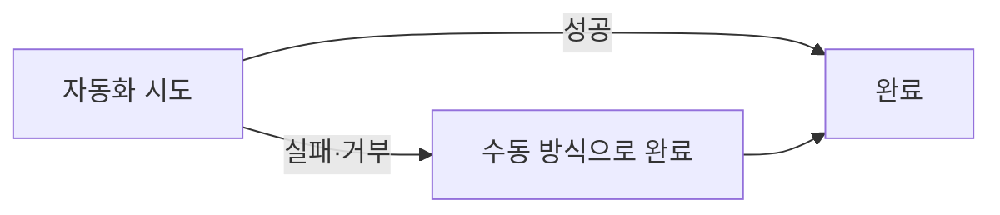

# 수동 대안

> AI 자동화가 안 되거나 사용자가 원치 않을 때 **일반적인 비자동 방식으로 같은 일을 끝낼 수 있게** 마련해 두는 안전장치다.

## 쉽게 말하면
자동문이 고장 나도 옆에 손잡이가 달린 문이 있는 것이다. 자동이 실패해도 일을 마칠 수 있어야 사용자가 갇히지 않는다.

## 자세히
(Google PAIR "Feedback + Control" 챕터를 직접 읽었다.)
- **권고(PAIR)**: 사용자가 과제를 "평소의 비자동 방식으로" 완료할 수 있는 길을 제공하라. 가이드는 이를 "안전하고 유용한 대안(fallback)"이라 부른다.
- **필요한 이유(PAIR)**: 오류가 AI 개선에 중요하기 때문에, 특히 초기에는 사용자에게 이런 안전장치가 필요하다.
- **관련**: [AI 옵트아웃](#ai-opt-out)(아예 끄기), [우아한 실패 경로](#graceful-failure-paths)(실패 시 통제권 반환).
- **설계 질문(해석)**: 자동이 막혔을 때 사용자가 같은 화면에서 수동으로 이어 갈 수 있는가? 수동 경로가 느리거나 숨겨져 있지 않은가?

## 그림으로 보기

## 예시
- 회의록 자동 요약이 실패하면 "직접 작성" 템플릿을 같은 화면에 띄운다(제안).
- 교육 소재: 자동 기능을 끄고도 업무를 끝낼 수 있는지 점검표로 확인하는 실습.

## 헷갈리는 것과 비교
| 개념 | 차이 |
|---|---|
| 수동 대안 | 자동 대신 일을 끝내는 길 |
| [AI 옵트아웃](#ai-opt-out) | AI 기능을 쓰지 않을 선택 |
| [통제 감사](#controls-audit) | 통제 수단을 점검하는 표 |

## 더 읽을거리
- [Google PAIR — Feedback + Control](https://pair.withgoogle.com/chapter/feedback-controls/) — 직접 읽음.
