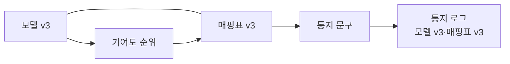
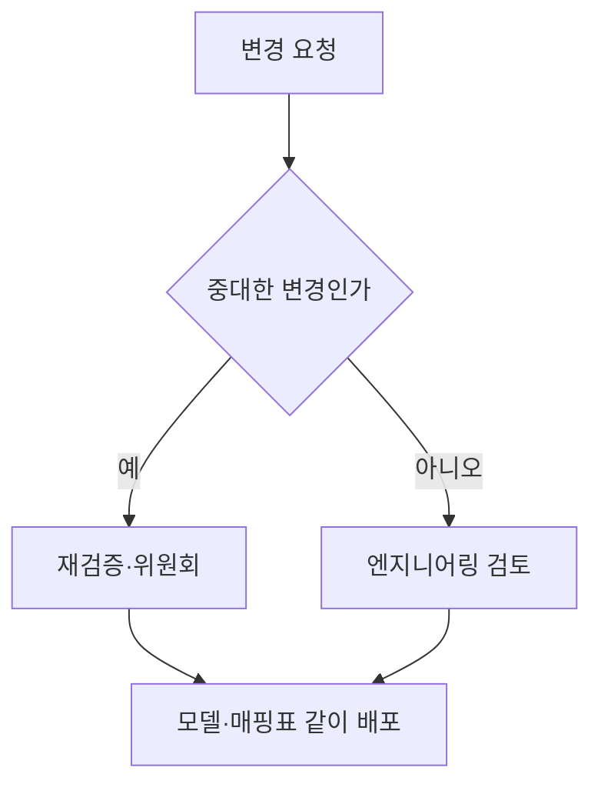

# 매핑표 버전 관리

> 변수→이유 문구 매핑표(어떤 변수 묶음이 어떤 거절 이유 문구가 되는가)를 모델 버전과 함께 관리하는 일. 모델이 바뀌었는데 문구표가 그대로면 통지서에 적힌 이유가 실제 거절 요인과 어긋나, 법이 요구하는 정확성이 깨진다.

## 쉽게 말하면
요리 레시피(모델)를 바꿨는데 메뉴판(문구표)은 옛날 그대로라면 손님은 틀린 재료 설명을 읽게 된다. 둘은 한 세트로 고치고, 언제 누가 무엇을 바꿨는지 기록해야 한다. 나중에 "2026년 3월 그 고객에게 왜 그 이유를 보냈나"를 물으면 그날의 모델과 문구표를 그대로 꺼낼 수 있어야 한다.

## 자세히
출처: 모델 리스크 관리 해설 사이트(internalauditguide, 2차 출처, 직접 읽음)와 검색 결과 요약. 매핑표 자체를 다루는 규제 문서는 찾지 못했다. 아래 운영 요령은 이 글의 제안이며 규제 요구사항으로 확인된 것이 아니다.
- **규제 배경**: 미국 은행 모델 리스크 관리 지침 SR 11-7(2011)은 2026-04-17 SR 26-2(OCC Bulletin 2026-13)로 대체됐다는 2차 보도(연준 원문 미확인). SR 11-7의 문서화 기준과 변경·구현 통제 기대는 유지됐다고 한다. 모델 인벤토리가 중심 통제이고 벤더 모델도 은행이 책임진다. 이 지침은 AI를 직접 다루지 않는다고 한다.
- **변경 관리의 일반 원칙**: 알고리즘 변경, 일정 기준 이상의 재학습, 변수 추가 같은 중대한 변경은 재검증과 위원회 검토를 촉발한다. 사소한 변경은 엔지니어링 수준에서 문서와 함께 처리(검색 결과 요약).
- **매핑표에 적용하는 방법(제안)**
  1. 모델 버전 ID ↔ 매핑표 버전 ID를 한 쌍으로 배포한다. 한쪽만 바꾸지 않는다.
  2. 매핑표는 코드처럼 저장소에서 diff로 관리하고, 변경 사유·승인자·법무 검토일을 커밋에 남긴다.
  3. 거절 통지 로그에 사용한 모델 버전, 매핑표 버전, 기여도 상위 요인을 남긴다. 분쟁 시 재현할 수 있다.
  4. 변수 묶음(그룹)이 바뀌면 이유 순위가 바뀌므로 재검증 대상으로 본다.
  5. 문구 변경 전후로 같은 샘플 건에 대해 이유가 어떻게 달라지는지 회귀 테스트를 돌린다.
  6. 문구가 사라지거나 새로 생기면 상담원 스크립트·고객센터 FAQ도 같이 갱신한다.
- **보관 기간**: 규제상 보관 기간은 상황마다 다르다. 이 글에서는 확인하지 않았다.

## 그림으로 보기

## 예시
- 새 모델이 "최근 6개월 신규 계좌 수" 변수를 추가했다. 기존 문구표에는 이 변수의 문구가 없어 이유가 "기타"로 나간다 → 새 문구를 추가하고 모델과 함께 배포하기 전에는 릴리스를 막는다.
- 2026년 3월 거절 건: 로그에 모델 v2.4, 매핑표 v2.4-r3이 남아 있으면 당시 통지를 똑같이 재현할 수 있다.

## 헷갈리는 것과 비교
| 개념 | 차이 |
|---|---|
| 매핑표 버전 관리 | 문구표를 모델과 한 세트로 이력 관리 |
| [변수→이유 문구 매핑](#reason-code-mapping) | 매핑 자체의 설계 |
| 모델 인벤토리 | 은행의 모델 목록 관리(규제 중심 통제) |
| [이유 코드](#reason-codes) | 법적 요건과 표준 항목 |

## 더 읽을거리
- [SR 11-7 and SR 26-2 Explained (internalauditguide, 2026-10)](https://internalauditguide.com/2026/10/sr-11-7-and-sr-26-2-explained/) — 대체 여부·유지된 요건(2차 출처, 연준 원문 대조 필요)
- [Model Risk Management SR 11-7 Framework (Umbrex)](https://umbrex.com/resources/frameworks/regulatory-frameworks/model-risk-management-sr-11-7-framework/) — 인벤토리·문서화 개요(검색 결과로만 확인)
