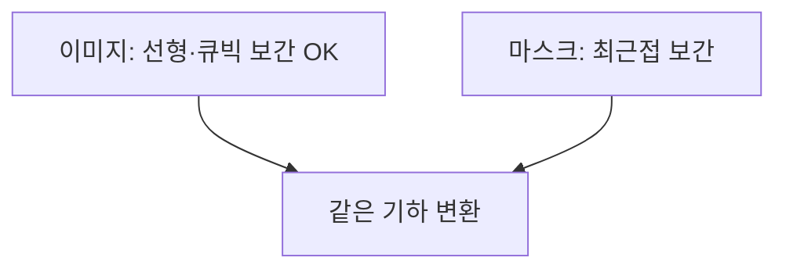

# 마스크 증강과 최근접 보간

> 이미지 세분화(semantic segmentation)의 **마스크는 각 픽셀의 클래스 번호이므로, 회전·확대할 때 최근접(nearest) 보간을 써야 한다.** 선형 보간을 쓰면 1과 3 사이에 존재하지 않는 클래스 2가 생긴다.

## 쉽게 말하면
지도에서 "숲=1, 호수=3"으로 칠한 칸이 맞닿은 곳을 부드럽게 섞으면 "2"라는 가짜 지형이 생긴다. 클래스 번호는 색의 농도가 아니라 이름표라 평균을 내면 안 된다.

## 자세히
(Albumentations 2.0.8과 OpenCV로 직접 실행. 100×100 마스크: 왼쪽 절반 클래스 1, 오른쪽 절반 클래스 3. 30도 회전)
- 이미지는 부드럽게 보간해도 되지만(선형·큐빅) 마스크 값은 범주형이다. 두 값 사이를 보간하면 **평균값이 다른 클래스 번호**가 된다.
- 실행 결과: 
  - Albumentations 기본 설정 `Rotate` → 마스크에 등장하는 값 [0, 1, 3](정상: 마스크용 보간 기본이 최근접)
  - `mask_interpolation=cv2.INTER_LINEAR`로 지정 → [0, 1, **2**, 3] (클래스 2 생성)
  - OpenCV `warpAffine` 선형 보간 → [0, 1, 2, 3], 클래스 2 픽셀이 78개 생김. 최근접 → [0, 1, 3]
- 의미: 클래스 2가 실제로 존재하는 데이터셋이라면 경계 픽셀이 "2"로 학습돼 경계가 틀린 라벨이 되고, 존재하지 않으면 범위 밖 클래스 오류나 조용한 학습 오염이 된다. 경계에서 0(배경)과의 보간도 비슷한 문제를 만든다(0↔3 사이 1·2).
- Albumentations는 `Rotate`에 `interpolation`(이미지용)과 `mask_interpolation`(마스크용)을 따로 받는다. 이 버전의 기본값이 마스크에 최근접을 쓴 것은 실험으로 확인했지만, 다른 라이브러리·직접 구현에서는 기본값이 다를 수 있다.
- 점검(제안): 증강 뒤 `np.unique(mask)`가 원래 클래스 집합의 부분집합인지 단위 테스트로 확인한다. 원-핫/확률 마스크를 쓰면 채널별 선형 보간 후 argmax도 가능하지만 클래스 경계 처리를 따로 검토한다.

## 그림으로 보기



## 예시
```python
A.Rotate(limit=30, interpolation=cv2.INTER_LINEAR,
         mask_interpolation=cv2.INTER_NEAREST)
```
- 의료 영상 장기 분할에서 회전 증강 후 `np.unique(mask)` 확인.
- 교육: 범주형 데이터에 평균을 쓰면 안 된다는 예.

## 헷갈리는 것과 비교
| 개념 | 차이 |
|---|---|
| 이미지 보간 | 부드럽게 해도 됨 |
| 마스크 보간 | 최근접만(범주 값 보존) |
| [박스 증강](#bbox-coordinate-formats) | 좌표를 변환하며 형식과 가시성을 관리 |

## 더 읽을거리
- [Albumentations 문서](https://albumentations.ai/docs/) — Rotate의 interpolation·mask_interpolation(설치해 확인·실행).
