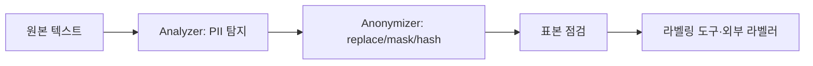
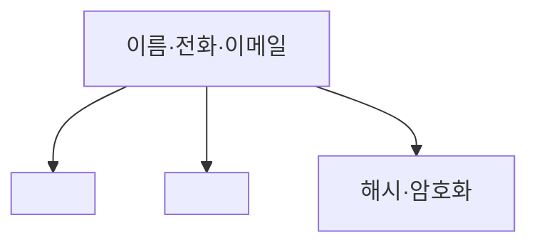

# 라벨링 전 마스킹

> 외부 라벨러나 라벨링 도구에 데이터를 올리기 전에 이름·전화번호 같은 개인정보(PII)를 자동 탐지해 가리거나 치환하는 전처리 단계다. Microsoft Presidio 같은 오픈소스를 쓴다.

## 쉽게 말하면
이삿짐센터에 짐을 맡기기 전에 서류 속 주민번호를 먼저 지워 두는 것과 같다. 일을 맡기는 쪽이 가져가는 정보 자체를 줄인다.

## 자세히
(Presidio 공식 문서 첫 페이지와 Anonymizer 페이지를 직접 열어 확인. 문서 주소는 이전 microsoft.github.io에서 presidio.dataprivacystack.org로 이동.)
- **구성**: **Analyzer**(텍스트에서 PII 식별)와 **Anonymizer**(찾은 개체를 연산자로 비식별화). 텍스트·이미지 모두 다루며, 탐지는 **NER·정규식·규칙·체크섬 검증·문맥**을 결합하고 다국어를 지원한다.
- **Anonymizer 연산자**: `replace`(기본은 `<PHONE_NUMBER>` 같은 자리표시), `redact`(삭제), `hash`(sha256 기본, sha512, 솔트), `mask`(chars_to_mask·masking_char·from_end), `encrypt`(키로 암호화; `decrypt`로만 되돌림), `custom`(함수), `keep`, `surrogate_ahds`(Azure Health Data Services).
- **한계**: 공식 문서가 "Presidio가 모든 민감 정보를 찾는다는 보장은 없다"고 밝히며 추가 안전장치를 쓰라고 한다. 한국어 이름·주민번호 등은 인식기 추가 설정이 필요할 수 있다(제안, 확인 안 함).
- **절차(제안)**: ① 전처리 마스킹 ② 표본 점검(놓친 PII 확인) ③ 업로드 ④ 원본↔마스킹 매핑은 사내에만 보관. 마스킹이 라벨링 품질을 해치지 않는지(맥락 손실) 작은 표본으로 확인한다.

## 그림으로 보기

## 예시
- 상담 로그의 고객 이름·전화번호를 `<PERSON>`, `<PHONE_NUMBER>`로 치환한 뒤 감정 라벨링을 외주.
- 교육 활용: 마스킹 전후 문장을 비교하며 "어디까지 가려야 안전한가" 토론.

## 헷갈리는 것과 비교
| 개념 | 차이 |
|---|---|
| 마스킹(replace/mask) | 값을 가리거나 자리표시로 대체 |
| 가명화(hash) | 같은 값은 같은 해시, 연결 가능 |
| 암호화 | 키가 있으면 복원 가능 |

## 더 읽을거리
- [Presidio 문서](https://presidio.dataprivacystack.org/) — Analyzer·Anonymizer 개요와 면책.
- [Presidio Anonymizer](https://presidio.dataprivacystack.org/anonymizer/) — 연산자 목록.
