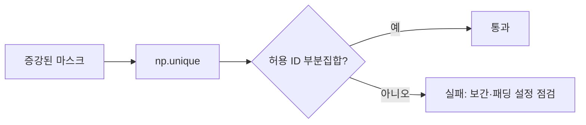
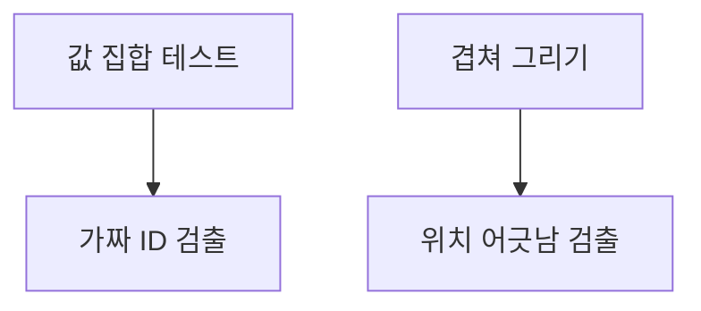

# 마스크 값 집합 테스트

> 세그멘테이션 증강 뒤 **마스크에 들어 있는 값의 집합이 원래 클래스 ID 집합의 부분집합인지 `np.unique`로 검사하는** 단위 테스트다. 보간 오류로 생긴 가짜 클래스 ID를 바로 잡아낸다.

## 쉽게 말하면
시험 답안지 번호가 1~5인데 채점 기계가 7번이라고 읽었다면 오류임을 바로 안다. 마스크의 허용 번호 목록을 정해 두고 증강 결과가 그 목록 밖인지 검사하는 일이다.

## 자세히
- 배경: [이미지·마스크 보간 분리](#image-vs-mask-interpolation) 실험에서 클래스 ID 0·1·5·9의 마스크에 선형 보간을 쓰면 고유 값이 10개로 늘고, 3차 보간은 12개(원래 최대 9 초과)가 되었지만 코드는 오류 없이 끝났다.
- 테스트 규칙(제안): ① 증강 전 마스크의 허용 ID 집합 S를 구한다(또는 데이터셋 정의에서 가져온다) ② 증강 후 `set(np.unique(aug_mask)) ⊆ S`를 단언 ③ dtype·shape가 기대와 같은지 함께 검사.
- 실제 결과로 보면 NEAREST는 `[0, 1, 5, 9]`로 통과, LINEAR는 `{2,3,4,6,7,8}`이 추가되어 실패한다(직접 실험, Albumentations 2.0.8).
- 패딩 값 주의: 회전·이동으로 생긴 빈 영역은 `fill_mask` 등 패딩 값이 들어간다. 이 값이 "배경 ID"인지 "무시(ignore) ID(예: 255)"인지 정하고, 허용 집합에 포함한다(제안).
- 비용이 매우 작다: 샘플 몇 백 개에 CI 테스트로 돌리거나 데이터 로더 디버그 모드에서 매 배치 검사.
- 한계: 값 집합만 보므로 클래스가 **엉뚱한 위치로 이동**한 오류(이미지와 마스크의 변환 불일치)는 못 잡는다. 이때는 이미지 위에 마스크를 겹쳐 그려 보는 시각 점검이 필요하다([박스 그려 보기 점검](#draw-bbox-sanity-check)과 같은 정신).

## 그림으로 보기



## 예시
```python
allowed = {0, 1, 5, 9}
out = aug(image=img, mask=mask)["mask"]
assert set(np.unique(out)) <= allowed, np.unique(out)
```
- 교육: "한 줄 단언으로 조용한 버그를 시끄럽게 만든다"는 테스트 습관 사례.

## 헷갈리는 것과 비교
| 개념 | 차이 |
|---|---|
| 마스크 값 집합 테스트 | 가짜 클래스 ID 검출 |
| 겹쳐 그리기 | 이미지·마스크 위치 일치 확인 |
| [증강 단위 테스트](#augmentation-unit-test) | 이 테스트를 포함한 증강 검증 전반 |

## 더 읽을거리
- [NumPy unique](https://numpy.org/doc/stable/reference/generated/numpy.unique.html) — `np.unique` 사용법.
- 직접 실행: Albumentations 2.0.8 보간별 고유 값 비교.
