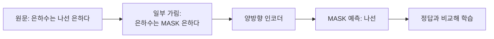

# 마스크드 언어 모델링 (MLM)

> 문장의 일부 토큰을 가리고(`<mask>`) 원래 토큰을 맞히게 하며 학습하는 자기지도 사전학습 방식으로, 양방향 문맥을 쓰는 BERT류 인코더가 대표적이다.

## 쉽게 말하면
빈칸 채우기 문제집으로 공부하는 것이다. 빈칸 앞뒤 문맥을 모두 보고 정답을 추론하므로 문장 이해력이 좋아진다. 반대로 GPT류는 "다음 말 이어 쓰기"로 공부한다.

## 자세히
Hugging Face 문서(2026-11 확인):
- MLM은 가려진 토큰을 예측하며 모델이 **좌우 토큰을 모두 볼 수 있다**(양방향). 문장 전체의 문맥 이해가 필요한 작업에 적합하며 BERT가 예.
- 라벨이 따로 필요 없다 — 다음(또는 가려진) 단어 자체가 정답인 **자기지도 학습**.
- 데이터 콜레이터 예: `DataCollatorForLanguageModeling(tokenizer, mlm_probability=0.15)`(예시 설정값 15%), 반복마다 무작위로 가린다.
- 추론: `pipeline("fill-mask", ...)`로 `"The Milky Way is a <mask> galaxy."` → 후보 `spiral`(약 0.52), `massive`, `small`.
- 평가 지표 예: 퍼플렉서티(문서 예시 8.76).
- 대조: 인과 언어 모델링(CLM)은 미래를 가리고 다음 토큰을 예측 → 생성에 적합. MLM 인코더는 임베딩·분류·개체 인식에 쓰인다.

## 그림으로 보기

## 예시
`fill-mask` 파이프라인으로 문장 빈칸의 상위 3개 후보와 점수를 확인해 모델이 문맥을 어떻게 이해하는지 실습.

## 헷갈리는 것과 비교
| 개념 | 차이 |
|---|---|
| MLM | 가린 토큰 맞히기, 양방향, 인코더 |
| 인과 LM | 다음 토큰 예측, 단방향, 디코더 |
| [attention mask](#attention-mask) | 어텐션 가림 — 학습 과제와 별개 |
| [사전학습](#pretraining) | MLM은 사전학습 목표의 한 종류 |

## 더 읽을거리
- [Masked language modeling (Hugging Face)](https://huggingface.co/docs/transformers/tasks/masked_language_modeling) — 실습 코드와 fill-mask.
- [Glossary](https://huggingface.co/docs/transformers/glossary) — MLM·자기지도 학습 정의.
