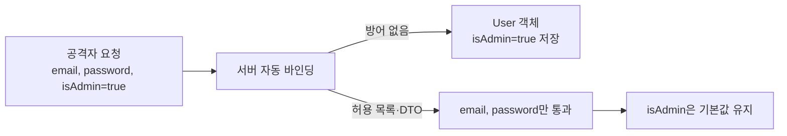

# 대량 할당 취약점 (Mass Assignment)

> 프레임워크가 요청 파라미터를 객체 필드에 자동으로 통째 바인딩할 때, 개발자가 열어 둘 생각이 없던 필드(권한·가격 등)까지 공격자가 덮어쓰는 취약점이다.

## 쉽게 말하면
회원가입 서류에 "이름·이메일·비밀번호"만 적게 했는데, 접수 직원이 서류에 적힌 건 뭐든 시스템에 그대로 입력해 준다고 해 보자. 누군가 서류 구석에 "관리자: 예"라고 적어 내면 그대로 관리자가 된다. 이것이 대량 할당이다. 바이브코딩에서 AI가 `User.create(req.body)` 한 줄로 편하게 짜 주는 코드가 정확히 이 모양이다.

## 자세히
OWASP Mass Assignment Cheat Sheet(2026-11 확인)의 정리:
- **다른 이름**: autobinding(Spring MVC·ASP.NET MVC), object injection(PHP).
- **원리**: 요청 본문의 키를 모델 객체의 속성에 자동 매핑 → `isAdmin=true` 같은 필드를 추가하면 그대로 저장된다.
- **방어 1, DTO**: 입력을 받는 전용 객체에 사용자가 고칠 수 있는 필드만 둔다. 도메인 모델에 직접 바인딩하지 않는다.
- **방어 2, 허용 목록**: 바인딩 가능한 필드를 명시한다. 차단 목록은 나중에 민감 필드가 추가되면 구멍이 되므로 허용 목록을 권장한다.
- **방어 3, 권한 검사 병행**: DTO·허용 목록은 쓰기 가능한 필드를 줄일 뿐, "이 사용자가 이 객체를 수정해도 되는가"를 대신 검사해 주지 않는다.
- **프레임워크별 기능**: Spring `setAllowedFields`, Laravel `$fillable`/`$guarded`, Rails strong parameters, Mongoose 스키마 선택 등.

## 그림으로 보기

## 예시
- 위험한 코드(Express + Mongoose): `await User.create(req.body)`
- 안전한 코드: `const { email, password } = req.body; await User.create({ email, password })`
- AI에게 이렇게 요청: "회원가입·프로필 수정 API에서 사용자가 바꿀 수 있는 필드만 허용 목록으로 받게 하고, role·price·isAdmin은 서버에서만 정하게 고쳐 줘."

## 헷갈리는 것과 비교
| 개념 | 차이 |
|---|---|
| 대량 할당 | 허용하지 않은 필드가 자동 바인딩되어 덮어써짐 |
| [허용 목록 검증](#allow-list-validation) | 대량 할당을 막는 핵심 방어 기법 |
| [거부 목록 우회](#denylist-bypass) | 차단 목록 방식이 약한 이유 |
| [SQL 인젝션](#sql-injection) | 쿼리 문자열을 조작하는 공격 — 필드를 조작하는 것과 다름 |

## 더 읽을거리
- [OWASP Mass Assignment Cheat Sheet](https://cheatsheetseries.owasp.org/cheatsheets/Mass_Assignment_Cheat_Sheet.html) — 정의·DTO·허용 목록·프레임워크별 방어.
