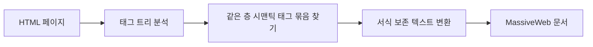
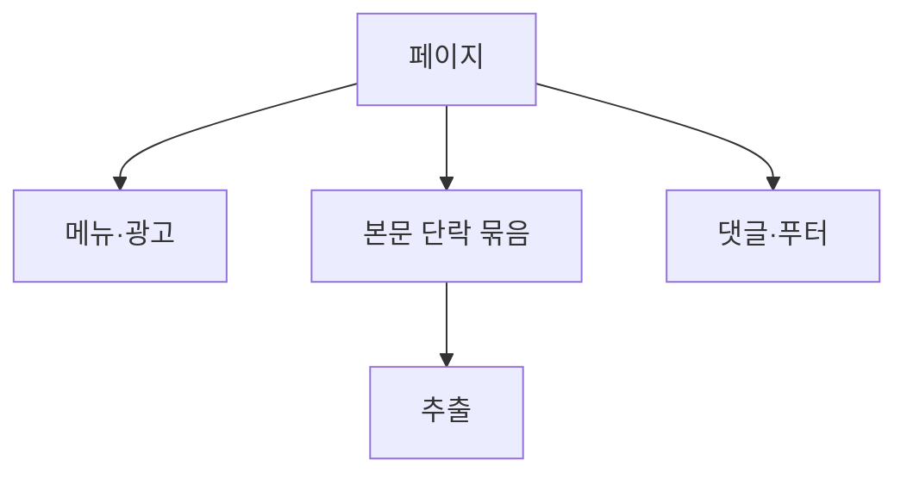

# MassiveWeb HTML 구조 추출

> HTML 태그 트리에서 같은 층에 모여 있는 의미 있는 태그 묶음을 본문 블록으로 보고 일반 텍스트로 바꾸는, Gopher의 MassiveWeb이 쓴 추출 방식이다.

## 쉽게 말하면
신문 지면에서 광고·메뉴·댓글을 빼고 "기사 단락이 줄지어 있는 영역"만 오려 내는 일이다. 글자 내용을 읽는 게 아니라 페이지의 뼈대(구조)를 보고 판단한다.

## 자세히
(Gopher 논문 arXiv 2112.11446 부록 A.1 "Text Extraction"을 직접 읽고 확인.)
- 고품질 웹 페이지에서는 **독립적이고 일관된 핵심 글 덩어리가 HTML 트리의 같은 층 시맨틱 태그 그룹**으로 나타난다고 관찰했다.
- 그런 태그 집합을 찾아 일반 텍스트로 변환하되 **들여쓰기·줄바꿈·글머리표** 같은 의미 있는 서식을 보존한다.
- 저자 주장: 이렇게 얻은 문서의 다양한 서식이 Gopher 모델의 생성 능력에 잘 옮겨진다.
- MassiveText 하위 집합 중 **MassiveWeb에만** 적용된다(Books·News·Code·C4·Wikipedia에는 해당 없음). MassiveWeb은 학습 데이터의 48%.
- 구체 알고리즘(태그 목록, 임계값)은 부록에 없다. 같은 계열 도구로는 trafilatura 같은 오픈소스 추출기가 있다(제안).
- 비교점: Common Crawl의 WET 텍스트는 서식을 단순화한 텍스트라 구조가 없다(제안).

## 그림으로 보기

## 예시
- 사내 위키 HTML에서 본문 블록과 목차·사이드바를 구분해 텍스트로 뽑기.
- 교육 활용: "웹 페이지 ≠ 글. 본문 추출이 데이터 품질의 첫 단추"라는 설명 소재.

## 헷갈리는 것과 비교
| 개념 | 차이 |
|---|---|
| 구조 기반 추출 | 태그 트리로 본문 판단 |
| 전체 텍스트 덤프 | 메뉴·광고까지 포함 |
| [Gopher 품질 휴리스틱](#gopher-quality-heuristics) | 추출 후 걸러내기 단계 |

## 더 읽을거리
- [Gopher (arXiv 2112.11446)](https://arxiv.org/abs/2112.11446) — 부록 A.1 Text Extraction 단락.
