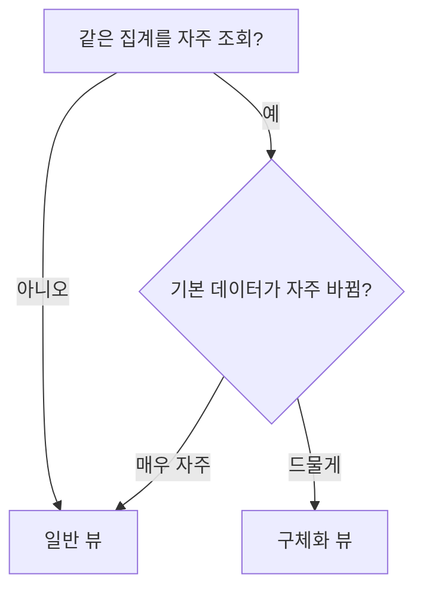

# 구체화 뷰

> 쿼리 **결과를 미리 계산해 표처럼 저장**해 두고, 같은 질문이 오면 다시 계산하지 않고 저장본을 읽게 하는 DB 기능이다. 빠른 대신 저장 비용과 갱신 비용이 든다.

## 쉽게 말하면
매일 같은 매출 합계를 계산하느라 장부 수천 쪽을 넘기는 대신, 합계만 적은 요약표를 따로 두는 것이다. 장부에 거래가 추가되면 요약표도 고쳐 줘야 하는데, 그 수고와 종이값이 구체화 뷰의 비용이다.

## 자세히
- **일반 뷰와 차이**: 일반 뷰는 쿼리만 저장하고 매번 실행한다. 구체화 뷰는 결과 데이터를 저장한다(Snowflake 문서). 결과가 드물게 바뀌고 자주 조회되며 쿼리가 무거울 때 유리하고, 자주 바뀌거나 가끔 쓰면 일반 뷰가 낫다.
- **Snowflake(Enterprise Edition 이상)**: 백그라운드 서비스가 자동 유지한다. 삽입은 refresh, 삭제는 compaction을 일으킨다. 뷰가 뒤처지면(`BEHIND_BY`) 변경분을 기본 테이블에서 읽어 결과는 최신이지만 느려질 수 있다. 저장 비용과 서버리스 갱신 크레딧을 낸다. 제약: 단일 테이블만, 조인·윈도 함수·HAVING·ORDER BY·UDF 불가, 비결정 함수 불가.
- **BigQuery**: 기본은 **증분(incremental) 갱신**, 즉 새 변경분만 반영한다. 비증분 정의는 `allow_non_incremental_definition = true`가 필요하고 갱신마다 전체를 다시 돈다. `max_staleness`는 30분~3일. 기본 테이블이 바뀌어 뷰가 못 따라가면 기본 테이블을 직접 읽어 최신성을 보장한다. **smart tuning**: 기본 테이블에 보낸 쿼리를 자동으로 뷰로 돌려 쿼리를 고치지 않아도 된다(증분 뷰만).
- **트레이드오프 요약**: 읽기 속도·스캔량 절감 ↔ 저장비·갱신 컴퓨트·최신성 지연·SQL 제약. 기본 테이블 컬럼 변경이나 삭제 시 뷰를 다시 만들어야 할 수 있다.
- 이 문서의 수치는 2026-11 시점 공식 문서 기준이며 에디션별 지원은 달라질 수 있다.

## 그림으로 보기

## 예시
- 대시보드가 매 접속마다 수억 행에서 `일별 매출 합계`를 계산 → 구체화 뷰로 저장해 스캔량과 응답 시간을 줄인다.
- AI 데이터 파이프라인에서 학습용 피처 집계를 반복 조회할 때 활용. 단 최신성 허용 범위(`max_staleness`)를 먼저 정한다.

## 헷갈리는 것과 비교
| 개념 | 차이 |
|---|---|
| 일반 뷰 | 쿼리만 저장, 매번 실행. 저장·갱신 비용 없음 |
| 구체화 뷰 | 결과 저장, 자동 갱신 비용 있음 |
| [질의 가속](#query-acceleration) | 구체화 뷰는 그 수단 중 하나(파티셔닝·클러스터링·인덱스·캐시와 병렬) |
| 캐시 | 임시·휘발성. 구체화 뷰는 정의가 있고 DB가 유지 |

## 더 읽을거리
- [Snowflake: Working with Materialized Views](https://docs.snowflake.com/en/user-guide/views-materialized) — 유지·비용·제약 공식 문서.
- [BigQuery: Introduction to materialized views](https://docs.cloud.google.com/bigquery/docs/materialized-views-intro) — 증분 갱신, smart tuning, max_staleness.
