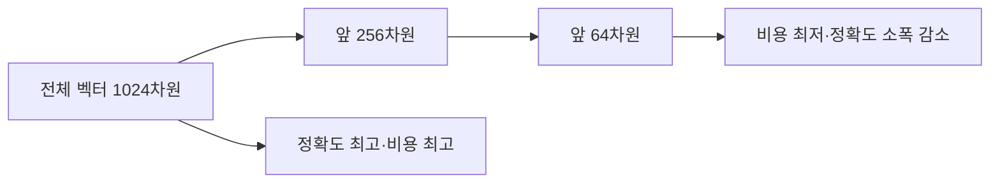
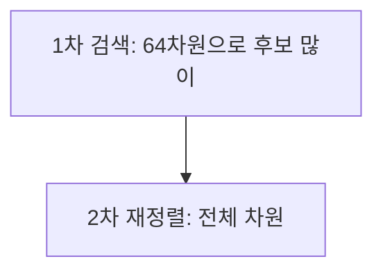

# 마트료시카 임베딩

> **마트료시카 표현 학습(MRL)** 은 한 임베딩 벡터가 **앞부분만 잘라 써도** 쓸 만하도록 **굵은 정보부터 세밀한 정보 순으로** 담는 학습법이다. 용도에 따라 차원을 줄여 저장·검색 비용을 아낀다.

## 쉽게 말하면
러시아 인형 마트료시카처럼, 큰 인형 안에 작은 인형이 들어 있다. 긴 벡터(큰 인형)가 필요 없으면 앞쪽 일부(작은 인형)만 꺼내 써도 의미가 보존된다.

## 자세히
(Kusupati 외, arXiv 2205.13147 초록 확인)
- 하나의 임베딩이 **여러 해상도**의 정보를 담아 다운스트림 과제의 연산 예산에 맞춰 **줄여 쓸 수** 있다.
- 기존 학습 파이프라인을 **조금만 고치면** 되고, **추론·배포 비용이 추가되지 않는다.**
- 굵은 것에서 세밀한 것 순으로 쌓인 임베딩이 **따로 학습한 저차원 임베딩과 같거나 더 낫다.**
- 보고된 결과: ImageNet-1K 분류에서 같은 정확도로 임베딩 크기 **최대 14배 축소**, ImageNet-1K·4K 대규모 검색에서 실제 속도 **최대 14배**, 롱테일 퓨샷 분류 정확도 **최대 2%p** 향상, 견고성은 원본 수준. ViT·ResNet(비전), ALIGN(비전-언어), BERT(언어)로 웹 규모까지 확장됨을 보고한다.
- 실무(일반 지식): 일부 임베딩 서비스가 차원 축소 옵션을 제공한다. 쓰기 전 해당 모델이 MRL로 학습됐는지 문서에서 확인한다.

## 그림으로 보기



## 예시
```python
vec = embed(text)            # 1024차원 (MRL 지원 모델 가정)
small = vec[:256]
small = small / (sum(x*x for x in small) ** 0.5)   # 정규화 후 사용
```
- 벡터 DB 비용 절감: 256차원으로 저장하고 상위 후보만 전체 차원으로 재정렬.

## 헷갈리는 것과 비교
| 개념 | 차이 |
|---|---|
| 마트료시카 임베딩 | 앞부분 잘라 써도 유지되게 학습 |
| 일반 임베딩 차원 축소(PCA) | 사후 변환 |
| 양자화 | 값 정밀도를 낮춤 |
| [임베딩 모델 고르기](#embedding-model-selection) | 모델 선택 기준 |

## 더 읽을거리
- [Matryoshka Representation Learning](https://arxiv.org/abs/2205.13147)
