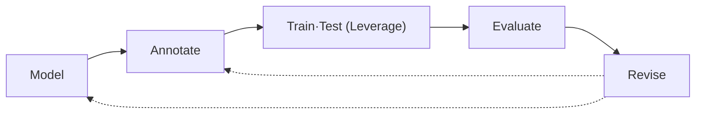
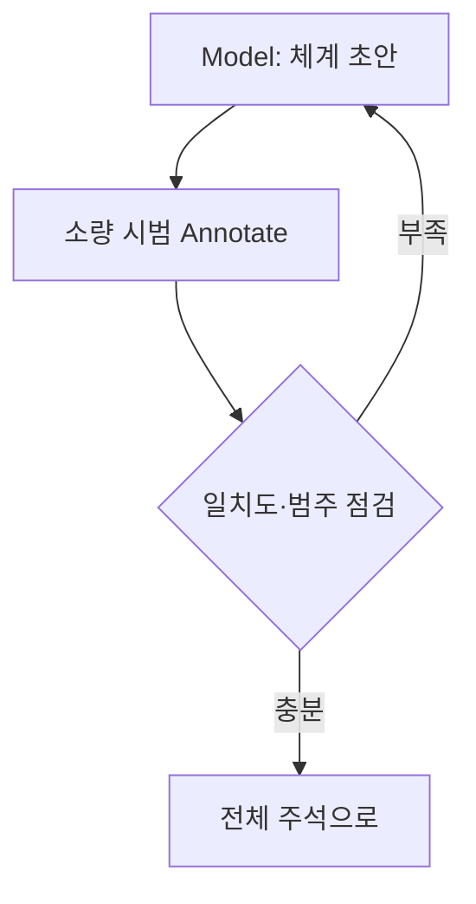

# MATTER·MAMA 순환

> MATTER는 Model(모델링)·Annotate(주석)·Train(학습)·Test(시험)·Evaluate(평가)·Revise(개정)의 여섯 단계로 주석 프로젝트를 조직하는 순환이다(Pustejovsky & Stubbs). MAMA(Model-Annotate-Model-Annotate)는 프로젝트 초반에 모델과 소량 시범 주석을 오가며 주석 체계를 다듬는 작은 순환이다.

## 쉽게 말하면
식당을 열기 전에 메뉴(모델)를 만들고, 손님 몇 명에게 시식(시범 주석)시켜 보고, 메뉴를 고치고 다시 시식하는 일이 MAMA다. 메뉴가 안정된 뒤에야 본격적으로 요리(전체 주석)를 시작한다.

## 자세히
- **MATTER 여섯 단계(Finlayson & Erjavec, arXiv 1602.05753 요약)**:
  - **Model**: 현상에 대한 이론 조사, 추상 모델과 주석 체계(scheme) 정의, 주석 대상 자료 수집, 사양서 작성.
  - **Annotate**: 훈련된 여러 주석자가 라벨을 적용. 지침 작성, 주석자 모집·훈련(허용 가능한 일치도에 이를 때까지), 진행 감시, 일치도 추적, 지침 버전 관리, 여러 주석을 판정자가 골드 스탠더드로 병합.
  - **Train / Test**: 주석을 이용한 기계학습 모델 학습·시험. 위 논문은 목적이 꼭 학습만은 아니라서 이 둘을 **Leverage**(활용)로 일반화한다.
  - **Evaluate**: 데이터 탐색·시각화, 정확도·정밀도·재현율 같은 통계, 혼동 행렬·오류 유형.
  - **Revise**: 평가 결과가 만족스럽지 않으면 앞 단계 중 하나로 돌아간다. 독립 단계라기보다 되돌아가는 화살표다.
- **MAMA 하위 순환(같은 논문)**: 프로젝트 초반 모델을 개발하는 동안 모델링과 시범 주석 사이를 반복해, 전체 코퍼스에 시간을 쓰기 전에 주석 체계 품질을 높인다. 가설을 세우고 사양서와 안내서로 옮긴 뒤 몇 명을 훈련해 소량을 주석시키고, 직접 또는 일치도(IAA)로 점검한다. 중요한 범주가 빠졌거나 일치도가 너무 낮으면 모델로 돌아간다. 모델은 괜찮은데 지침이 모자라면 주석 단계 안의 더 작은 순환에서 지침을 명확하게 고친다.
- **확장(같은 논문)**: MATTER만으로 프로젝트 전체를 덮지 못한다며 Idea, Procure, Distribute 세 단계를 더 제안한다.
- **이 지도와의 연결(해석)**: [라벨러 훈련 라운드](#annotator-training-rounds)는 Annotate 안의 작은 순환, [시범 라운드 종료 조건](#round-stopping-criteria)은 MAMA를 언제 끝낼지의 문제다.

## 그림으로 보기

## 예시
- 고객 문의 분류 라벨링: 범주 8개 초안으로 50건 시범 → 일치도 낮은 두 범주를 합치고 → 다시 50건 시범 → 통과하면 전체 1만 건 시작.
- 교육 활용: 학습자가 주제를 하나 정해 범주를 만들고 MAMA를 두 바퀴 돌려 본다.

## 헷갈리는 것과 비교
| 개념 | 차이 |
| --- | --- |
| MATTER | 전체 6단계 순환 |
| MAMA | 초반 모델링과 시범 주석의 작은 순환 |
| [라벨러 훈련 라운드](#annotator-training-rounds) | 주석자 일치도를 맞추는 반복 |
| [정리→재학습 라운드](#relabel-retrain-rounds) | 라벨 오류 정리 후 모델 재학습 반복 |

## 더 읽을거리
- [Overview of Annotation Creation: Processes & Tools (Finlayson & Erjavec, arXiv 1602.05753)](https://arxiv.org/abs/1602.05753) — MATTER·MAMA 설명, 추가 단계
