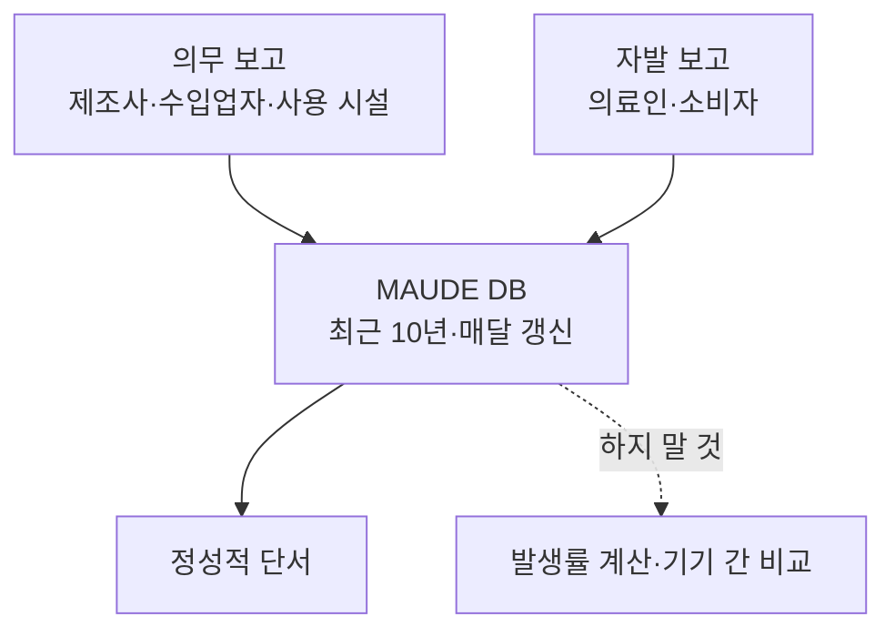

# MAUDE

> Manufacturer and User Facility Device Experience. FDA가 공개하는 의료기기 이상 사례 보고(MDR) 데이터베이스. 최근 10년 치 보고를 담고 매달 갱신되며, **발생률 계산이나 기기 간 비교에는 쓰면 안 된다**고 FDA가 명시한다.

## 쉽게 말하면
소비자 불만 접수함이다. 어디에서 어떤 불만이 접수됐는지는 알 수 있지만, 접수 건수로 "어느 제품이 더 위험한가"를 순위 매기면 안 된다. 신고하는 사람이 얼마나 많은지, 제품이 얼마나 팔렸는지가 전혀 반영되지 않기 때문이다.

## 자세히
출처: FDA "About MAUDE" 페이지(열어서 읽음).
- **내용**: 최근 10년의 MDR 데이터를 담고, 직전 달 말일까지 접수된 보고로 매달 갱신된다. 2019-06 이전의 오래된 보고와 면제 기반 보고 일부는 빠져 있을 수 있고 MDR Data Files에서 받을 수 있다(자발적 보고는 1993년부터).
- **항목**: 기기·환자 문제 코드, 사건 서술, 기기 세부 정보, 환자의 나이·성별·체중·인종·민족. FOIA에 따라 영업 비밀 "(b)(4)"와 개인 정보 "(b)(6)"는 가려진다.
- **보고 출처**: 의무(제조사·수입업자·기기 사용 시설)와 자발(의료인·소비자 등), 유통업자, 자기가 만들지 않은 기기 정보를 전달한 제조사.
- **FDA가 밝힌 한계**:
  - 이상 사례 **발생률** 평가, 시간에 따른 변화 추적, **기기 간 비교**에 쓰지 말 것.
  - 보고 하나가 기기가 사건을 일으켰거나 기여했음을 **보여 주지 않는다**.
  - 단독으로 발생률·유병률·원인을 알 수 없다. 이유: 과소 보고, 부정확한 보고, 검증 부족, 기기 사용 빈도 자료 부재.
  - MDR은 FDA의 여러 시판 후 감시 출처 중 하나이며, 보고 제출 자체가 기기나 보고자가 사건을 일으켰다는 인정은 아니다(21 CFR 803.16).
- **AI 기기 조사에서**: product code로 검색해 어떤 유형의 문제가 보고되는지 훑는 정성적 단서로 쓰고, 건수 비교로 안전성을 말하지 않는다([제품 코드](#product-code), [MDR 보고](#mdr-reporting)).

## 그림으로 보기

## 예시
- 한 AI 영상 소프트웨어의 문제 코드를 훑어 "입력 파일 형식 오류" 보고가 반복되는지 확인하고 제조사에 질문.
- 잘못된 사용: A사 보고 20건, B사 5건이니 A가 4배 위험하다고 결론내기(판매량·보고율이 다름).

## 헷갈리는 것과 비교
| 개념 | 차이 |
|---|---|
| MAUDE | 이상 사례 보고가 모이는 공개 DB |
| [MDR 이상 사례 보고](#mdr-reporting) | 보고를 의무화하는 제도 |
| 리콜 DB | 회수·시정 조치 기록 |
| [FDA 기기 데이터베이스](#fda-device-database) | 여러 DB 중 하나 |

## 더 읽을거리
- [About MAUDE (FDA)](http://www.fda.gov/medical-devices/mandatory-reporting-requirements-manufacturers-importers-and-device-user-facilities/about-manufacturer-and-user-facility-device-experience-maude-database) — 내용·출처·한계(열어서 확인)
