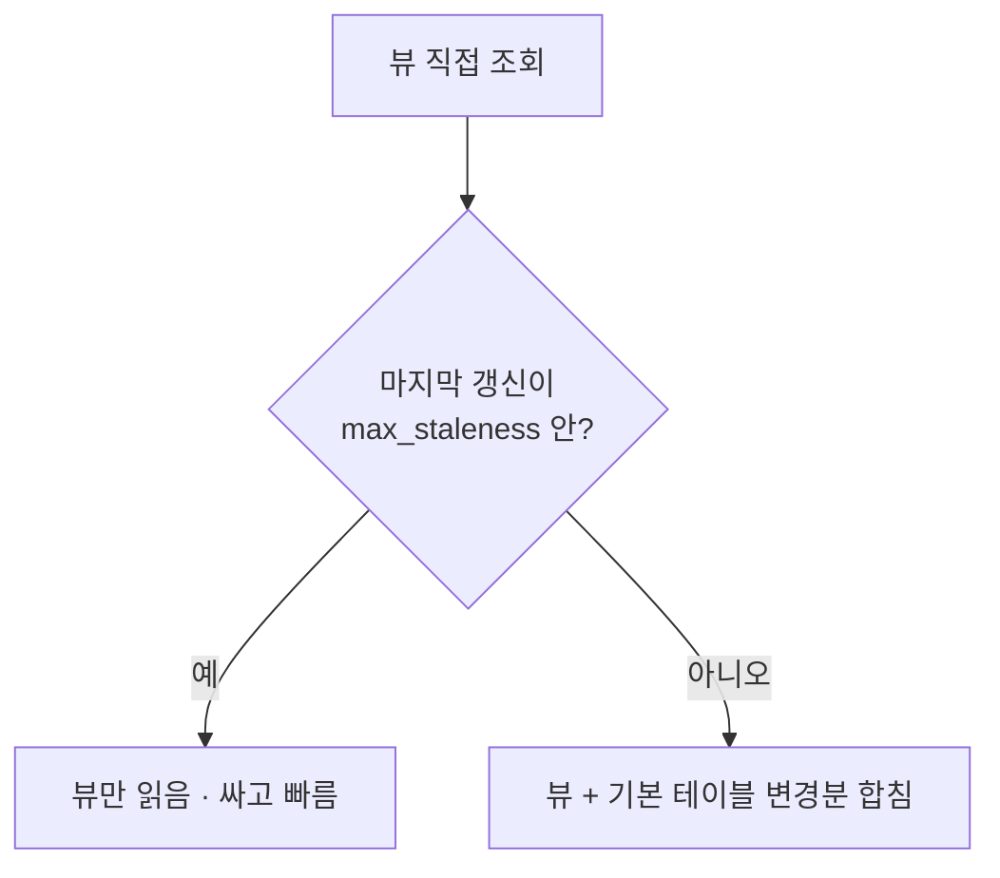

# 허용 최신성 지연(max_staleness)

> BigQuery 구체화 뷰에서 **"결과가 이만큼 오래돼도 괜찮다"는 시간 간격**을 정하는 옵션이다. 마지막 갱신이 이 간격 안이면 기본 테이블을 읽지 않고 뷰만 읽어 더 싸고 빠르게 답한다.

## 쉽게 말하면
도서관 신문 코너가 "4시간 이내에 갱신한 신문이면 그걸 그대로 보여 드립니다"라고 정해 둔 것이다. 4시간 안이면 편집국(기본 테이블)에 안 물어보고 바로 신문을 건넨다. 4시간이 넘으면 편집국에서 그동안의 새 소식을 받아 합쳐 준다.

## 자세히
(BigQuery 공식 문서 "Introduction to materialized views"와 "Create materialized views"의 해당 부분을 직접 읽었다. 이 옵션은 BigQuery 전용이다. 두 문서의 서술이 서로 다른 부분(허용 범위 서술)은 구분해 적는다.)
- **문법(문서 예)**: `CREATE MATERIALIZED VIEW ... OPTIONS (enable_refresh = true, refresh_interval_minutes = 60, max_staleness = INTERVAL "4:0:0" HOUR TO SECOND)`. 기존 뷰에는 `ALTER MATERIALIZED VIEW ... SET OPTIONS (..., max_staleness = INTERVAL "8:0:0" HOUR TO SECOND);`.
- **의미(문서)**: "쿼리 결과의 데이터 최신성 지연을 허용하는 시간 간격"이다.
  - **마지막 갱신이 간격 안**: 기본 테이블을 읽지 않고 **뷰에서 직접** 결과를 돌려준다. 예: 간격 4시간, 2시간 전 갱신이면 기본 테이블을 읽지 않는다.
  - **간격 밖**: 뷰를 읽고 마지막 갱신 이후의 **기본 테이블 변경분을 합쳐** 돌려준다. 그 결과도 `max_staleness` 간격까지는 낡을 수 있다고 문서가 적는다.
  - 이 옵션은 뷰를 **직접 조회하는 쿼리**에만 영향을 준다. 기본 테이블을 조회하는 쿼리를 뷰로 자동 재작성하는 [smart tuning](#smart-tuning)은 이 옵션과 무관하게 동작한다.
- **갱신 주기와의 관계(문서)**: 갱신이 `max_staleness` 간격 안에 끝나도록 `refresh_interval_minutes`를 설정하라고 권하고, 평균 갱신 소요 시간에 성장 여유를 더하라고 한다. 예: 갱신 1시간 + 여유 1시간 → `refresh_interval_minutes = 120`, `max_staleness = "4:0:0"`.
- **허용 범위**: 입문 문서(Intro)는 "30분에서 3일 사이(포함)"라고 적는다. 생성 문서는 최솟값·최댓값을 명시하지 않고 예시 값(4시간·8시간·24시간)과 "3일 넘게 갱신되지 않으면 스트리밍 데이터를 일시적으로 쓸 수 없다는 오류가 난다. 최소 3일에 한 번은 갱신하라"는 운영 제약만 적는다. 두 문서의 서술 방식이 달라 정확한 허용 범위는 현재 공식 문서로 재확인해야 한다.
- **절충(문서)**: 간격이 클수록 쿼리가 기본 테이블을 건너뛸 수 있어 **비용과 지연이 낮아지고**, 대신 결과가 덜 최신이다. 마지막 갱신이 간격 밖이면 쿼리가 기본 테이블을 읽어 비용이 늘어난다. 스트리밍 데이터에서는 여러 테이블에 걸친 시점 스냅샷이 아닐 수 있다.
- **CDC 기본 테이블(Intro)**: 기본 테이블이 CDC이면 `max_staleness`를 기본 테이블 값의 **최소 두 배**로 설정해야 하고 smart tuning은 쓸 수 없다.

## 그림으로 보기



## 예시
```sql
ALTER MATERIALIZED VIEW my_dataset.daily_counts
SET OPTIONS (max_staleness = INTERVAL "4:0:0" HOUR TO SECOND);
```
- 교육 소재: 대시보드가 "최신 데이터가 몇 시간 늦어도 되는가?"를 정해 비용과 맞바꾸는 의사결정 연습.

## 헷갈리는 것과 비교
| 개념 | 차이 |
|---|---|
| max_staleness | 결과가 얼마나 낡아도 되는지(조회 시 허용치) |
| refresh_interval_minutes | 갱신을 얼마나 자주 돌릴지 |
| [smart tuning](#smart-tuning) | 기본 테이블 쿼리를 뷰로 자동 재작성 |
| [증분 갱신](#incremental-refresh) | 변경분만 반영하는 갱신 방식 |

## 더 읽을거리
- [Introduction to materialized views (BigQuery)](https://docs.cloud.google.com/bigquery/docs/materialized-views-intro) — 범위·CDC 규칙·비용(직접 읽음).
- [Create materialized views (BigQuery)](https://docs.cloud.google.com/bigquery/docs/materialized-views-create) — `max_staleness` 문법과 의미(직접 읽음).
