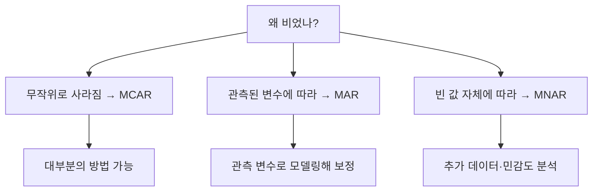
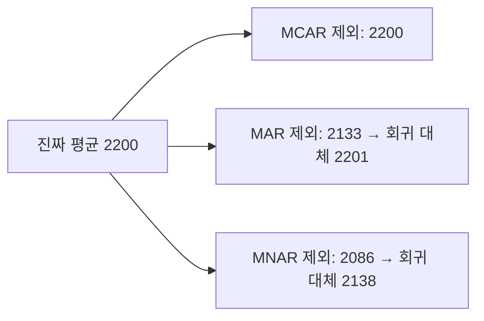

# MCAR·MAR·MNAR

> 결측값(빈칸)이 생긴 이유를 세 가지로 나눈 Rubin의 분류다. MCAR은 완전 무작위, MAR은 관측된 값에 따라 달라지는 무작위, MNAR은 비어 있는 값 자체에 달린 결측이다. 어느 유형이냐에 따라 안전한 처리 방법이 달라진다.

## 쉽게 말하면
설문에서 소득 칸이 비었다고 하자. 우편 사고로 몇 장이 무작위로 사라졌다면 MCAR, 나이 든 응답자가 더 자주 비워 뒀다면(나이는 알고 있음) MAR, 소득이 높은 사람이 소득 칸을 비워 뒀다면 MNAR이다. 마지막 경우 비운 값 자체가 이유라 가장 다루기 어렵다.

## 자세히
(Stef van Buuren의 『Flexible Imputation of Missing Data』 해당 절을 직접 열어 확인하고, 결측 유형별 편향은 직접 시뮬레이션.)
- **MCAR**: 결측 확률이 모든 사례에서 같다. 결측의 원인이 데이터와 무관(예: 저울 배터리가 나감). 책은 MCAR이 흔히 비현실적이라고 말한다.
- **MAR**: 결측 확률이 **관측된 데이터로 정의한 집단 안에서만** 같다. MCAR보다 훨씬 넓은 범주이며 현대 결측 처리 방법의 출발 가정이다. 예: 저울이 부드러운 표면에서 더 자주 결측되는데 표면 유형을 알고 있다면.
- **MNAR**: MCAR도 MAR도 아니다. 분석자가 모르는 이유(대개 결측된 값 자체)에 따라 결측 확률이 달라진다. 예: 저울이 마모돼 무거운 물체가 더 자주 결측, 여론조사에서 의견이 약한 사람이 덜 응답. 대응은 결측 원인에 대한 데이터를 더 모으거나 **what-if 민감도 분석**.
- **중요성**: 대부분의 간단한 처리법은 제한적인 **MCAR 가정에서만** 타당하다. MCAR이 아니면 편향된 추정이 나올 수 있다.
- **직접 시뮬레이션(10만 명, 소득 = 1000 + 30×나이 + 잡음, 진짜 평균 2200.1)**
  | 결측 유형 | 결측률 | 결측 제외(완전 사례) 평균 | 나이로 회귀 대체한 평균 |
  |---|---|---|---|
  | MCAR(30% 무작위) | 30% | **2200.4** (편향 없음) | – |
  | MAR(나이 많을수록 결측) | 20.4% | 2132.7 (편향 −67) | **2200.9** (복원) |
  | MNAR(소득 높을수록 결측) | 25% | 2085.6 (편향 −115) | 2138.3 (일부만 복원) |
  MCAR에서는 결측을 지워도 평균이 맞지만, MAR에서는 지우면 평균이 낮아지고 **관측된 나이로 모델링해 대체하면 복원**된다. MNAR에서는 관측 변수로는 완전히 못 고친다(−115 → −62). 결측 유형은 데이터만으로는 구분하기 어렵고 도메인 지식·수집 과정 이해가 필요하다(제안).
- **AI에서의 의미(제안)**: 학습 데이터의 결측이 특정 집단에 몰려 있으면 그 집단에서 성능이 나빠진다([데이터 분포 편향](#data-distribution-bias)). 결측 여부 자체가 정보일 수 있어 [결측 표시 특징](#missing-indicator-feature)을 함께 쓴다.

## 그림으로 보기



## 예시
```python
# MAR 예: 나이를 보고 소득을 회귀로 대체
import numpy as np
b = np.polyfit(age[~missing], income[~missing], 1)
income_imputed = np.where(missing, np.polyval(b, age), income)
```
- 고객 설문의 "연봉" 결측: 연령·직군으로 결측 패턴을 살펴보고, 고소득자가 비운 것 같으면 MNAR로 보고 민감도 분석(제안).

## 헷갈리는 것과 비교
| 유형 | 결측 확률이 의존하는 것 |
|---|---|
| MCAR | 아무것에도 의존하지 않음 |
| MAR | 관측된 변수 |
| MNAR | 결측된 값 자체(또는 관측 안 된 요인) |
| [다중 대체](#multiple-imputation) | 결측 처리 기법(MAR 가정에서 주로 사용) |

## 더 읽을거리
- [Flexible Imputation of Missing Data — 결측 메커니즘](https://stefvanbuuren.name/fimd/sec-MCAR.html) — MCAR·MAR·MNAR 정의와 예(열어 확인).
