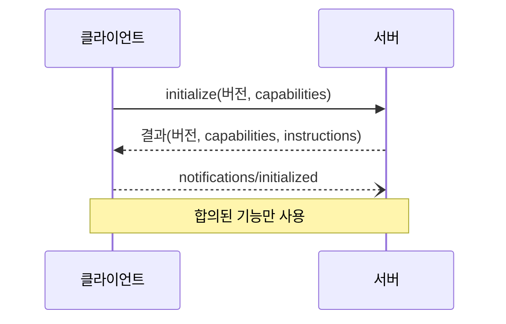
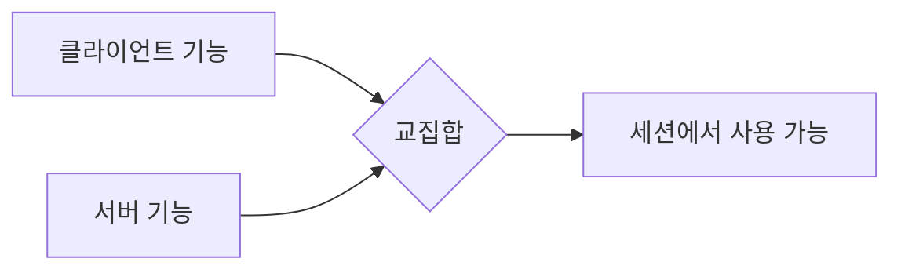

# MCP 기능 협상

> MCP 연결을 시작할 때 클라이언트와 서버가 `initialize`로 "내가 지원하는 기능"을 서로 알려, 그 교집합만 세션에서 쓰기로 합의하는 과정.

## 쉽게 말하면
해외 거래처와 첫 통화에서 "우리는 영어와 한국어 되고, 이메일·전화 가능합니다"를 서로 말한 뒤, 둘 다 되는 방식으로만 일하기로 정하는 것과 같다.

## 자세히
(MCP 사양 2025-06-18 Lifecycle 기준)
- 생명주기: **초기화 → 운영 → 종료**. 초기화가 첫 상호작용이어야 한다(MUST).
- 흐름: 클라이언트 `initialize`(지원 프로토콜 버전·capabilities·clientInfo) → 서버 응답(버전·capabilities·serverInfo·선택 `instructions`) → 클라이언트 `notifications/initialized`.
- **버전 협상**: 클라이언트는 지원하는 최신 버전을 보내고, 서버는 같은 버전이면 그대로, 아니면 자신이 지원하는 다른 버전을 답한다. 클라이언트가 못 맞추면 연결을 끊는다. HTTP에선 이후 모든 요청에 `MCP-Protocol-Version` 헤더.
- **기능 목록**: 클라이언트 — `roots`, `sampling`, `elicitation`, `experimental`. 서버 — `prompts`, `resources`, `tools`, `logging`, `completions`, `experimental`. 하위 기능으로 `listChanged`, `subscribe`.
- 운영 중에는 **협상된 기능만** 써야 한다(MUST).
- 오류 예: 버전 불일치 시 `-32602 Unsupported protocol version` + `supported`/`requested` 데이터. 요청에는 타임아웃을 두고 초과 시 취소 알림을 보낸다.

## 그림으로 보기

## 예시
서버가 `"tools":{"listChanged":true}`를 선언하면 클라이언트는 도구 목록 변경 알림을 기대할 수 있다. 선언하지 않았다면 알림이 와도 의존하지 않는다. 클라이언트가 `sampling`을 선언하지 않으면 서버는 LLM 요청을 보내면 안 된다.

## 헷갈리는 것과 비교
| 개념 | 차이 |
| --- | --- |
| 기능 협상 | 선택 기능의 사용 여부 합의 |
| 버전 협상 | 프로토콜 버전 합의(같은 initialize 안) |
| [list_changed](#mcp-list-changed) | 협상된 하위 기능 중 하나 |
| [MCP 샘플링](#mcp-sampling) | 클라이언트가 선언해야 쓰는 기능 |

## 더 읽을거리
- [MCP 사양: Lifecycle](https://modelcontextprotocol.io/specification/2025-06-18/basic/lifecycle) — 초기화·협상·종료
