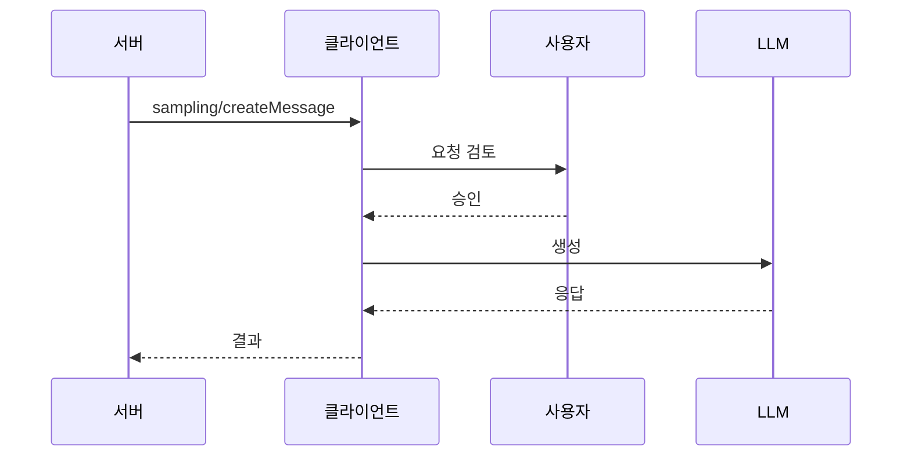
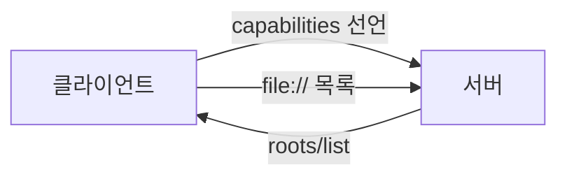

# MCP 클라이언트 기능

> MCP에서 서버가 클라이언트(앱)에게 요청할 수 있는 기능들. 대표적으로 sampling(모델 호출 요청)과 roots(작업 범위 확인).

## 쉽게 말하면
보통 앱이 서버에 부탁한다. 반대로 서버가 "AI 한 번만 불러 줄래?", "내가 어느 폴더까지 만져도 돼?"라고 앱에 되묻는 통로다. 서버는 AI 키를 갖지 않고도 AI를 쓰고, 앱은 승인권을 쥔다.

## 자세히
- **Sampling** (`sampling/createMessage`): 서버가 클라이언트의 LLM 생성을 요청. 클라이언트가 `sampling` capability를 선언해야 한다. 서버 API 키가 필요 없고, 사람이 요청·응답을 검토하고 거부할 수 있어야 한다(SHOULD).
  - `modelPreferences`: `costPriority`·`speedPriority`·`intelligencePriority`(0~1)와 모델 이름 `hints`(부분 문자열, 권고). 최종 모델은 클라이언트가 고른다.
  - 내용은 텍스트·이미지·오디오 가능.
- **Roots** (`roots/list`): 서버가 작업 가능한 `file://` 경로 목록을 묻는다. `listChanged` 지원 시 `notifications/roots/list_changed`로 변경을 알린다. 미지원 시 `-32601`.
- 보안: 루트 URI는 경로 탈출을 검증하고, 사용자 동의를 받은 것만 노출한다. 서버는 루트 밖을 건드리지 않는다.
- 스펙 2025-06-18 기준이며 이후 개정으로 바뀔 수 있다. 이 밖에 elicitation(사용자에게 입력 요청) 같은 기능도 클라이언트 쪽에 있다.

## 그림으로 보기

## 예시
- 문서 요약 서버가 긴 파일을 받아 sampling으로 클라이언트 모델에 요약을 맡긴다 → 서버에 모델 비용·키 없음.
- 코드 서버가 roots로 `file:///home/me/proj`만 확인하고 그 밖은 접근 안 함.

## 헷갈리는 것과 비교
| 개념 | 방향 |
|---|---|
| [MCP Tools](#mcp-tools)·[Resources](#mcp-resources)·[Prompts](#mcp-prompts) | 서버가 클라이언트에 제공 |
| Sampling·Roots | 클라이언트가 서버에 제공(서버가 요청) |

## 더 읽을거리
- [MCP Sampling 스펙](https://modelcontextprotocol.io/specification/2025-06-18/client/sampling)
- [MCP Roots 스펙](https://modelcontextprotocol.io/specification/2025-06-18/client/roots)
