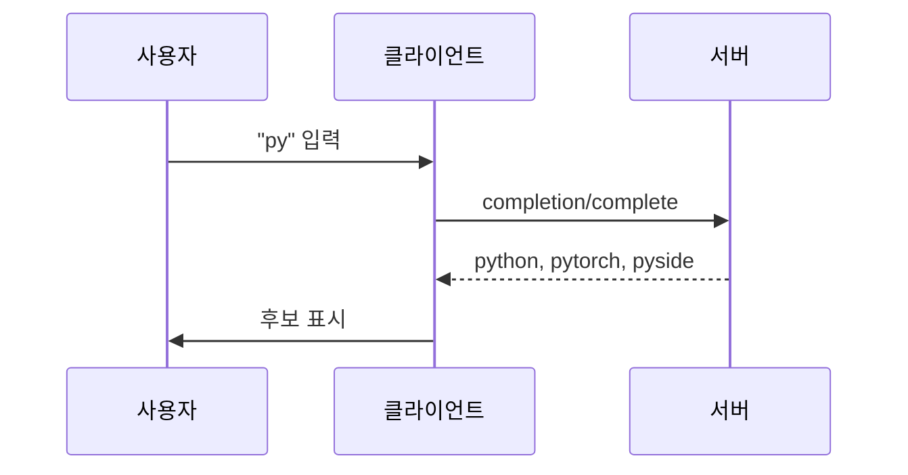
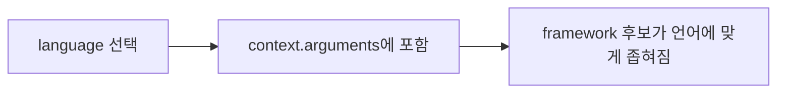

# MCP 인자 자동완성 (Completion)

> 프롬프트와 리소스 템플릿의 인자를 사용자가 입력하는 동안 서버가 후보를 제안하는 기능으로, IDE의 코드 자동완성과 비슷하다.

## 쉽게 말하면
검색창에 "py"만 쳐도 "python, pytorch, pyside"를 제안해 주는 자동완성이다. 정확한 값을 외우지 않아도 목록에서 고른다.

## 자세히
MCP 명세 2025-06-18 Completion 문서 기준:
- 서버는 `completions` capability를 선언한다. 클라이언트는 `completion/complete`를 보낸다.
- 요청의 `ref`는 두 종류: `ref/prompt`(프롬프트 이름) 또는 `ref/resource`(URI 템플릿, 예 `file:///{path}`). `argument`에 인자 `name`과 현재 입력 `value`를 담는다.
- 인자가 여러 개면 이미 정한 값을 `context.arguments`에 넣어 보낸다. 예: `language: python`을 정한 뒤 `framework`에 `fla`를 입력하면 `["flask"]`가 온다.
- 응답: 관련도 순 `values`(**최대 100개**), 선택적 `total`, `hasMore`.
- 서버는 관련도 정렬·퍼지 매칭·빈도 제한·입력 검증, 클라이언트는 디바운스·캐시·부분 결과 처리를 권장한다. 정보 노출을 막기 위해 민감한 제안은 접근 통제(MUST).
- 오류: capability 미지원 `-32601`, 잘못된 프롬프트명·필수 인자 누락 `-32602`.

## 그림으로 보기



## 예시
```json
{"method": "completion/complete", "params": {"ref": {"type": "ref/prompt", "name": "code_review"}, "argument": {"name": "framework", "value": "fla"}, "context": {"arguments": {"language": "python"}}}}
```
`/code_review` 프롬프트를 쓰는 사용자가 언어를 고르면 프레임워크 후보가 그 언어 것으로만 나온다.

## 헷갈리는 것과 비교
| 개념 | 차이 |
|---|---|
| completion | 인자 입력 보조(후보 제안) |
| [프롬프트](#mcp-prompts) | 인자를 받는 재사용 템플릿 |
| [리소스 템플릿](#mcp-resource-templates) | 완성 대상이 되는 URI 규칙 |
| 모델 텍스트 생성 | LLM 답변, 이것과 무관 |

## 더 읽을거리
- [MCP Completion 명세 (2025-06-18)](https://modelcontextprotocol.io/specification/2025-06-18/server/utilities/completion) — 요청·응답 형식, 제한, 보안.
