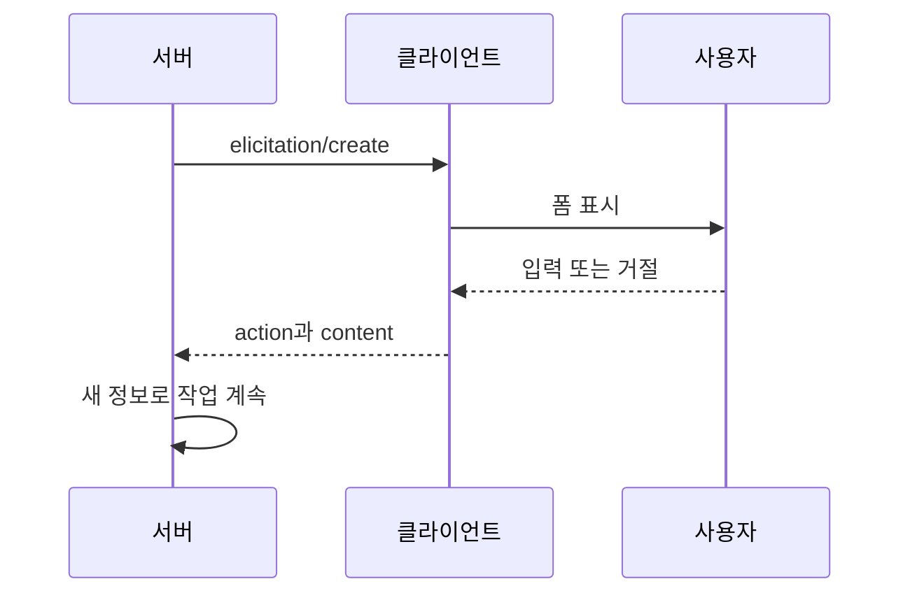
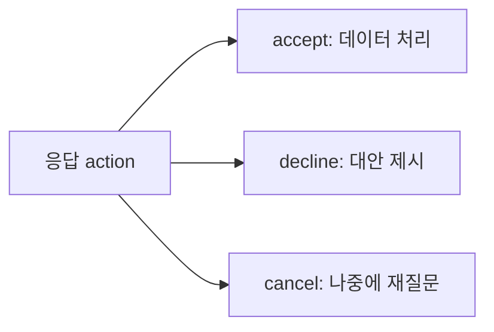

# MCP Elicitation

> 서버가 작업 도중 `elicitation/create`로 사용자에게 추가 정보를 구조화된 폼 형태로 묻는 기능. 스펙 2025-06-18에 새로 추가됐다.

## 쉽게 말하면
정비소에서 수리 중에 정비사가 "이 부품은 정품과 호환품 중 뭘로 할까요?" 하고 고객에게 전화하는 것과 같다. 처음 접수 때 모든 걸 물을 필요 없이, 필요한 순간에 필요한 것만 묻는다. 고객은 답하거나, 거절하거나, 전화를 끊을 수 있다.

## 자세히
- 클라이언트가 `capabilities: {"elicitation": {}}` 선언.
- 요청: `message`(사람이 읽을 질문) + `requestedSchema`(응답 구조). 스키마는 **납작한 객체 + 원시 타입**만 허용: string(`minLength`·`maxLength`, format `email`·`uri`·`date`·`date-time`), number/integer(`minimum`·`maximum`), boolean, enum(`enumNames`로 표시 이름). 중첩 객체·객체 배열은 의도적으로 제외(클라이언트 구현 단순화).
- 응답 `action` 3가지: `accept`(제출, `content`에 데이터), `decline`(명시적 거절), `cancel`(창 닫기 등 선택 없이 이탈). 서버는 셋을 다르게 처리해야 한다(예: decline → 대안 제시, cancel → 나중에 다시).
- 보안: 서버는 **민감 정보(비밀번호 등)를 요청하면 안 된다(MUST NOT)**. 클라이언트는 어느 서버가 묻는지 표시, 언제든 거절 가능, 속도 제한, 스키마 검증.
- 스펙은 설계가 바뀔 수 있다고 명시했다.

## 그림으로 보기

## 예시
- 예약 서버가 날짜가 비어 있으면 `{"properties":{"date":{"type":"string","format":"date"}},"required":["date"]}` 스키마로 날짜만 되묻는다.
- 배포 서버가 enum `["staging","production"]`로 환경을 선택하게 한다.

## 헷갈리는 것과 비교
| 개념 | 차이 |
|---|---|
| Elicitation | 서버 → **사용자**에게 입력 요청 |
| [Sampling](#mcp-sampling) | 서버 → **LLM** 호출 요청 |
| 도구 인자 | 모델이 채움. elicitation은 사람이 채움 |

## 더 읽을거리
- [MCP Elicitation 스펙(2025-06-18)](https://modelcontextprotocol.io/specification/2025-06-18/client/elicitation) — 스키마 타입·응답 액션·보안
