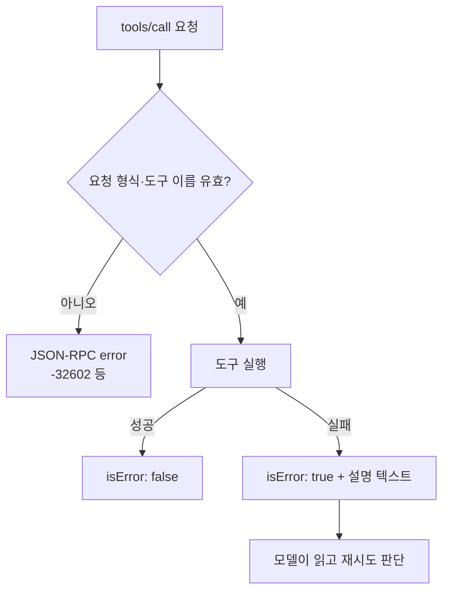

# MCP 오류 처리

> MCP 도구 호출의 오류는 두 종류다. 프로토콜 오류(JSON-RPC `error`, 요청 자체가 잘못됨)와 도구 실행 오류(정상 응답 안에 `isError: true`, 도구가 일을 하다 실패).

## 쉽게 말하면
택배로 비유하면, 주소가 없는 집(프로토콜 오류)은 배송 시스템이 반송하고, 집에 갔는데 수취인이 부재중(실행 오류)이면 "부재중이었다"는 메모가 상품 대신 돌아온다. 뒤의 메모는 받는 사람(모델)이 읽고 다음 행동을 정할 수 있다.

## 자세히
(MCP 사양 2025-06-18 Tools 문서 기준)
- **프로토콜 오류**: 알 수 없는 도구, 잘못된 인자, 서버 오류. 예: `{"error":{"code":-32602,"message":"Unknown tool: invalid_tool_name"}}`.
- **도구 실행 오류**: API 실패, 입력값 문제, 비즈니스 로직 오류. `result.content`에 사유를 적고 `isError: true`. 예: "API rate limit exceeded".
- 실행 오류 메시지는 **모델에게 전달되는 글**이므로, 코드·스택 트레이스 대신 "무엇이 잘못됐고 어떻게 다시 시도할지"를 쓴다. Anthropic의 도구 설계 글도 불투명한 오류 코드보다 올바른 입력 예시를 담은 구체적 안내를 권한다.
- 서버는 입력 검증·접근 제어·호출 속도 제한·출력 정리를 해야 하고(MUST), 클라이언트는 타임아웃·로깅·사용자 확인을 한다(SHOULD).

## 그림으로 보기

## 예시
- 나쁜 메시지: `Error 500`. 좋은 메시지: `날짜 형식이 잘못됨. YYYY-MM-DD로 다시 호출하세요. 예: 2026-11-11`.
- 속도 제한: `isError: true`, "1분 뒤 재시도 또는 범위를 좁히세요".

## 헷갈리는 것과 비교
| 개념 | 차이 |
| --- | --- |
| 프로토콜 오류 | 요청 단계 문제. 보통 모델이 직접 보지 않음 |
| 실행 오류(isError) | 모델 컨텍스트로 들어가 자가 수정에 쓰임 |
| [구조화 출력](#mcp-structured-output) | 성공 결과의 형태. 오류와는 별개 |
| [도구 설명 설계](#mcp-tool-description-design) | 오류를 줄이는 사전 설계 |

## 더 읽을거리
- [MCP 사양: Tools — Error Handling](https://modelcontextprotocol.io/specification/2025-06-18/server/tools) — 두 오류 방식과 예시
- [Anthropic: Writing tools for agents](https://www.anthropic.com/engineering/writing-tools-for-agents) — 도움 되는 오류 메시지 원칙
