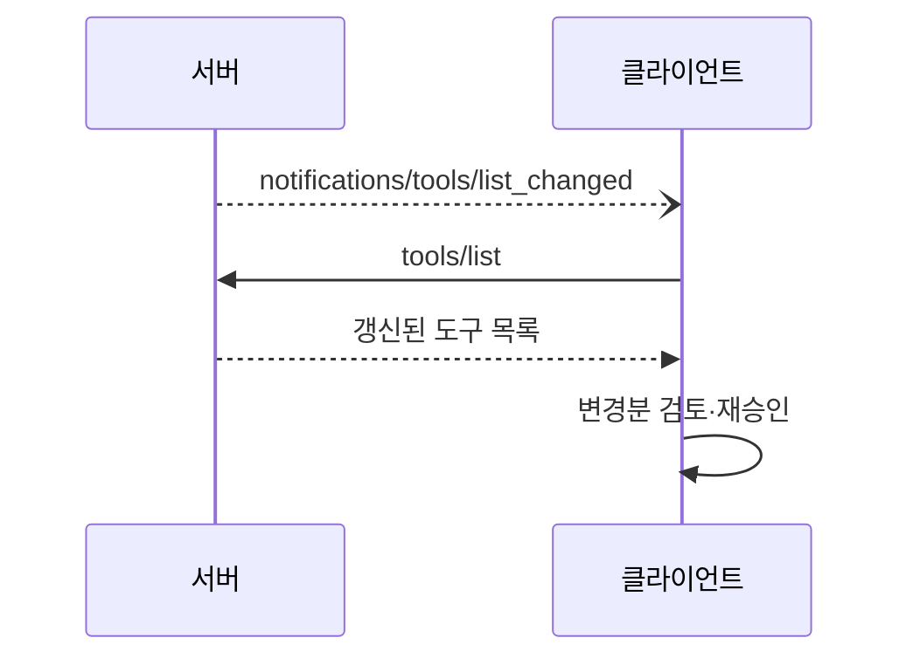
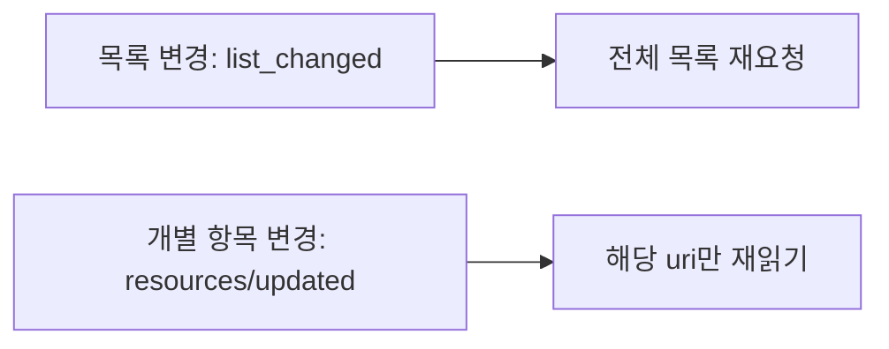

# list_changed 알림

> 서버가 제공하는 도구·리소스·프롬프트 목록이 바뀌었을 때 보내는 MCP 알림(`notifications/tools/list_changed` 등). 받은 클라이언트는 목록을 다시 요청한다.

## 쉽게 말하면
식당이 메뉴를 바꾸면 "메뉴 바뀜" 종을 울린다. 손님은 종소리를 듣고 새 메뉴판을 다시 받아 본다. 종이 울렸다는 사실만 알려 줄 뿐 새 메뉴 내용은 안 들어 있다.

## 자세히
(MCP 사양 2025-06-18 기준)
- 서버는 초기화 때 `capabilities`에 `tools`/`resources`/`prompts` 항목의 `"listChanged": true`를 선언해야 알림을 보낼 수 있다. 알림은 SHOULD.
- 알림 이름: `notifications/tools/list_changed`, `notifications/resources/list_changed`(prompts도 같은 형태). 본문 없이 `{"jsonrpc":"2.0","method":"..."}`만 보낸다.
- 클라이언트는 받으면 `tools/list`(또는 `resources/list`)를 다시 호출해 최신 목록을 받는다.
- **다른 알림과 구분**: 개별 리소스 내용이 바뀌면 `resources/subscribe` 후 `notifications/resources/updated`(uri 포함)를 쓴다.
- **보안**: 목록이 바뀌면 도구 설명도 바뀔 수 있다. 승인 이후 설명이 악성으로 바뀌는 [러그풀](#mcp-rug-pull) 경로이므로, 클라이언트는 변경된 설명을 재검토·재승인해야 한다(Invariant Labs 권고: 설명 해시 검증).

## 그림으로 보기

## 예시
- 사용자가 GitHub 서버에 새 권한을 주자 서버가 쓰기 도구를 추가 → `tools/list_changed` → 클라이언트가 목록을 갱신하고 새 도구에 승인 요청.
- 파일 서버에서 파일이 추가되면 `resources/list_changed`.

## 헷갈리는 것과 비교
| 개념 | 차이 |
| --- | --- |
| list_changed | 목록 구성이 바뀜(추가·삭제·설명 변경) |
| resources/updated | 구독한 개별 리소스의 내용이 바뀜 |
| [구독](#mcp-subscriptions) | updated 알림을 받기 위한 사전 신청 |
| [도구 설명 오염](#mcp-tool-poisoning) | list_changed를 악용할 수 있는 공격 |

## 더 읽을거리
- [MCP 사양: Tools — List Changed](https://modelcontextprotocol.io/specification/2025-06-18/server/tools) — 도구 알림
- [MCP 사양: Resources](https://modelcontextprotocol.io/specification/2025-06-18/server/resources) — 리소스 알림·구독
