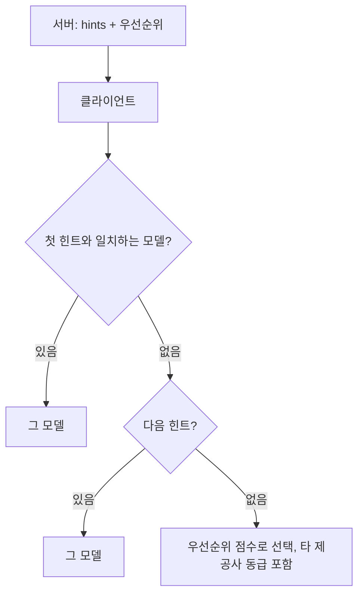

# 모델 힌트 매칭

> MCP sampling 요청의 `modelPreferences.hints`는 서버가 원하는 모델 이름의 부분 문자열 목록이다. 클라이언트는 이를 참고해 자기가 가진 모델(다른 제공사 포함) 중 비슷한 것을 고르며, 최종 선택권은 클라이언트에 있다.

## 쉽게 말하면
손님이 "소고기 국밥 비슷한 걸로"라고 말하면, 식당이 소고기 국밥이 없을 때 비슷한 설렁탕을 내줄 수 있다. 정확한 메뉴명을 강제하지 않고 "이런 계열"이라고만 힌트를 주는 방식이다.

## 자세히
스펙 2025-11-25 Model Preferences 절(확인 2026-11-12).
- 서버는 특정 모델 이름만 요구할 수 없다. 클라이언트가 그 모델이 없거나 다른 제공사를 쓸 수 있기 때문이다.
- `hints`: `{"name": "claude-3-sonnet"}` 같은 객체 배열. **부분 문자열**로 유연하게 매칭되고, 여러 개면 **앞에 있는 것이 우선**이다. 예: `claude-3-sonnet`(Sonnet급) 다음 `claude`(아무 Claude).
- 클라이언트는 힌트를 다른 제공사의 **동급 모델로 매핑해도 된다**(MAY). 예: Claude가 없으면 sonnet 힌트를 `gemini-1.5-pro`로.
- 힌트는 권고일 뿐이다. 최종 선택은 클라이언트.
- 힌트와 함께 0~1 정규화 우선순위 세 개: `costPriority`(싼 모델), `speedPriority`(빠른 모델), `intelligencePriority`(강한 모델).

## 그림으로 보기


## 예시
```json
{"hints":[{"name":"claude-3-sonnet"},{"name":"claude"}],
 "costPriority":0.3,"speedPriority":0.8,"intelligencePriority":0.5}
```
속도를 중시하는 요약 작업에서 Sonnet급을 선호하되 없으면 아무 Claude, 그것도 없으면 클라이언트가 고른다.

## 헷갈리는 것과 비교
| 개념 | 차이 |
|---|---|
| hints | 이름 기반 선호(부분 문자열, 순서 우선) |
| 세 priority | 특성 기반 선호(0~1) |
| 모델 ID 고정 | MCP는 지원하지 않음. 이식성 때문 |
| [MCP Sampling](#mcp-sampling) | 이 설정이 실리는 요청 |

## 더 읽을거리
- [MCP Sampling 스펙 2025-11-25](https://modelcontextprotocol.io/specification/2025-11-25/client/sampling) — Model Preferences, 보안 고려사항
