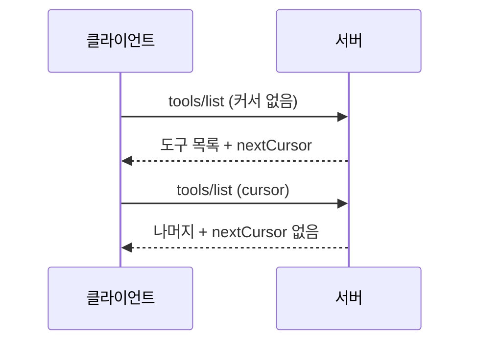
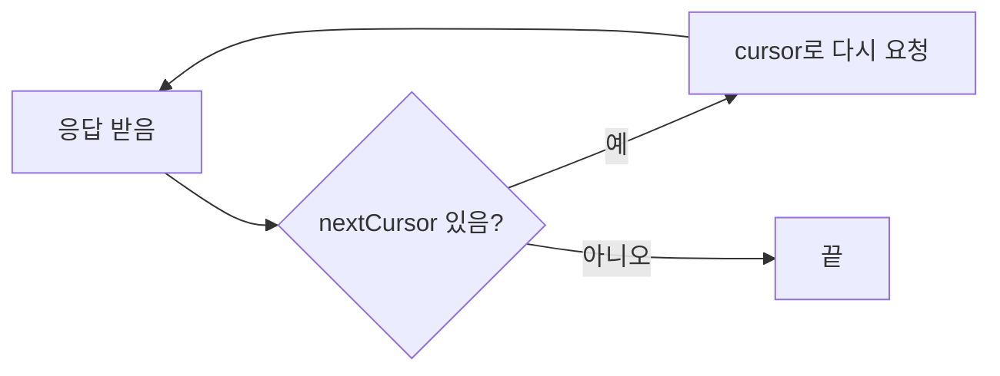

# MCP 페이지네이션

> 목록이 클 때 서버가 결과를 한 덩어리가 아니라 여러 쪽으로 나눠 주고, 클라이언트가 `cursor` 토큰으로 다음 쪽을 이어 받는 MCP의 방식이다.

## 쉽게 말하면
도서관 책 목록을 한 번에 1만 권 받으면 무겁다. 그래서 사서가 "일단 50권, 다음은 이 번호표로 다시 오세요"라고 준다. 번호표(cursor)는 사서만 해석할 수 있는 암호 같은 것이라 손님은 그냥 들고 오기만 하면 된다.

## 자세히
MCP 명세 2025-06-18 Pagination 문서 기준:
- **불투명(opaque) 커서 방식**이다. 쪽 번호(1, 2, 3)가 아니라 결과 집합 안의 위치를 가리키는 문자열 토큰을 쓴다.
- **쪽 크기는 서버가 정한다.** 클라이언트는 고정 크기를 가정하면 안 된다(MUST NOT).
- 응답에 `nextCursor`가 있으면 더 있다는 뜻이고, 없으면 끝이다. 다음 요청의 `params.cursor`에 그 값을 넣는다.
- 지원 연산 4개: `resources/list`, `resources/templates/list`, `prompts/list`, `tools/list`.
- 서버는 안정적인 커서를 주고 잘못된 커서를 정중히 처리한다(SHOULD). 잘못된 커서는 오류 `-32602`(Invalid params).
- 클라이언트는 커서를 해석·수정하지 말고 세션 사이에 저장하지도 않는다(MUST NOT).
- 참고: 앞 노드 [MCP 인자 자동완성](#mcp-completion)은 별도로 `values` 최대 100개와 `hasMore`를 쓴다. 목록 페이지네이션과 다른 장치다.

## 그림으로 보기



## 예시
```json
{"jsonrpc":"2.0","id":"124","method":"resources/list","params":{"cursor":"eyJwYWdlIjogMn0="}}
```
커서 `eyJwYWdlIjogMn0=`는 base64로 `{"page": 2}`처럼 보이지만, 이는 서버 내부 사정이다. 클라이언트가 풀어 보고 값을 바꾸면 안 된다.
업무 장면: 사내 문서 수천 건을 노출하는 MCP 서버라면 `resources/list`를 쪽으로 나눠 에이전트가 필요한 만큼만 불러오게 한다.

## 헷갈리는 것과 비교
| 개념 | 차이 |
|---|---|
| 오프셋 페이지(`page=3`) | 번호로 점프. MCP는 쓰지 않고 커서만 쓴다 |
| 커서 | 서버가 만든 위치 토큰. 데이터가 바뀌어도 안정적이기 쉽다 |
| [인자 자동완성](#mcp-completion) | 입력 중 후보 제안(최대 100개). 목록 순회가 아님 |

## 더 읽을거리
- [MCP Pagination 명세](https://modelcontextprotocol.io/specification/2025-06-18/server/utilities/pagination) — 커서·지원 연산·오류 코드 원문
