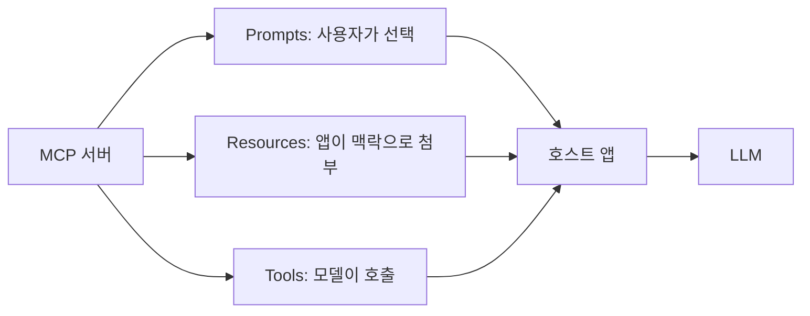
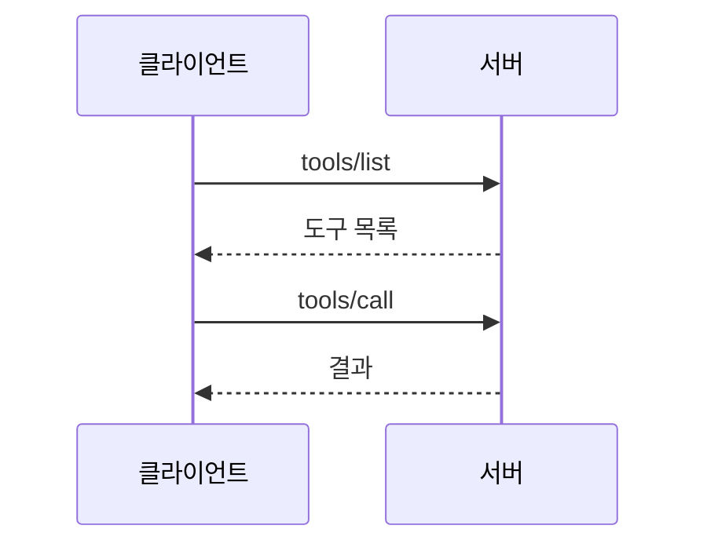

# MCP 프리미티브

> MCP 서버가 제공하는 기본 구성 요소는 Prompts, Resources, Tools 세 가지이며, 각각 "누가 쓸지 결정하는가"가 다르다.

## 쉽게 말하면
식당에 비유하면 메뉴판(Prompts)은 손님이 골라 주문하는 것, 식탁 위 재료와 비치 자료(Resources)는 주방(앱)이 꺼내 놓는 것, 요리사가 쓰는 도구(Tools)는 요리사(모델)가 필요할 때 알아서 쓰는 것이다.

## 자세히
공식 스펙(2025-06-18 서버 개요)의 통제 주체 표:
| 프리미티브 | 통제 | 설명 | 예 |
|---|---|---|---|
| Prompts | 사용자 | 사용자가 골라 쓰는 상호작용 템플릿 | 슬래시 명령, 메뉴 항목 |
| Resources | 애플리케이션 | 클라이언트가 붙이고 관리하는 맥락 데이터 | 파일 내용, git 기록 |
| Tools | 모델 | LLM이 호출해 행동하는 함수 | API POST, 파일 쓰기 |

- 셋 다 클라이언트가 목록 조회(list)로 찾아낸 뒤 사용한다.
- 가장 많이 쓰이는 것은 Tools이며, 부작용이 있을 수 있어 사용자 승인 절차를 두는 것이 권장된다. 도구 호출 일반론은 [Tool Use](#tool-use) 참고.
- 전체 구조와 연결 방식은 [MCP](#mcp) 노드에서 다룬다.

## 그림으로 보기

## 예시
- GitHub MCP 서버: Tools = 이슈 만들기, Resources = 저장소 파일, Prompts = "PR 리뷰 요청" 템플릿.
- 문서 서버: 사용자가 `/summarize` 같은 Prompt를 고르면 앱이 Resource로 문서를 붙이고 모델이 필요하면 Tool로 검색한다.

## 헷갈리는 것과 비교
| 개념 | 차이 |
|---|---|
| Tool | 행동 실행. 모델이 결정 |
| Resource | 읽기용 맥락. 앱이 결정 |
| Prompt | 재사용 템플릿. 사용자가 결정 |

## 더 읽을거리
- [MCP Specification: Server Overview](https://modelcontextprotocol.io/specification/2025-06-18/server) — 세 프리미티브와 통제 계층.
