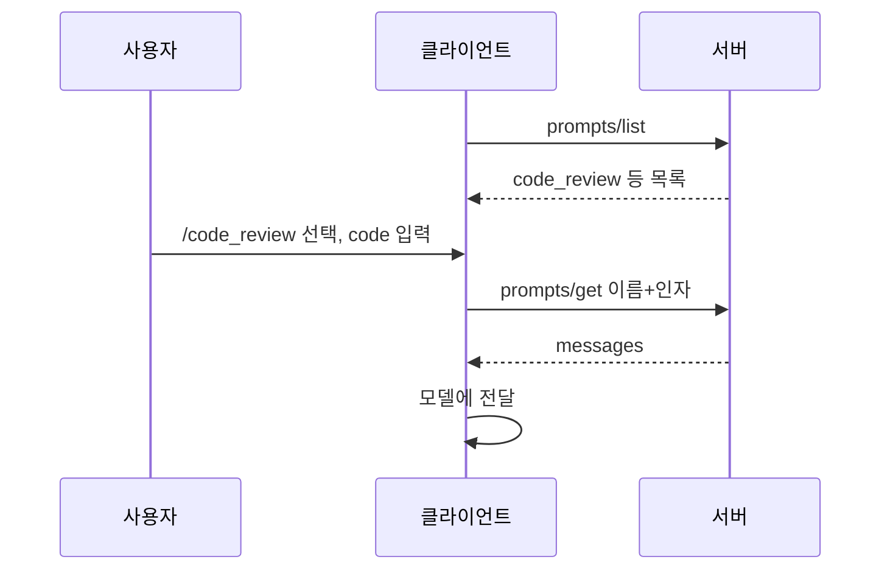

# MCP Prompts

> MCP Prompts는 서버가 제공하는 재사용 프롬프트 템플릿이다. 사용자가 슬래시 명령 같은 UI로 직접 골라 인자를 채우면 서버가 완성된 메시지를 돌려준다.

## 쉽게 말하면
자주 쓰는 문서 서식을 모아 둔 "양식 서랍"이다. 사용자가 양식(코드 리뷰 요청서)을 고르고 빈칸(코드)을 채우면 완성된 요청문이 모델에 전달된다.

## 자세히
MCP 스펙 2025-06-18 기준:
- **사용자 주도(user-controlled)**: 사용자가 명시적으로 고르도록 만든 것이다. 흔한 UI는 슬래시 명령([MCP 프리미티브](#mcp-primitives)).
- 서버는 `prompts` capability 선언(`listChanged` 선택).
- `prompts/list`: 이름·title·description·arguments(이름, 설명, required) 목록. `prompts/get`: 이름과 인자를 보내면 `messages` 배열 반환.
- 메시지는 `role`(user/assistant)과 `content`. 내용 유형: text, image, audio, 임베디드 리소스(서버 문서·코드를 메시지에 직접 포함).
- 오류: 잘못된 이름·필수 인자 누락은 `-32602`, 내부 오류는 `-32603`.
- 보안: 프롬프트 입력·출력 검증을 해서 주입이나 무단 리소스 접근을 막아야 한다. 인자 자동완성은 completion API로 가능하다.
- 모델이 호출하는 [MCP Tools](#mcp-tools)와 달리 사람이 시작하는 진입점이다.

## 그림으로 보기

## 예시
`code_review` 프롬프트에 `code`를 넣으면 "Please review this Python code: ..." 메시지가 만들어진다. 팀 공용 서버에 "릴리스 노트 초안", "장애 보고서 양식" 같은 프롬프트를 올려 모두 같은 형식으로 쓰게 할 수 있다.

## 헷갈리는 것과 비교
| 개념 | 차이 |
|---|---|
| Prompts | 사용자가 고르는 템플릿 |
| [Resources](#mcp-resources) | 앱이 붙이는 맥락 데이터 |
| 시스템 프롬프트 | 앱이 고정해 두는 상시 지침. 사용자가 고르지 않음 |

## 더 읽을거리
- [MCP Specification: Prompts](https://modelcontextprotocol.io/specification/2025-06-18/server/prompts) — list/get, 메시지 유형, 오류.
